--- 
title: "Factores asociados al rendimiento en peso muerto en atletas de powerlifting: análisis estadístico"
author: "Karla Paredes y Mauricio Orozco"
date: "2026-11-27"
site: bookdown::bookdown_site
output: bookdown::gitbook
documentclass: book
bibliography: [book.bib, packages.bib]
biblio-style: apalike
link-citations: yes
github-repo: rstudio/bookdown-demo
description: " "
---


<!--chapter:end:index.Rmd-->

---
title: "Introduccion"
output: html_document
date: "2026-09-18"
---

# Introducción

El powerlifting es una disciplina deportiva de fuerza cuyo objetivo consiste en levantar la mayor cantidad de peso posible en tres movimientos fundamentales: sentadilla, press de banca y peso muerto. El rendimiento de los atletas en estas pruebas se encuentra relacionado con diferentes características físicas, deportivas y competitivas, entre las que se destacan la edad, el sexo, el peso corporal y el tipo de equipamiento utilizado durante la competencia.

El proyecto tiene como propósito realizar un análisis estadístico sobre una base de datos de powerlifting, conformada por 18.900 observaciones. Se establece como variable de respuesta el mejor levantamiento en peso muerto (BestDeadliftKg), con el fin de identificar los factores asociados a su comportamiento, cuantificar las relaciones existentes entre las variables y construir modelos estadísticos que permitan estimar dicho rendimiento.

En una primera etapa, se realiza un análisis exploratorio de datos que comprende la identificación y corrección de inconsistencias, el tratamiento de valores faltantes, la caracterización de las variables y el estudio de sus distribuciones mediante herramientas gráficas y medidas estadísticas descriptivas. Asimismo, se desarrolla un proceso de ingeniería de características orientado a representar de manera conjunta el rendimiento obtenido en sentadilla y press de banca.

Posteriormente, se aplican herramientas de estadística inferencial paramétrica y no paramétrica, considerando los supuestos correspondientes a cada procedimiento. Se estudian las diferencias en el rendimiento en peso muerto según el sexo y el equipamiento, la asociación entre variables categóricas y el grado de relación entre las variables cuantitativas mediante coeficientes de correlación.

A partir de los resultados anteriores, se desarrolla un modelo de regresión lineal simple para estudiar la relación entre la fuerza combinada de sentadilla y press de banca y el mejor levantamiento en peso muerto. Se estiman los parámetros del modelo mediante el método de mínimos cuadrados, se evalúa su capacidad explicativa y se analizan los supuestos asociados a los errores.

Finalmente, se construye un modelo de regresión lineal múltiple que permite estudiar simultáneamente la relación de diferentes variables explicativas con el rendimiento en peso muerto. Se analiza la multicolinealidad, la significancia global e individual de los coeficientes y la bondad de ajuste de los modelos considerados, incorporando transformaciones cuando estas permiten mejorar su ajuste.

De esta manera, el proyecto integra herramientas de estadística descriptiva, inferencial y de modelación estadística para proporcionar una comprensión más amplia del rendimiento en powerlifting, reconociendo tanto la capacidad explicativa de los modelos obtenidos como las limitaciones asociadas a sus supuestos y a la naturaleza de los datos.


<!--chapter:end:Introduccion.Rmd-->

---
title: "Objetivos"
output: html_document
date: "2026-09-19"
---

# Objetivos generales y especificos

## Pregunta problema

¿Qué factores se encuentran asociados al rendimiento en peso muerto de los atletas de powerlifting y en qué medida los modelos de regresión lineal simple y múltiple permiten explicar y estimar dicho rendimiento a partir de sus características físicas y deportivas?

## Objetivo general

Analizar los factores asociados al rendimiento en peso muerto de los atletas de powerlifting mediante herramientas de estadística descriptiva, inferencial y modelos de regresión lineal simple y múltiple, con el propósito de identificar relaciones estadísticamente significativas, cuantificar su magnitud y determinar la capacidad explicativa de las variables consideradas.

## Objetivos específicos

1. Caracterizar las variables del conjunto de datos mediante medidas estadísticas descriptivas y representaciones gráficas, identificando inconsistencias y valores faltantes que puedan afectar el análisis.

2. Evaluar los supuestos estadísticos necesarios para seleccionar los procedimientos de inferencia paramétrica y no paramétrica adecuados.

3. Determinar si existen diferencias estadísticamente significativas en el rendimiento en peso muerto según el sexo de los atletas y el tipo de equipamiento utilizado durante la competencia.

4. Analizar la existencia de una asociación estadísticamente significativa entre el sexo de los atletas y el tipo de equipamiento empleado mediante tablas de contingencia y pruebas de independencia.

5. Cuantificar el grado y la dirección de la relación entre el rendimiento en peso muerto, el peso corporal y la fuerza combinada de sentadilla y press de banca mediante coeficientes de correlación.

6. Construir un modelo de regresión lineal simple que permita estudiar y cuantificar la relación entre la fuerza combinada de sentadilla y press de banca y el mejor levantamiento en peso muerto.

7. Desarrollar un modelo de regresión lineal múltiple que permita analizar la relación simultánea de la edad, el peso corporal, el sexo, el equipamiento y las marcas deportivas con el rendimiento en peso muerto.

8. Evaluar los modelos de regresión mediante la estimación de parámetros, intervalos de confianza, pruebas de hipótesis, medidas de bondad de ajuste y diagnóstico de los supuestos.

9. Comparar los modelos de regresión originales y transformados mediante el coeficiente de determinación, el coeficiente de determinación ajustado, el error estándar residual y el criterio de información de Akaike, con el propósito de seleccionar el modelo que presente el mejor ajuste entre las alternativas consideradas.

<!--chapter:end:Objetivos.Rmd-->

---
title: "Metodologia"
output: html_document
date: "2026-09-19"
---

# Metodología

## Diseño de la investigación

La presente investigación se desarrolla bajo un enfoque cuantitativo, con un diseño no experimental y un alcance exploratorio, descriptivo, correlacional y de modelación estadística.

El estudio se fundamenta en el análisis de registros existentes de atletas de powerlifting, sin realizar manipulaciones experimentales sobre las variables. Se busca caracterizar su comportamiento, identificar asociaciones estadísticamente significativas y construir modelos que permitan explicar y estimar el rendimiento en peso muerto.

## Fuente de datos

Se utiliza una base de datos conformada por 18.900 registros correspondientes a atletas de powerlifting, que contiene información relacionada con sus características físicas, el equipamiento utilizado y los resultados obtenidos en los tres levantamientos principales.

La variable BestDeadliftKg, correspondiente al mejor levantamiento en peso muerto expresado en kilogramos, se establece como variable de respuesta.

Las variables explicativas consideradas comprenden la edad, el sexo, el peso corporal, el tipo de equipamiento y los resultados obtenidos en sentadilla y press de banca.

## Herramientas computacionales

El procesamiento de los datos, los cálculos estadísticos, el ajuste de los modelos y la generación de representaciones gráficas se realizan mediante el lenguaje de programación R y el entorno de desarrollo RStudio.

La elaboración y organización del informe se lleva a cabo mediante R Markdown y Bookdown, integrando el código computacional, los resultados y sus correspondientes interpretaciones estadísticas.

Los procedimientos estadísticos se fundamentan en las notas de clase de la asignatura Métodos Estadísticos.

## Procedimiento metodológico

### Etapa 1. Preparación y limpieza de datos

Se realiza una revisión inicial de la estructura de la base de datos, identificando los tipos de variables, valores faltantes e inconsistencias en los registros.

Se corrigen los problemas de formato de la variable correspondiente al mejor levantamiento en sentadilla. Los valores negativos identificados en esta variable se consideran datos faltantes y se realiza una imputación mediante la media de las variables numéricas correspondientes.

Las variables cualitativas se convierten en factores y los identificadores personales no se incluyen como predictores de los modelos estadísticos.

### Etapa 2. Análisis exploratorio de datos

Se desarrolla un análisis univariado y bivariado mediante medidas estadísticas descriptivas y representaciones gráficas.

El análisis univariado permite caracterizar individualmente las variables, mientras que el análisis bivariado permite identificar patrones de asociación entre ellas, prestando especial atención a su relación con el mejor levantamiento en peso muerto.

### Etapa 3. Ingeniería de características

A partir de las relaciones identificadas durante el análisis exploratorio, se construyen nuevas variables que permiten representar características relevantes del rendimiento deportivo.

Se define la variable upper_lower_total como la suma de las mejores marcas obtenidas en sentadilla y press de banca. Adicionalmente, se construyen variables que relacionan las marcas deportivas con el peso corporal del atleta.

Estas variables se analizan con el propósito de identificar posibles alternativas para la construcción de los modelos de regresión.

### Etapa 4. Análisis de variables categóricas

Se construye una tabla de contingencia entre el sexo y el equipamiento utilizado por los atletas.

Se calculan las frecuencias observadas y esperadas, y se aplica la prueba de independencia chi-cuadrado para determinar si existe una asociación estadísticamente significativa entre ambas variables.

### Etapa 5. Estadística inferencial paramétrica y no paramétrica

Se evalúa el supuesto de normalidad de las variables involucradas en las comparaciones con el propósito de seleccionar el procedimiento estadístico correspondiente.

Considerando los resultados obtenidos, se aplica la prueba de Mann-Whitney-Wilcoxon para comparar el rendimiento en peso muerto entre los dos grupos definidos por el sexo de los atletas.

Posteriormente, se utiliza la prueba de Kruskal-Wallis para evaluar las diferencias existentes entre los cuatro tipos de equipamiento considerados.

Las pruebas de hipótesis se desarrollan utilizando un nivel de significancia del 5 %.

### Etapa 6. Análisis de correlación

Se analiza la relación entre el peso corporal, la fuerza combinada de sentadilla y press de banca y el mejor levantamiento en peso muerto.

Se utiliza el coeficiente de correlación de Spearman para cuantificar la intensidad y dirección de las asociaciones monótonas observadas, considerando los resultados de las pruebas de normalidad.

Asimismo, se realizan pruebas de hipótesis para evaluar la significancia estadística de las correlaciones obtenidas.

### Etapa 7. Regresión lineal simple

Se construye un modelo de regresión lineal simple utilizando la fuerza combinada de sentadilla y press de banca como variable explicativa y el mejor levantamiento en peso muerto como variable de respuesta.

Se estiman los coeficientes mediante el método de mínimos cuadrados ordinarios, se calcula la varianza residual y se evalúa la capacidad explicativa del modelo mediante el coeficiente de determinación.

Posteriormente, se construyen intervalos de confianza y se realizan pruebas de hipótesis sobre los parámetros del modelo.

Se desarrolla el diagnóstico de los supuestos mediante el análisis de los residuos y se evalúa una especificación alternativa que incorpora la transformación de raíz cuadrada de la fuerza combinada.

### Etapa 8. Regresión lineal múltiple

Se ajusta inicialmente un modelo de regresión lineal múltiple que incorpora la edad, el peso corporal, el sexo, el equipamiento y las marcas individuales de sentadilla y press de banca.

Se analiza la multicolinealidad mediante la matriz de correlaciones y el factor de inflación de la varianza.

Posteriormente, se considera un modelo alternativo que incorpora la transformación de raíz cuadrada de la fuerza combinada, junto con las demás características físicas y deportivas.

Se realiza la estimación matricial de los coeficientes, el cálculo de las sumas de cuadrados, el análisis de varianza, la estimación de la varianza residual y las pruebas de significancia global e individual.

Asimismo, se construyen intervalos de confianza para los parámetros y se evalúan los supuestos del modelo mediante el análisis de los residuos.

### Etapa 9. Comparación y selección del modelo

Se comparan los modelos de regresión lineal simple y múltiple, tanto en sus especificaciones originales como transformadas.

La comparación se realiza mediante el coeficiente de determinación, el coeficiente de determinación ajustado, el error estándar residual y el criterio de información de Akaike.

Finalmente, se selecciona el modelo que presenta las características de ajuste más favorables entre las alternativas evaluadas, considerando las limitaciones identificadas durante el diagnóstico estadístico.

## Consideraciones metodológicas

Los resultados obtenidos se interpretan como asociaciones estadísticas y no como relaciones de causalidad, debido al carácter no experimental de la investigación.

Asimismo, se reconocen las limitaciones asociadas a la imputación de valores faltantes, al posible incumplimiento de los supuestos de regresión y a la imposibilidad de garantizar completamente la independencia de todas las observaciones.

<!--chapter:end:Metodologia.Rmd-->

---
title: "Marco_Teorico"
output: html_document
date: "2026-09-19"
---

# Marco Teorico

## El powerlifting como deporte de fuerza

El powerlifting es un deporte nacido de la necesidad y el deseo de crear una disciplina en donde se evidencie la fuerza máxima del ser humano, tanto en categorías femeninas como masculinas.

Este deporte se practica con una barra de metal con dimensiones específicas, a la cual se le agregan discos con diversos pesos, donde el objetivo es cargar la mayor cantidad de peso posible en tres ejercicios básicos. Cada participante cuenta con tres intentos por cada ejercicio para levantar la barra, teniéndose en cuenta la mayor cantidad de peso levantado en los tres intentos (Doncel, 2010).

## Técnica

Las técnicas que se deben dominar para el powerlifting son press de banca, sentadilla y peso muerto; en las tres se usa una barra con discos de diversos pesos conectados a ella. Las pruebas buscan sacar el máximo potencial de los competidores, poniendo a prueba diversas partes del cuerpo.

## Press de banca

El levantador se tumba sobre un banco boca arriba con las piernas tocando el suelo; el objetivo es levantar la barra con los brazos de abajo hacia arriba, utilizando los músculos del brazo y exigiéndole al torso en dicha prueba.

## Sentadilla

El levantador tendrá la barra en la parte superior de la espalda y procederá a flexionar las rodillas para bajar y después subir, cargando el peso de la barra y exigiéndole a sus piernas y glúteos en el proceso.

## Peso muerto

El objetivo es levantar la barra, ubicada en el suelo, hasta las caderas. El levantador no podrá utilizar la fuerza de sus brazos ni flexionar las rodillas como en el ejercicio de sentadilla, la disciplina exige utilizar la fuerza de las piernas y glúteos para poder realizar este ejercicio.

## Peso corporal y Categorías por peso

Las competiciones se dividen en categoría femenina y masculina. Se establecen nueve categorías de peso para las mujeres (desde menos de 48 kilos hasta más de 90 kilos) y diez para los hombres (desde menos de 56 kilos hasta más de 125 kilos). Dependiendo de la edad, se puede competir en subjúnior (14 a 18 años), júnior (19 a 23 años) o veteranos (a partir de 40 años, con diferentes subdivisiones), existiendo también la categoría absoluta, en la que se puede participar una vez cumplidos los 14 años (Doncel, 2010).
1.7 Las federaciones de powerlifting distinguen a los competidores según el soporte mecánico de su equipamiento. En la modalidad Raw solo se permiten elementos básicos como cinturón, calzado y rodilleras o vendas no compresivas. En la modalidad Wraps se permite además el uso de vendas de rodilla compresivas durante la sentadilla, las cuales generan un efecto de rebote elástico y ayudan al atleta a generar más fuerza en la fase de ascenso.

Dentro de la modalidad equipada "se permiten los materiales que en RAW no estaban permitidos" (Guillén Vitaller, 2018, p. 8), diferenciándose a su vez entre Single-ply (traje de una sola capa) y Multi-ply (traje de múltiples capas), según el número de capas del traje utilizado. Estos trajes almacenan energía elástica al estirarse en el descenso del movimiento, energía que se libera para ayudar al atleta en el ascenso.
Este efecto no es solo reglamentario, sino biomecánico. Blatnik, Skinner y McBride (2012) señalan que, hasta su estudio, "no previous investigation has examined the effect of an SS on squat performance", y al comparar a 8 powerlifters de élite con y sin traje de sentadilla, hallaron diferencias significativas en fuerza, velocidad y potencia entre ambas condiciones.

El equipamiento en el powerlifting puede servir tanto de ayuda y mecanismo de seguridad, sin embargo, dependiendo de la federación o la modalidad, algunos de los equipamientos pueden estar prohibidos, por lo cual su uso puede sancionar o revocar la participación de un powerlifter, pues brindan una ventaja significativa.

## 1.8 Diferencias de fuerza asociadas al sexo

Durante la pubertad, hombres y mujeres experimentan cambios hormonales que determinan el desarrollo de sus características físicas de forma diferenciada. En el caso de los varones, el incremento en la secreción de testosterona durante esta etapa favorece un mayor anabolismo proteico, lo que se traduce en un desarrollo muscular considerablemente superior al que presentan las mujeres en el mismo periodo; además, atraviesan una fase de crecimiento más prolongada, lo cual les permite alcanzar no solo una mayor estatura, sino también un mayor peso corporal y tamaño corporal general en comparación con ellas. En cuanto a la composición corporal, mientras los estrógenos favorecen en las mujeres una mayor acumulación de tejido adiposo, los andrógenos presentes en los varones incrementan de forma predominante el tejido libre de grasa, diferencia hormonal que resulta en gran parte responsable de la brecha en el rendimiento físico observada entre ambos sexos a partir de la pubertad. Esta diferencia se mantiene e incluso se acentúa en la adultez: los hombres llegan a presentar hasta un 40% más de masa muscular que las mujeres en la mayoría de los grupos musculares, siendo esta diferencia aún más marcada en los miembros superiores del cuerpo, debido a que los varones concentran una mayor proporción de su masa corporal en la parte superior (León París, 2000). 

Esto deja en evidencia que el desarrollo entre hombres y mujeres es muy diferente, con el hombre poseyendo un 40% más de masa muscular a comparación con una mujer y un desarrollo hormonal “superior”, esto hace la diferencia en el powerlifting pues quien posee más masa muscular tiende a desarrollar mucha más fuerza, lo que conlleva a desempeñarse mejor al momento de realizar las tres disciplinas del powerlifting (Sentadilla, Press de banca y Peso muerto). 


## Fundamentos estadísticos

### Análisis exploratorio de datos

El análisis exploratorio de datos constituye una etapa fundamental del proceso estadístico, orientada a comprender la estructura, distribución y comportamiento de las variables antes de aplicar procedimientos de inferencia o modelación. Mediante medidas de tendencia central, dispersión y forma, complementadas con histogramas, diagramas de caja y gráficos de dispersión, es posible identificar patrones, posibles valores atípicos y relaciones entre las variables.

En el contexto del powerlifting, estas herramientas permiten caracterizar el rendimiento de los atletas y establecer una base para los análisis posteriores.

### Estadística paramétrica y no paramétrica

Los métodos de inferencia estadística permiten obtener conclusiones sobre las características de una población a partir de la información proporcionada por una muestra.

Las pruebas paramétricas requieren el cumplimiento de determinados supuestos, como la normalidad y, dependiendo del procedimiento, la homogeneidad de varianzas. Cuando estos supuestos no se cumplen, pueden emplearse procedimientos no paramétricos.

La prueba de Mann-Whitney-Wilcoxon permite comparar dos grupos independientes mediante los rangos de las observaciones. Por su parte, la prueba de Kruskal-Wallis permite realizar comparaciones entre tres o más grupos independientes.

En esta investigación, dichos procedimientos se utilizan para estudiar las diferencias en el rendimiento en peso muerto según el sexo y el equipamiento de los atletas.

### Tablas de contingencia

Las tablas de contingencia permiten organizar las frecuencias observadas correspondientes a las diferentes combinaciones de categorías de dos variables cualitativas. Mediante la prueba de independencia chi-cuadrado se evalúa si existe una asociación estadísticamente significativa entre dichas variables, comparando las frecuencias observadas con las frecuencias esperadas bajo la hipótesis de independencia.

En este estudio, este procedimiento permite analizar la asociación entre el sexo del atleta y el tipo de equipamiento utilizado.

### Coeficiente de correlación

El coeficiente de correlación es una medida estadística que permite cuantificar el grado y la dirección de la asociación entre dos variables.

El coeficiente de Pearson mide la intensidad de la relación lineal, mientras que el coeficiente de Spearman evalúa la asociación monótona a partir de los rangos de las observaciones.

Ambos coeficientes toman valores comprendidos entre −1 y 1. Los valores positivos indican una asociación directa, los negativos una asociación inversa y los valores cercanos a cero indican ausencia o debilidad del tipo de asociación evaluada.

El análisis de correlación constituye una etapa previa a la construcción de los modelos de regresión, ya que permite identificar variables que presentan relaciones importantes con la variable de respuesta.

### Regresión lineal simple

La regresión lineal simple es un modelo estadístico que permite estudiar la relación entre una variable de respuesta cuantitativa y una única variable explicativa.

Los coeficientes del modelo representan la ordenada al origen y la pendiente de la recta de regresión. La pendiente permite cuantificar el cambio esperado en la variable de respuesta asociado a un incremento unitario de la variable explicativa. Los parámetros del modelo se estiman mediante el método de mínimos cuadrados ordinarios, cuyo objetivo consiste en minimizar la suma de los cuadrados de las diferencias entre los valores observados y los valores ajustados.

En el presente estudio, la regresión lineal simple permite analizar la relación entre la fuerza combinada de sentadilla y press de banca y el rendimiento en peso muerto.

### Regresión lineal múltiple

La regresión lineal múltiple constituye una extensión de la regresión lineal simple que permite estudiar el comportamiento de una variable de respuesta a partir de dos o más variables explicativas.

Cada coeficiente de regresión representa el cambio esperado en la variable de respuesta asociado a una unidad adicional del predictor correspondiente, manteniendo constantes las demás variables incluidas en el modelo. Para las variables categóricas, los coeficientes representan diferencias respecto a una categoría de referencia.

La estimación de los parámetros puede realizarse mediante operaciones matriciales, aplicando el método de mínimos cuadrados ordinarios.

En el contexto de esta investigación, la regresión lineal múltiple permite estudiar conjuntamente las características físicas y deportivas de los atletas relacionadas con su rendimiento en peso muerto.

### Coeficiente de determinación

El coeficiente de determinación, representado mediante R², permite cuantificar la proporción de la variabilidad observada en la variable de respuesta que es explicada por el modelo de regresión ajustado. En regresión lineal múltiple también se utiliza el coeficiente de determinación ajustado, el cual considera el número de predictores incluidos en el modelo. Estas medidas permiten evaluar la capacidad explicativa de los modelos, aunque un valor elevado no garantiza por sí mismo el cumplimiento de los supuestos estadísticos.

### Inferencia estadística en los modelos de regresión

La inferencia estadística permite evaluar los parámetros poblacionales de los modelos de regresión mediante intervalos de confianza y pruebas de hipótesis.

Las pruebas individuales permiten determinar si un coeficiente de regresión es significativamente diferente de cero, mientras que la prueba de significancia global permite evaluar si al menos uno de los predictores contribuye a explicar el comportamiento de la variable de respuesta. El análisis de varianza permite descomponer la variabilidad total en una componente explicada por el modelo y una componente asociada a los errores.

### Supuestos de los modelos de regresión

La aplicación de los modelos clásicos de regresión lineal requiere considerar los supuestos de linealidad, independencia, normalidad, media cero y varianza constante de los errores.

El diagnóstico de estos supuestos se realiza mediante el análisis de los residuos, utilizando herramientas gráficas y pruebas estadísticas.

Su evaluación es necesaria para establecer las condiciones bajo las cuales pueden interpretarse adecuadamente las pruebas de hipótesis, los intervalos de confianza y los resultados del modelo.

### Multicolinealidad

La multicolinealidad se presenta cuando existe una relación lineal importante entre las variables explicativas de un modelo de regresión múltiple. Esta situación puede dificultar la estimación e interpretación individual de los coeficientes. Para su diagnóstico se emplean herramientas como las matrices de correlación y el factor de inflación de la varianza (VIF).

### Transformación de variables

Las transformaciones de variables permiten evaluar especificaciones alternativas de un modelo de regresión cuando la relación original no presenta un comportamiento lineal adecuado o cuando se identifican dificultades en el ajuste. En esta investigación se considera la transformación de raíz cuadrada de la fuerza combinada de sentadilla y press de banca, conservando la variable de respuesta en su escala original.

### Selección de modelos

La selección de modelos busca identificar una representación estadística adecuada de la relación entre las variables explicativas y la variable de respuesta. Entre los criterios considerados se encuentran el coeficiente de determinación ajustado y el criterio de información de Akaike (AIC), que permite comparar modelos ajustados considerando tanto su ajuste como su complejidad.


<!--chapter:end:Marco_Teorico.Rmd-->

# Dataset

## Librerias

``` r
library(tidyverse)
library(Amelia)
library(nortest)
library(moments)
library(MASS)
library(lmtest)
library(sandwich)
library(ggplot2)
library(patchwork)
library(GGally)
library(reshape)
library(car)
library(sandwich)
library(ggpubr)
library(knitr) #Visualización de tablas.
library(kableExtra) # Estilo
options(scipen = 999) #Nos permite observar mejor números muy grandes en los diagramas.
select <- dplyr::select
```


## Leer dataset

``` r
df<-read.csv("Data/X_train.csv")
```

## Mostrar las 10 primeras filas

``` r
head(df, n=10) %>% 
  kable(caption = " Primeras 5 observaciones del dataset") %>%
  kable_styling(bootstrap_options = c("striped", "hover", "condensed"),
                full_width = TRUE) %>%
  scroll_box(width = "100%")
```

<div style="border: 1px solid #ddd; padding: 5px; overflow-x: scroll; width:100%; "><table class="table table-striped table-hover table-condensed" style="color: black; margin-left: auto; margin-right: auto;">
<caption>(\#tab:primerasfilas)(\#tab:primerasfilas) Primeras 5 observaciones del dataset</caption>
 <thead>
  <tr>
   <th style="text-align:right;"> playerId </th>
   <th style="text-align:left;"> Name </th>
   <th style="text-align:left;"> Sex </th>
   <th style="text-align:left;"> Equipment </th>
   <th style="text-align:right;"> Age </th>
   <th style="text-align:right;"> BodyweightKg </th>
   <th style="text-align:left;"> BestSquatKg </th>
   <th style="text-align:right;"> BestDeadliftKg </th>
   <th style="text-align:right;"> BestBenchKg </th>
  </tr>
 </thead>
<tbody>
  <tr>
   <td style="text-align:right;"> 19391 </td>
   <td style="text-align:left;"> Carlos Ceron </td>
   <td style="text-align:left;"> M </td>
   <td style="text-align:left;"> Raw </td>
   <td style="text-align:right;"> 23.0 </td>
   <td style="text-align:right;"> 87.30 </td>
   <td style="text-align:left;"> 205.0 </td>
   <td style="text-align:right;"> 235.0 </td>
   <td style="text-align:right;"> 125.0 </td>
  </tr>
  <tr>
   <td style="text-align:right;"> 15978 </td>
   <td style="text-align:left;"> Tito Herrera </td>
   <td style="text-align:left;"> M </td>
   <td style="text-align:left;"> Wraps </td>
   <td style="text-align:right;"> 23.0 </td>
   <td style="text-align:right;"> 73.48 </td>
   <td style="text-align:left;"> 220.0 </td>
   <td style="text-align:right;"> 260.0 </td>
   <td style="text-align:right;"> 157.5 </td>
  </tr>
  <tr>
   <td style="text-align:right;"> 27209 </td>
   <td style="text-align:left;"> Levi Lehman </td>
   <td style="text-align:left;"> M </td>
   <td style="text-align:left;"> Raw </td>
   <td style="text-align:right;"> 26.0 </td>
   <td style="text-align:right;"> 112.40 </td>
   <td style="text-align:left;"> 142.5 </td>
   <td style="text-align:right;"> 220.0 </td>
   <td style="text-align:right;"> 145.0 </td>
  </tr>
  <tr>
   <td style="text-align:right;"> 27496 </td>
   <td style="text-align:left;"> Stacy Hayford </td>
   <td style="text-align:left;"> F </td>
   <td style="text-align:left;"> Raw </td>
   <td style="text-align:right;"> 35.0 </td>
   <td style="text-align:right;"> 59.42 </td>
   <td style="text-align:left;"> 95.0 </td>
   <td style="text-align:right;"> 102.5 </td>
   <td style="text-align:right;"> 60.0 </td>
  </tr>
  <tr>
   <td style="text-align:right;"> 20293 </td>
   <td style="text-align:left;"> Brittany Hirt </td>
   <td style="text-align:left;"> F </td>
   <td style="text-align:left;"> Raw </td>
   <td style="text-align:right;"> 26.5 </td>
   <td style="text-align:right;"> 61.40 </td>
   <td style="text-align:left;"> 105.0 </td>
   <td style="text-align:right;"> 127.5 </td>
   <td style="text-align:right;"> 60.0 </td>
  </tr>
  <tr>
   <td style="text-align:right;"> 25176 </td>
   <td style="text-align:left;"> Zoran Jankovski </td>
   <td style="text-align:left;"> M </td>
   <td style="text-align:left;"> Wraps </td>
   <td style="text-align:right;"> 23.0 </td>
   <td style="text-align:right;"> 113.50 </td>
   <td style="text-align:left;"> 260.0 </td>
   <td style="text-align:right;"> 285.0 </td>
   <td style="text-align:right;"> 160.0 </td>
  </tr>
  <tr>
   <td style="text-align:right;"> 128 </td>
   <td style="text-align:left;"> Mitchell Hayes </td>
   <td style="text-align:left;"> M </td>
   <td style="text-align:left;"> Raw </td>
   <td style="text-align:right;"> 22.5 </td>
   <td style="text-align:right;"> 90.55 </td>
   <td style="text-align:left;"> 162.5 </td>
   <td style="text-align:right;"> 200.0 </td>
   <td style="text-align:right;"> 107.5 </td>
  </tr>
  <tr>
   <td style="text-align:right;"> 28187 </td>
   <td style="text-align:left;"> John Gibson </td>
   <td style="text-align:left;"> M </td>
   <td style="text-align:left;"> Raw </td>
   <td style="text-align:right;"> 24.0 </td>
   <td style="text-align:right;"> 100.00 </td>
   <td style="text-align:left;"> 200.0 </td>
   <td style="text-align:right;"> 227.5 </td>
   <td style="text-align:right;"> 180.0 </td>
  </tr>
  <tr>
   <td style="text-align:right;"> 8022 </td>
   <td style="text-align:left;"> Sakiko Ito </td>
   <td style="text-align:left;"> F </td>
   <td style="text-align:left;"> Single-ply </td>
   <td style="text-align:right;"> 19.5 </td>
   <td style="text-align:right;"> 51.20 </td>
   <td style="text-align:left;"> 115.0 </td>
   <td style="text-align:right;"> 127.5 </td>
   <td style="text-align:right;"> 62.5 </td>
  </tr>
  <tr>
   <td style="text-align:right;"> 22487 </td>
   <td style="text-align:left;"> Lorrie Bosen </td>
   <td style="text-align:left;"> F </td>
   <td style="text-align:left;"> Raw </td>
   <td style="text-align:right;"> 54.0 </td>
   <td style="text-align:right;"> 65.25 </td>
   <td style="text-align:left;"> 72.5 </td>
   <td style="text-align:right;"> 115.0 </td>
   <td style="text-align:right;"> 55.0 </td>
  </tr>
</tbody>
</table></div>

## Estructura de los datos

``` r
estructura <- data.frame(
  "Variable" = names(df),
  "Tipo de dato" = unname(sapply(df, class)),
  "Valores faltantes" = unname(colSums(is.na(df))),
  check.names = FALSE
)

knitr::kable(
  estructura,
  caption = "Estructura de las variables del conjunto de datos",
  row.names = FALSE
) %>%
  kableExtra::kable_styling(
    bootstrap_options = c("striped", "hover", "condensed"),
    full_width = FALSE
  )
```

<table class="table table-striped table-hover table-condensed" style="color: black; width: auto !important; margin-left: auto; margin-right: auto;">
<caption>(\#tab:str)(\#tab:str)Estructura de las variables del conjunto de datos</caption>
 <thead>
  <tr>
   <th style="text-align:left;"> Variable </th>
   <th style="text-align:left;"> Tipo de dato </th>
   <th style="text-align:right;"> Valores faltantes </th>
  </tr>
 </thead>
<tbody>
  <tr>
   <td style="text-align:left;"> playerId </td>
   <td style="text-align:left;"> numeric </td>
   <td style="text-align:right;"> 0 </td>
  </tr>
  <tr>
   <td style="text-align:left;"> Name </td>
   <td style="text-align:left;"> character </td>
   <td style="text-align:right;"> 0 </td>
  </tr>
  <tr>
   <td style="text-align:left;"> Sex </td>
   <td style="text-align:left;"> character </td>
   <td style="text-align:right;"> 0 </td>
  </tr>
  <tr>
   <td style="text-align:left;"> Equipment </td>
   <td style="text-align:left;"> character </td>
   <td style="text-align:right;"> 0 </td>
  </tr>
  <tr>
   <td style="text-align:left;"> Age </td>
   <td style="text-align:left;"> numeric </td>
   <td style="text-align:right;"> 175 </td>
  </tr>
  <tr>
   <td style="text-align:left;"> BodyweightKg </td>
   <td style="text-align:left;"> numeric </td>
   <td style="text-align:right;"> 0 </td>
  </tr>
  <tr>
   <td style="text-align:left;"> BestSquatKg </td>
   <td style="text-align:left;"> character </td>
   <td style="text-align:right;"> 0 </td>
  </tr>
  <tr>
   <td style="text-align:left;"> BestDeadliftKg </td>
   <td style="text-align:left;"> numeric </td>
   <td style="text-align:right;"> 0 </td>
  </tr>
  <tr>
   <td style="text-align:left;"> BestBenchKg </td>
   <td style="text-align:left;"> numeric </td>
   <td style="text-align:right;"> 0 </td>
  </tr>
</tbody>
</table>

El conjunto de datos contiene 18.900 observaciones y 9 variables. A partir de la tabla de estructura se identifican variables numéricas y de tipo carácter.

Se observa que `BestSquatKg`, correspondiente al mejor levantamiento en sentadilla, aparece registrada como una variable de tipo carácter, aunque representa una medida cuantitativa. Por esta razón, será necesario revisar y corregir sus valores para convertirla a tipo numérico.  También se puede notar que la variable `Age` tiene 175 valores faltantes. 

Asimismo, las variables `playerId` y `Name` se consideran identificadoras y no se incluirán en el análisis estadístico. Las variables `Sex` y `Equipment` se utilizarán como variables cualitativas.

## Solucionar valores inconsistentes
La variable 'BestSquatKg' está siendo leida como caracter (variable categórica) cuando en realidad es una variable numérica, lo que nos indica que hay una inconsistencia entre los datos. Y tambien presenta algunos valores negativos, lo cual es fisicamente imposible; en bases de datos de powerlifting, es una convención estándar del dominio: cuando un atleta falla sus 3 intentos en un levantamiento, el sistema registra el peso del mejor intento fallido como número negativo, en vez de dejarlo vacío. Como en nuestro estudio son relevantes los levantamientos que fueron exitosos, convertiremos esos valores a 'NA' y posteriormente reemplazaremos utilizando la funcion mutate para bajar las posibilidades de un sesgo mayor. 


``` r
# convertir a numérico
issues<- df %>%
  filter(is.na(as.numeric(BestSquatKg)) & !is.na(BestSquatKg))
```

```
## Warning: There was 1 warning in `filter()`.
## ℹ In argument: `is.na(as.numeric(BestSquatKg)) & !is.na(BestSquatKg)`.
## Caused by warning:
## ! NAs introducidos por coerción
```

``` r
issues %>%
  select(playerId, BestSquatKg)
```

```
##    playerId BestSquatKg
## 1     11462      102..5
## 2     21517      227..5
## 3     12116      133..0
## 4     28706      192..5
## 5     23256      105..0
## 6     12648      195..0
## 7     20917      237..5
## 8      1659      122..5
## 9     24353      295..0
## 10    17751      180..0
## 11    16459      205..0
## 12    14456      110..0
## 13    13558      220..0
## 14      545      145..0
## 15     5539      207..5
```


``` r
df %>%
  filter(str_detect(BestSquatKg, "\\.\\.")) %>%
  select(playerId, BestSquatKg)
```

```
##    playerId BestSquatKg
## 1     11462      102..5
## 2     21517      227..5
## 3     12116      133..0
## 4     28706      192..5
## 5     23256      105..0
## 6     12648      195..0
## 7     20917      237..5
## 8      1659      122..5
## 9     24353      295..0
## 10    17751      180..0
## 11    16459      205..0
## 12    14456      110..0
## 13    13558      220..0
## 14      545      145..0
## 15     5539      207..5
```

``` r
df <- df %>%
  mutate(
    BestSquatKg = str_replace(BestSquatKg, "\\.\\.", "."),  # corrige el doble punto
    BestSquatKg = as.numeric(BestSquatKg)
  )

df <- df %>% 
  mutate(BestSquatKg = ifelse(BestSquatKg < 0, NA, BestSquatKg)) #eliminamos los valores negativos

estructura_nueva <- data.frame(
  "Variable" = names(df),
  "Tipo de dato" = unname(sapply(df, class)),
  "Valores faltantes" = unname(colSums(is.na(df))),
  check.names = FALSE
)
knitr::kable(
  estructura_nueva, format = "html",
  caption = "Estructura de las variables del conjunto de datos",
  row.names = FALSE
) %>%
  kableExtra::kable_styling(
    bootstrap_options = c("striped", "hover", "condensed"),
    full_width = FALSE
  )
```

<table class="table table-striped table-hover table-condensed" style="color: black; width: auto !important; margin-left: auto; margin-right: auto;">
<caption>(\#tab:corregir.)Estructura de las variables del conjunto de datos</caption>
 <thead>
  <tr>
   <th style="text-align:left;"> Variable </th>
   <th style="text-align:left;"> Tipo de dato </th>
   <th style="text-align:right;"> Valores faltantes </th>
  </tr>
 </thead>
<tbody>
  <tr>
   <td style="text-align:left;"> playerId </td>
   <td style="text-align:left;"> numeric </td>
   <td style="text-align:right;"> 0 </td>
  </tr>
  <tr>
   <td style="text-align:left;"> Name </td>
   <td style="text-align:left;"> character </td>
   <td style="text-align:right;"> 0 </td>
  </tr>
  <tr>
   <td style="text-align:left;"> Sex </td>
   <td style="text-align:left;"> character </td>
   <td style="text-align:right;"> 0 </td>
  </tr>
  <tr>
   <td style="text-align:left;"> Equipment </td>
   <td style="text-align:left;"> character </td>
   <td style="text-align:right;"> 0 </td>
  </tr>
  <tr>
   <td style="text-align:left;"> Age </td>
   <td style="text-align:left;"> numeric </td>
   <td style="text-align:right;"> 175 </td>
  </tr>
  <tr>
   <td style="text-align:left;"> BodyweightKg </td>
   <td style="text-align:left;"> numeric </td>
   <td style="text-align:right;"> 0 </td>
  </tr>
  <tr>
   <td style="text-align:left;"> BestSquatKg </td>
   <td style="text-align:left;"> numeric </td>
   <td style="text-align:right;"> 83 </td>
  </tr>
  <tr>
   <td style="text-align:left;"> BestDeadliftKg </td>
   <td style="text-align:left;"> numeric </td>
   <td style="text-align:right;"> 0 </td>
  </tr>
  <tr>
   <td style="text-align:left;"> BestBenchKg </td>
   <td style="text-align:left;"> numeric </td>
   <td style="text-align:right;"> 0 </td>
  </tr>
</tbody>
</table>

La variable 'BestSquatKg' ahora es leida como numerica.

## Verificamos si los niveles de las variables cualitativas tienen inconsistencias 

``` r
#Niveles
unique(df$Sex)
```

```
## [1] "M" "F"
```

``` r
unique(df$Equipment)
```

```
## [1] "Raw"        "Wraps"      "Single-ply" "Multi-ply"
```
No existen inconsistencias en los niveles (Por ejemplo, observaciones como "F" y "f" que indiquen el mismo nivel).

## Forma directa de verificar si hay datos faltantes

``` r
df %>% 
  summarise(across(everything(), ~ sum(is.na(.)),.names="NA_{.col}")) %>% 
  kable(caption = " Verificar datos faltantes ") %>%
  kable_styling(bootstrap_options = c("striped", "hover", "condensed"),
                full_width = TRUE) %>%
  scroll_box(width = "100%")
```

<div style="border: 1px solid #ddd; padding: 5px; overflow-x: scroll; width:100%; "><table class="table table-striped table-hover table-condensed" style="color: black; margin-left: auto; margin-right: auto;">
<caption>(\#tab:Datos faltantes)(\#tab:Datos faltantes) Verificar datos faltantes</caption>
 <thead>
  <tr>
   <th style="text-align:right;"> NA_playerId </th>
   <th style="text-align:right;"> NA_Name </th>
   <th style="text-align:right;"> NA_Sex </th>
   <th style="text-align:right;"> NA_Equipment </th>
   <th style="text-align:right;"> NA_Age </th>
   <th style="text-align:right;"> NA_BodyweightKg </th>
   <th style="text-align:right;"> NA_BestSquatKg </th>
   <th style="text-align:right;"> NA_BestDeadliftKg </th>
   <th style="text-align:right;"> NA_BestBenchKg </th>
  </tr>
 </thead>
<tbody>
  <tr>
   <td style="text-align:right;"> 0 </td>
   <td style="text-align:right;"> 0 </td>
   <td style="text-align:right;"> 0 </td>
   <td style="text-align:right;"> 0 </td>
   <td style="text-align:right;"> 175 </td>
   <td style="text-align:right;"> 0 </td>
   <td style="text-align:right;"> 83 </td>
   <td style="text-align:right;"> 0 </td>
   <td style="text-align:right;"> 0 </td>
  </tr>
</tbody>
</table></div>

## Imputacion de datos faltantes

``` r
 df %>%  #datos
  mutate(across( #columnas
    where(is.numeric), #seleccionar variables numericas
    ~ ifelse(is.na(.),mean(.,na.rm=TRUE), .) #si hay un na, reemplazar, si no, dejar la variable
  )) -> df #data limpiada
```

## Ver si hay datos faltantes nuevamente en el Data Frame limpiado

``` r
df %>% 
  summarise(across(everything(), ~ sum(is.na(.)),.names="NA_{.col}")) %>% 
  kable(caption = " Verificar exito del dataset limpiado") %>% 
  kable_styling(bootstrap_options = c("striped", "hover", "condensed"),
                full_width = TRUE) %>%
  scroll_box(width = "100%")
```

<div style="border: 1px solid #ddd; padding: 5px; overflow-x: scroll; width:100%; "><table class="table table-striped table-hover table-condensed" style="color: black; margin-left: auto; margin-right: auto;">
<caption>(\#tab:datos faltantes 2)(\#tab:datos faltantes 2) Verificar exito del dataset limpiado</caption>
 <thead>
  <tr>
   <th style="text-align:right;"> NA_playerId </th>
   <th style="text-align:right;"> NA_Name </th>
   <th style="text-align:right;"> NA_Sex </th>
   <th style="text-align:right;"> NA_Equipment </th>
   <th style="text-align:right;"> NA_Age </th>
   <th style="text-align:right;"> NA_BodyweightKg </th>
   <th style="text-align:right;"> NA_BestSquatKg </th>
   <th style="text-align:right;"> NA_BestDeadliftKg </th>
   <th style="text-align:right;"> NA_BestBenchKg </th>
  </tr>
 </thead>
<tbody>
  <tr>
   <td style="text-align:right;"> 0 </td>
   <td style="text-align:right;"> 0 </td>
   <td style="text-align:right;"> 0 </td>
   <td style="text-align:right;"> 0 </td>
   <td style="text-align:right;"> 0 </td>
   <td style="text-align:right;"> 0 </td>
   <td style="text-align:right;"> 0 </td>
   <td style="text-align:right;"> 0 </td>
   <td style="text-align:right;"> 0 </td>
  </tr>
</tbody>
</table></div>

## Convertir las variables cualitativas en factor.

``` r
df$Sex <- factor(df$Sex)
df$Equipment <- factor(df$Equipment)
```


# Analisis exploratorio de BestDeadliftKg (target)


``` r
df %>% 
  summarise(n=length(BestDeadliftKg),
            Media=mean(BestDeadliftKg),
            Ds=sd(BestDeadliftKg),
            Mediana=median(BestDeadliftKg),
            RIC=IQR(BestDeadliftKg),
            Q1=quantile(BestDeadliftKg,0.25),
            Q3=quantile(BestDeadliftKg,0.75),
            Mínimo=min(BestDeadliftKg),
            Máximo=max(BestDeadliftKg),
            Asim=skewness(BestDeadliftKg),
            Curtosis=kurtosis(BestDeadliftKg)) %>% 
  kable(caption = "Caracterización") %>% 
  kable_styling(bootstrap_options = c("striped", "hover", "condensed"),
                full_width = TRUE) %>%
  scroll_box(width = "100%")
```

<div style="border: 1px solid #ddd; padding: 5px; overflow-x: scroll; width:100%; "><table class="table table-striped table-hover table-condensed" style="color: black; margin-left: auto; margin-right: auto;">
<caption>(\#tab:caracterizaciontarget)(\#tab:caracterizaciontarget)Caracterización</caption>
 <thead>
  <tr>
   <th style="text-align:right;"> n </th>
   <th style="text-align:right;"> Media </th>
   <th style="text-align:right;"> Ds </th>
   <th style="text-align:right;"> Mediana </th>
   <th style="text-align:right;"> RIC </th>
   <th style="text-align:right;"> Q1 </th>
   <th style="text-align:right;"> Q3 </th>
   <th style="text-align:right;"> Mínimo </th>
   <th style="text-align:right;"> Máximo </th>
   <th style="text-align:right;"> Asim </th>
   <th style="text-align:right;"> Curtosis </th>
  </tr>
 </thead>
<tbody>
  <tr>
   <td style="text-align:right;"> 18900 </td>
   <td style="text-align:right;"> 201.1228 </td>
   <td style="text-align:right;"> 62.17163 </td>
   <td style="text-align:right;"> 204.12 </td>
   <td style="text-align:right;"> 97.6425 </td>
   <td style="text-align:right;"> 149.8575 </td>
   <td style="text-align:right;"> 247.5 </td>
   <td style="text-align:right;"> 18.1 </td>
   <td style="text-align:right;"> 408.23 </td>
   <td style="text-align:right;"> 0.1097141 </td>
   <td style="text-align:right;"> 2.333665 </td>
  </tr>
</tbody>
</table></div>

**1. Medidas de tendencia central:**

Media = 201.1228 kg | Mediana = 204.12 kg

Aquí la media y la mediana son muy cercanas entre sí (201.12 vs 204.12), con la media apenas por debajo de la mediana. Esta pequeña diferencia sugiere una distribución bastante simétrica, sin una asimetría marcada hacia ningún lado. El valor "típico" se ubica entonces alrededor de 201–204 kg.

**2. Medidas de dispersión:**

DS = 62.17163 kg | RIC = 97.6425 kg

La desviación estándar representa cerca del 31% de la media, lo cual indica una dispersión moderada-alta. Esto es coherente con un contexto donde existen categorías o rangos amplios entre los distintos casos, por lo que se espera una variabilidad considerable en los valores.

**3. Medidas de posición:**

Q1 = 149.8575 kg | Q3 = 247.5 kg | Mínimo = 18.1 kg | Máximo = 408.23 kg

El 50% central de los datos se ubica entre 149.8575 y 247.5 kg, un rango de unos 97.6425 kg, que corresponde al RIC. El rango total, sin embargo, es mucho más amplio (18.1 a 408.23 kg, casi 390 kg de diferencia), lo que muestra la presencia de valores extremos tanto por debajo como por encima del rango central.

**4. Medidas de forma:**

Asimetría = 0.1097141 | Curtosis = 2.333665

Asimetría (0.1097141): es un valor muy cercano a 0, lo que indica una distribución prácticamente simétrica, con una leve tendencia hacia la derecha. Esto concuerda con lo observado en el punto 1, donde media y mediana son casi iguales.

Curtosis (2.333665): al estar por debajo de 3, indica una distribución platicúrtica, es decir, más "achatada" que una distribución normal, con colas más ligeras y una concentración de datos menos pronunciada alrededor de la media. En conjunto, ambas medidas de forma sugieren una distribución cercana a la simetría, aunque más aplanada que la normal.


## Grafico tipo histograma


``` r
df %>% 
  ggplot(aes(x=BestDeadliftKg))+
geom_histogram(aes(y=after_stat(density)),
                binwidth=14,
                fill="#797bb0",
                color="white",
                alpha=0.6,)+
  geom_density(color="darkblue",linewidth=1.2)+
  labs(title='Distribucion del peso muerto levantado por cada individuo (kg)',
       x='Peso muerto',
       y='densidad')+
  theme_bw()
```


 
La distribución es aproximadamente simétrica (por su valor de asimetría), con una asimetría leve hacia la derecha (sesgo positivo pequeño). La mayor concentración de datos está entre los 150 y 250 kg aproximadamente, con el pico más alto ubicado alrededor de los 200-230 kg. Se observa también un pico secundario, más pequeño, cerca de los 130-150 kg, esto es coherente con la curtosis de 2.3337, que indica una distribución platicúrtica (ligeramente más aplanada que una normal, sin una concentración muy marcada en un solo punto). El valor de asimetría (0.1097), que al estar muy cerca de 0 confirma que el estiramiento hacia los valores altos es leve y no pronunciado.


## Grafico de cajas y bigotes


``` r
df %>% 
  ggplot(aes(x = "", y = BestDeadliftKg))+
  geom_boxplot(fill="#797bb0",color="darkblue",
               outlier.color='darkred')+
  stat_summary(fun=mean, geom='point', shape=20, size=3, color='green3')+ #colocar un punto en la media
  theme_bw()+
  theme(axis.title.x = element_blank(),
        axis.text.x = element_blank(),
        axis.ticks.x = element_blank())
```

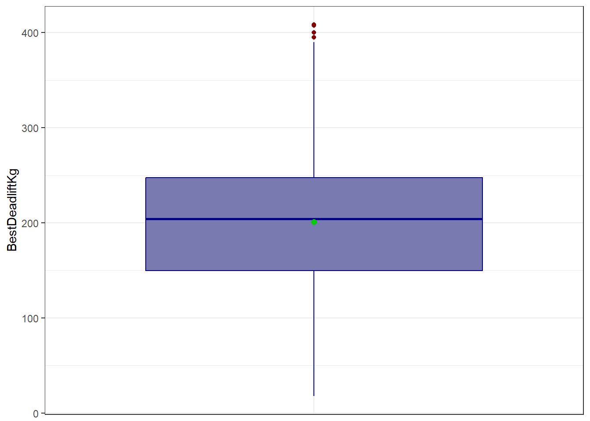

El boxplot muestra la caja central entre 149.86 y 247.5 kg (Q1-Q3), con la mediana muy cerca de la media y ligeramente por encima de ella, lo cual es consistente con la asimetría leve y casi simétrica ya identificada. Los bigotes van aproximadamente de 18 a 390 kg, y se observan algunos puntos atípicos por encima de 390 kg (hasta cerca de 400-410 kg), que corresponden a los valores más altos del peso muerto, probablemente de atletas en categorías de peso pesado o superpesado. Estos pocos outliers hacia arriba son coherentes con la ligera cola derecha observada en el histograma.


# Variables independientes (caracteristicas)

``` r
df %>%   
  select(where(is.numeric),-BestDeadliftKg,-playerId) %>% 
  pivot_longer(
    cols=everything(), #llaves y valores para cambiar la posicion del encabezado
    names_to='variable',
    values_to='valor'
    )  %>%
  group_by(variable) %>% 
  summarise(n=length(valor),
            media=mean(valor),
            sd=sd(valor),
            mediana=median(valor),
            RIC=IQR(valor),
            Q1=quantile(valor,0.25),
            Q3=quantile(valor,0.75),
            minimo=min(valor),
            maximo=max(valor),
            asim=skewness(valor),
            curtosis=kurtosis(valor)) %>% 
  kable(caption = "Caracterización") %>% 
  kable_styling(bootstrap_options = c("striped", "hover", "condensed"),
                full_width = TRUE) %>%
  scroll_box(width = "100%")
```

<div style="border: 1px solid #ddd; padding: 5px; overflow-x: scroll; width:100%; "><table class="table table-striped table-hover table-condensed" style="color: black; margin-left: auto; margin-right: auto;">
<caption>(\#tab:Variables independientes)(\#tab:Variables independientes)Caracterización</caption>
 <thead>
  <tr>
   <th style="text-align:left;"> variable </th>
   <th style="text-align:right;"> n </th>
   <th style="text-align:right;"> media </th>
   <th style="text-align:right;"> sd </th>
   <th style="text-align:right;"> mediana </th>
   <th style="text-align:right;"> RIC </th>
   <th style="text-align:right;"> Q1 </th>
   <th style="text-align:right;"> Q3 </th>
   <th style="text-align:right;"> minimo </th>
   <th style="text-align:right;"> maximo </th>
   <th style="text-align:right;"> asim </th>
   <th style="text-align:right;"> curtosis </th>
  </tr>
 </thead>
<tbody>
  <tr>
   <td style="text-align:left;"> Age </td>
   <td style="text-align:right;"> 18900 </td>
   <td style="text-align:right;"> 29.66470 </td>
   <td style="text-align:right;"> 11.50345 </td>
   <td style="text-align:right;"> 26.5 </td>
   <td style="text-align:right;"> 13.00 </td>
   <td style="text-align:right;"> 21.5 </td>
   <td style="text-align:right;"> 34.50 </td>
   <td style="text-align:right;"> 7.00 </td>
   <td style="text-align:right;"> 83 </td>
   <td style="text-align:right;"> 1.3295986 </td>
   <td style="text-align:right;"> 4.742084 </td>
  </tr>
  <tr>
   <td style="text-align:left;"> BestBenchKg </td>
   <td style="text-align:right;"> 18900 </td>
   <td style="text-align:right;"> 116.96339 </td>
   <td style="text-align:right;"> 51.23165 </td>
   <td style="text-align:right;"> 115.0 </td>
   <td style="text-align:right;"> 77.50 </td>
   <td style="text-align:right;"> 72.5 </td>
   <td style="text-align:right;"> 150.00 </td>
   <td style="text-align:right;"> 9.10 </td>
   <td style="text-align:right;"> 425 </td>
   <td style="text-align:right;"> 0.6450795 </td>
   <td style="text-align:right;"> 3.615781 </td>
  </tr>
  <tr>
   <td style="text-align:left;"> BestSquatKg </td>
   <td style="text-align:right;"> 18900 </td>
   <td style="text-align:right;"> 179.16597 </td>
   <td style="text-align:right;"> 69.09070 </td>
   <td style="text-align:right;"> 175.0 </td>
   <td style="text-align:right;"> 97.50 </td>
   <td style="text-align:right;"> 125.0 </td>
   <td style="text-align:right;"> 222.50 </td>
   <td style="text-align:right;"> 13.60 </td>
   <td style="text-align:right;"> 500 </td>
   <td style="text-align:right;"> 0.6052807 </td>
   <td style="text-align:right;"> 3.463130 </td>
  </tr>
  <tr>
   <td style="text-align:left;"> BodyweightKg </td>
   <td style="text-align:right;"> 18900 </td>
   <td style="text-align:right;"> 85.42556 </td>
   <td style="text-align:right;"> 22.95972 </td>
   <td style="text-align:right;"> 82.1 </td>
   <td style="text-align:right;"> 31.27 </td>
   <td style="text-align:right;"> 67.7 </td>
   <td style="text-align:right;"> 98.97 </td>
   <td style="text-align:right;"> 26.13 </td>
   <td style="text-align:right;"> 201 </td>
   <td style="text-align:right;"> 0.7953441 </td>
   <td style="text-align:right;"> 3.876567 </td>
  </tr>
</tbody>
</table></div>

### Veamos el análisis de cada variable independiente

**Age (Edad)**

Media = 29.66 años | Mediana = 26.5 años. La media está claramente por encima de la mediana, y con una asimetría alta (1.33) y curtosis elevada (4.74), esto indica una distribución bastante asimétrica hacia la derecha: la mayoría de competidores son jóvenes (20-30 años), pero hay una cola de atletas de mayor edad (hasta 83 años) que estira la media hacia arriba.

**BestBenchKg (Press banca)**

Media = 116.96 kg | Mediana = 115 kg, muy cercanas entre sí. Asimetría moderada (0.645) indica un sesgo positivo leve-moderado: la mayoría levanta entre 72.5 y 150 kg (RIC), con una cola hacia valores altos (hasta 425 kg). Curtosis cercana a 3 (3.62) sugiere una forma similar a la normal.

**BestSquatKg (Sentadilla)**

Media = 179.17 kg | Mediana = 175.0 kg, también cercanas. Asimetría moderada (0.605), similar al press banca: sesgo positivo leve, con la mayoría entre 125 y 222.5 kg y una cola hacia valores altos (hasta 500 kg). Curtosis (3.46) muy cercana a la normal.

**BodyweightKg (Peso corporal)**

Media = 85.43 kg | Mediana = 82.1 kg. Asimetría moderada-alta (0.795) muestra un sesgo positivo más marcado que en las otras variables: hay competidores con pesos corporales notablemente altos (hasta 201 kg, categoría superpesado) que estiran la distribución hacia la derecha. Curtosis (3.88) indica una distribución levemente más apuntada que la normal (leptocúrtica).


## Graficos de las variables independientes


``` r
# 'Age'
  df %>% 
  ggplot(aes(x =" ",y = Age))+
  geom_boxplot(fill="#797bb0",color="darkblue",
               outlier.color='darkred')+
  stat_summary(fun=mean, geom='point', shape=20,
               size=3, color='green')+ 
  theme_bw()+
    theme(axis.title.x = element_blank(),
        axis.text.x = element_blank(),
        axis.ticks.x = element_blank())->p1

# 'BestBenchKg'
  df %>% 
  ggplot(aes(x =" ",y = BestBenchKg ))+
  geom_boxplot(fill="#797bb0",color="darkblue",
               outlier.color='darkred')+
  stat_summary(fun=mean, geom='point', shape=20,
               size=3, color='green')+ 
  theme_bw()+
    theme(axis.title.x = element_blank(),
        axis.text.x = element_blank(),
        axis.ticks.x = element_blank())->p2

# 'BestSquatKg'
  df %>% 
  ggplot(aes(x =" ",y = BestSquatKg ))+
  geom_boxplot(fill="#797bb0",color="darkblue",
               outlier.color='darkred')+
  stat_summary(fun=mean, geom='point', shape=20,
               size=3, color='green')+ 
  theme_bw()+
    theme(axis.title.x = element_blank(),
        axis.text.x = element_blank(),
        axis.ticks.x = element_blank())->p3
  
# 'BodyweightKg'
  df %>% 
  ggplot(aes(x =" ",y = BodyweightKg))+
  geom_boxplot(fill="#797bb0",color="darkblue",
               outlier.color='darkred')+
  stat_summary(fun=mean, geom='point', shape=20,
               size=3, color='green')+ 
  theme_bw()+
    theme(axis.title.x = element_blank(),
        axis.text.x = element_blank(),
        axis.ticks.x = element_blank())->p4
  
  p1+p2+p3+p4
```

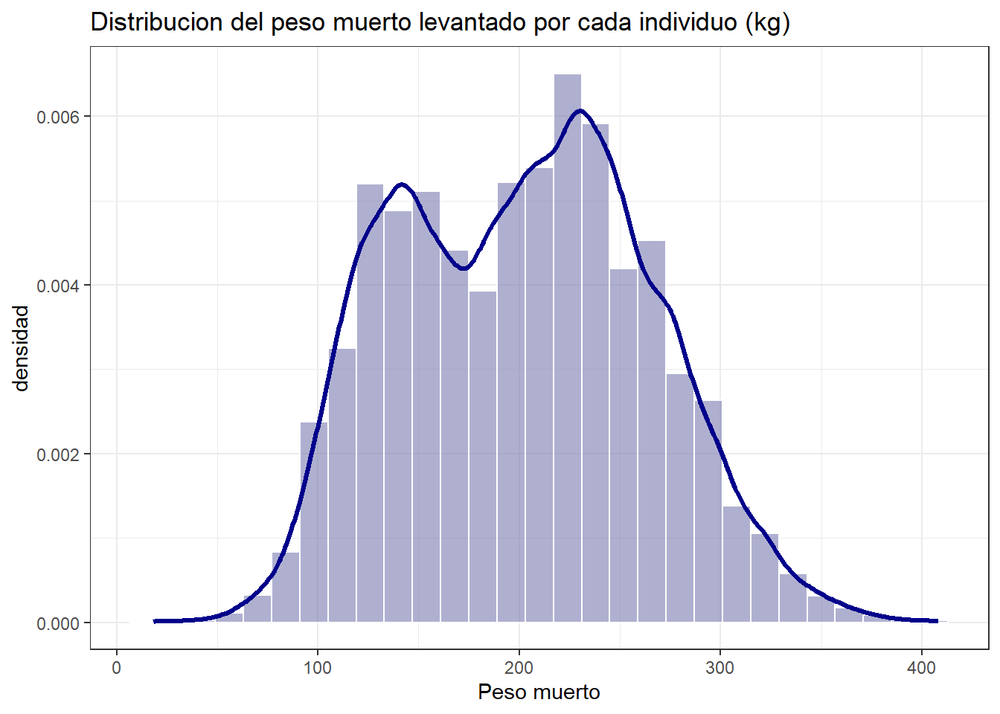

**Age (Edad)**

La caja central va de 21.5 a 34.5 años (Q1-Q3), con la mediana (26.5) por debajo de la media (29.66 años), señal de sesgo hacia la derecha. Se observan numerosos puntos atípicos por encima de 55 años, extendiéndose hasta los 83 años, lo que confirma la asimetría positiva alta (1.33) ya identificada: la mayoría de competidores son jóvenes, pero hay una cola larga de atletas mayores.

**BestBenchKg (Press banca)**

La caja va de 72.5 a 150 kg, con la mediana (115) muy cerca de la media (116.96), reflejando la asimetría moderada. Hay bastantes outliers por encima de 270 kg, llegando hasta 425 kg, lo que genera una cola derecha notoria, aunque el cuerpo central de los datos está bien concentrado.

**BestSquatKg (Sentadilla)**

Comportamiento muy similar al press banca: caja entre 125 y 222.5 kg, mediana (175) y media (179.17) cercanas. Los outliers aparecen por encima de 370 kg y llegan hasta 500 kg, consistentes con la asimetría moderada (0.605) y una cola derecha por atletas de fuerza superior.

**BodyweightKg (Peso corporal)**

Caja entre 67.7 y 98.97 kg, con la mediana (82.1) por debajo de la media (85.43), y el punto de mayor cantidad de outliers de las cuatro variables, comenzando desde ~150 kg hasta 201 kg. Esto es coherente con la asimetría moderada-alta (0.795), la más marcada entre las tres variables de fuerza/peso, reflejando la presencia de categorías superpesadas.


# Analisis Exploratorio Bivariado
Realizaremos un análisis entre nuestra variable respuesta 'BestDeadliftKg' (mejor peso muerto) y las demás variales numéricas.


## Peso muerto vs Edad


``` r
df %>%
  ggplot(aes(x=Age,y=BestDeadliftKg))+
  geom_point(alpha=0.4,color='darkblue')+
  labs(x='Edad',y='Peso muerto')+
  theme_bw()+
  facet_grid(.~'Dispersion entre la Edad y el Peso muerto')
```

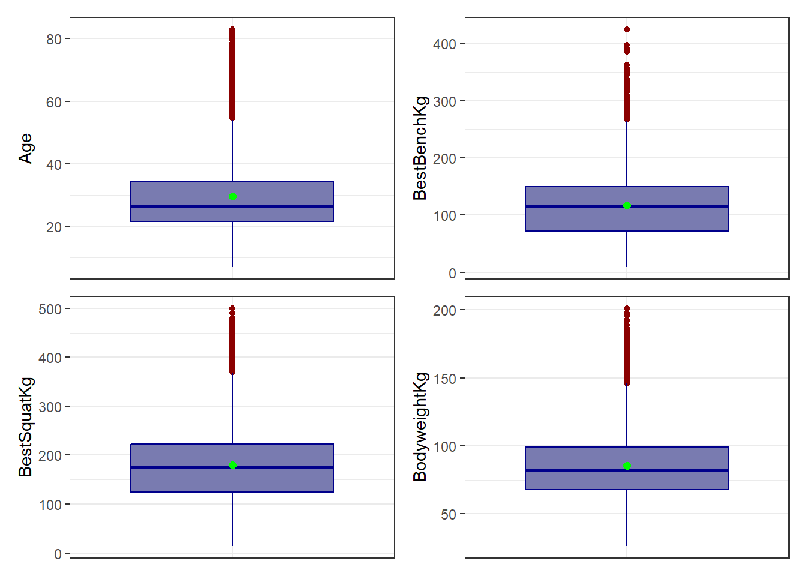

El peso muerto no muestra una tendencia lineal clara con la edad: aumenta hasta los 20-35 años y luego disminuye, sugiriendo una relación no lineal

## Peso muerto vs Mejor Sentadilla


``` r
df %>%
  ggplot(aes(x=BestSquatKg,y=BestDeadliftKg))+
  geom_point(alpha=0.4,color='darkblue')+
  labs(x='Mejor Sentadilla',y='Peso muerto')+
  theme_bw()+
  facet_grid(.~'Dispersion entre la Mejor Sentadilla y el Peso muerto')
```

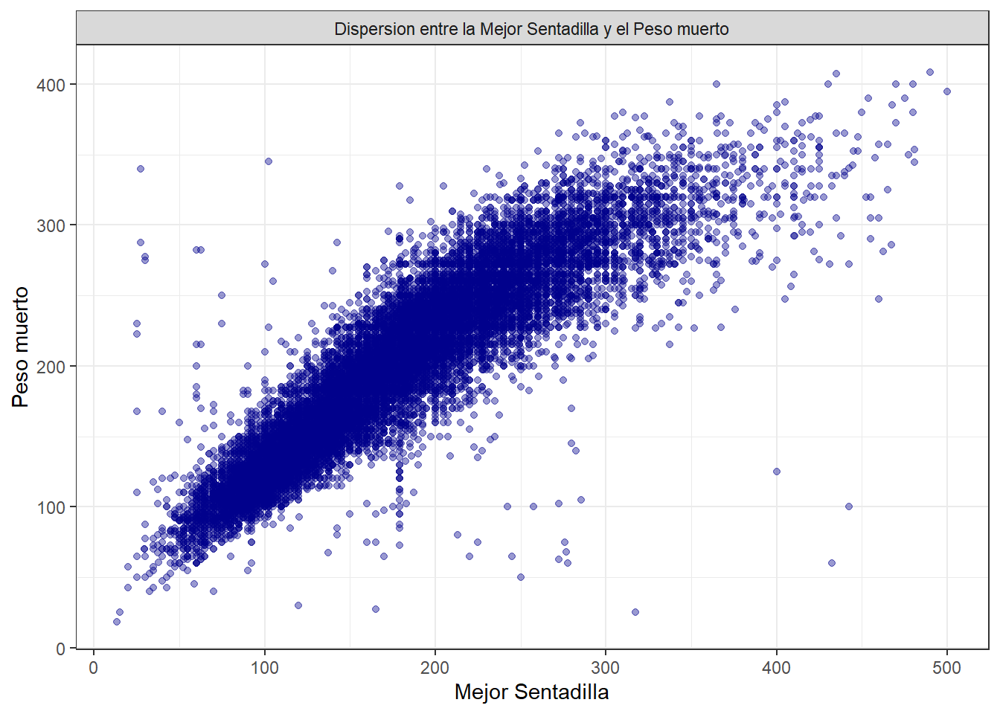

Se observa una tendencia creciente y muy marcada: a mayor peso en sentadilla, mayor peso muerto, con poca dispersión entre los puntos.

## Peso muerto vs Peso corporal


``` r
df %>%
  ggplot(aes(x=BodyweightKg,y=BestDeadliftKg))+
  geom_point(alpha=0.4,color='darkblue')+
  labs(x='Peso corporal',y='Peso muerto')+
  theme_bw()+
  facet_grid(.~'Dispersion entre el Peso corporal y el Peso muerto')
```

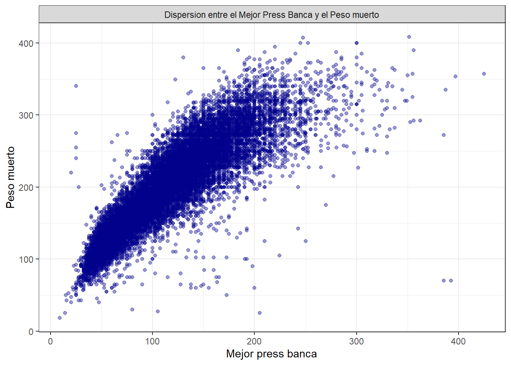

Existe una tendencia creciente, aunque con más dispersión que en los otros levantamientos, indicando una relación más débil.

## Peso muerto vs Mejor press banca


``` r
df %>%
  ggplot(aes(x=BestBenchKg,y=BestDeadliftKg))+
  geom_point(alpha=0.4,color='darkblue')+
  labs(x='Mejor press banca',y='Peso muerto')+
  theme_bw()+
  facet_grid(.~'Dispersion entre el Mejor Press Banca y el Peso muerto')
```


Se observa una tendencia creciente y bien definida, similar a la sentadilla.

# Variables categoricas 'Sex' y 'Equipament'


## Diagrama de barras: Frecuencia de la variable 'Sex'


``` r
tabla_sexo <- df %>% 
  count(Sex,name="n") %>% 
  mutate(Porcentaje=round((n/sum(n))*100,1),
         Etiqueta= paste0(n,"(",Porcentaje,"%)"))
tabla_sexo %>% 
  ggplot(aes(x=Sex,y=n))+
  geom_col(fill="#797bb0",width=0.6)+
  geom_text(aes(label=Etiqueta),vjust=-0.5,size=4.5)+
  facet_wrap(~'Distribución de la variable Sex')+
  scale_y_continuous(expand=expansion(mult=c(0,0.15)))+
  theme_bw()
```

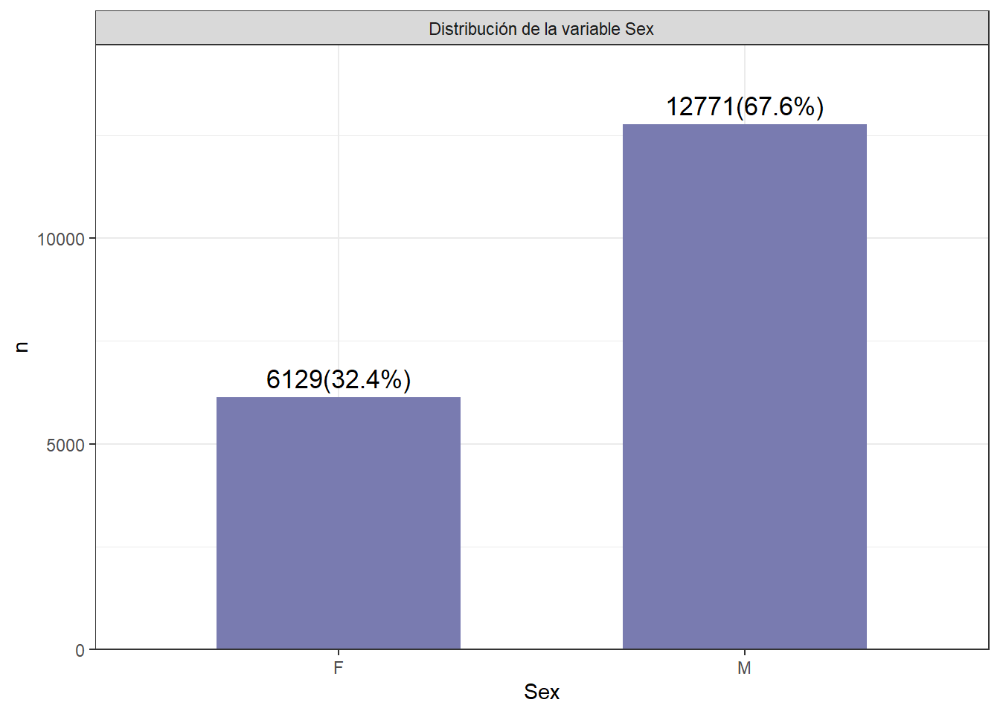

Se observa que la muestra está compuesta mayoritariamente por atletas de sexo masculino (12,771; 67.6%), mientras que las mujeres representan el 32.4% (6,129), evidenciando un desbalance entre ambos grupos.


## Comparacion entre peso muerto y sexo (tabla)


``` r
df %>%
  group_by(Sex) %>%
  summarise(
    n = n(),
    promedio = mean(BestDeadliftKg),
    mediana  = median(BestDeadliftKg),
    ds       = sd(BestDeadliftKg)
  )
```

```
## # A tibble: 2 × 5
##   Sex       n promedio mediana    ds
##   <fct> <int>    <dbl>   <dbl> <dbl>
## 1 F      6129     137.    138.  29.9
## 2 M     12771     232.    230   48.9
```
### Comparacion entre peso muerto y sexo (Caja de bigotes)

``` r
df %>% 
ggplot(aes(x=Sex, y=BestDeadliftKg))+
  geom_boxplot(fill="#797bb0", color="black",outlier.color="darkred")+
  stat_summary(fun=mean, geom='point', shape=20, size=3, color="green")+
  labs(title = "Peso muerto segun sexo", x = "Sexo", y = "Peso muerto (Kg)") +
  theme_bw()
```

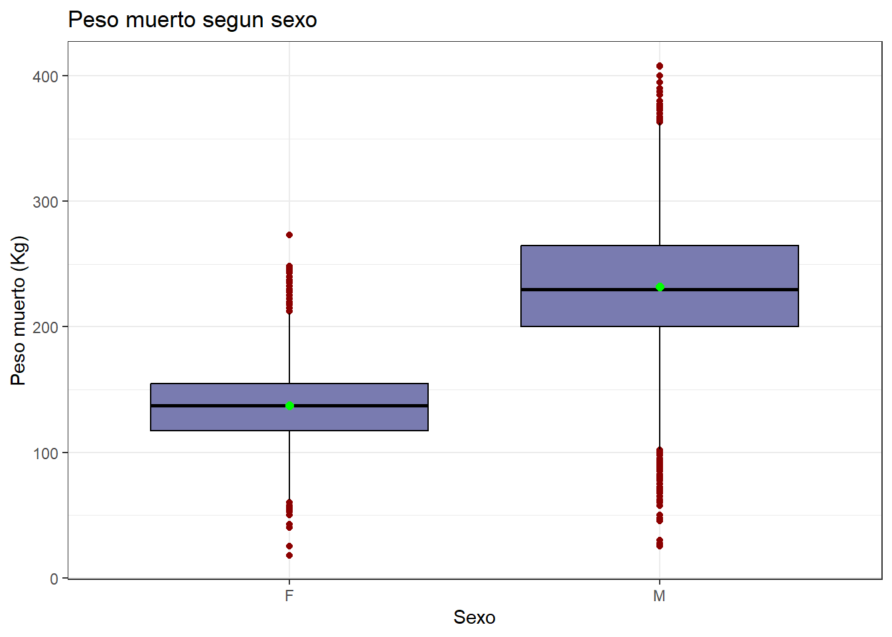

Los hombres presentan una mediana de peso muerto considerablemente más alta (230 kg) que las mujeres (137.5 kg), con mayor dispersión (DS=48.93 vs 29.89). La media (punto verde) se ubica cerca de la mediana en ambos grupos, indicando distribuciones relativamente simétricas, y se observan algunos outliers en rojo oscuro en ambos sexos.

## Diagrama de barras: Frecuencia de la variable 'Equipament'


``` r
tabla_eq <- df %>% 
  count(Equipment,name="n") %>% 
  mutate(Porcentaje=round((n/sum(n))*100,1),
         Etiqueta= paste0(n,"(",Porcentaje,"%)"))
tabla_eq %>% 
  ggplot(aes(x=Equipment,y=n))+
  geom_col(fill="#797bb0",width=0.6)+
  geom_text(aes(label=Etiqueta),vjust=-0.5,size=4.5)+
  facet_wrap(~'Distribucion de la variable Equipment')+
  scale_y_continuous(expand=expansion(mult=c(0,0.15)))+
  theme_bw()
```

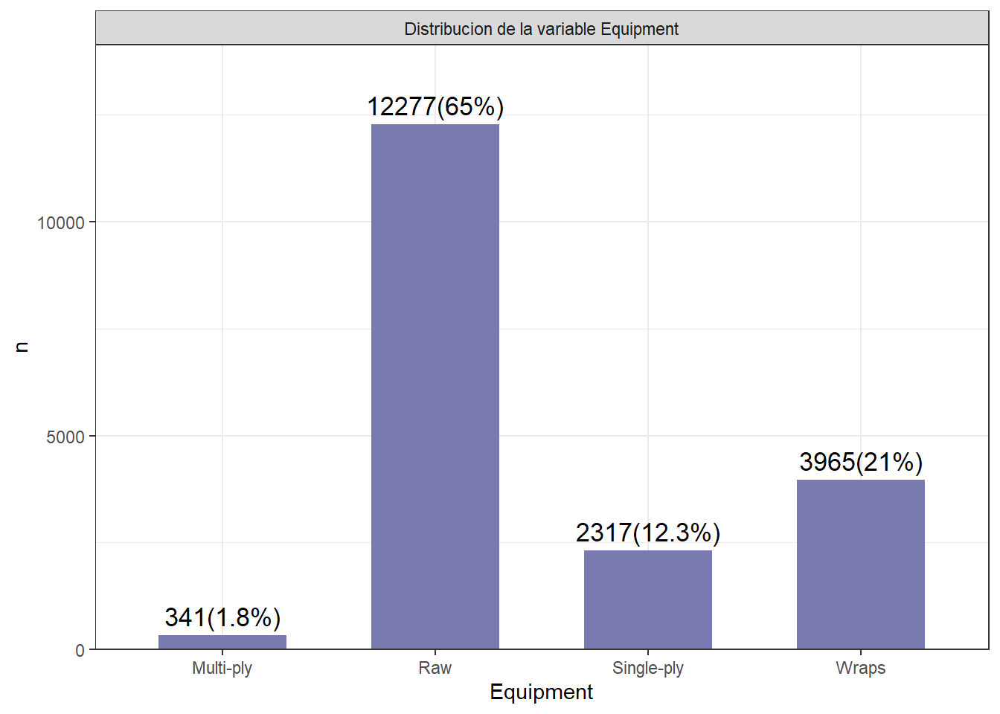

Se observa que la mayoría de los atletas compite en la modalidad Raw (12,277, 65%), seguida por Wraps (3,965, 21%) y Single-ply (2,317, 12.3%), mientras que Multi-ply representa una minoría muy reducida (341, 1.8%).

## Comparacion entre peso muerto y equipo (tabla)


``` r
df %>%
  group_by(Equipment) %>%
  summarise(
    n = n(),
    promedio = mean(BestDeadliftKg),
    mediana  = median(BestDeadliftKg),
    ds       = sd(BestDeadliftKg)
  )
```

```
## # A tibble: 4 × 5
##   Equipment      n promedio mediana    ds
##   <fct>      <int>    <dbl>   <dbl> <dbl>
## 1 Multi-ply    341     246.    252.  61.3
## 2 Raw        12277     193.    195   59.7
## 3 Single-ply  2317     211.    210   65.3
## 4 Wraps       3965     216.    225   62.6
```

### Comparacion entre peso muerto y equipo (Caja de bigotes)


``` r
df %>% 
ggplot(aes(x=Equipment, y=BestDeadliftKg))+
  geom_boxplot(fill="#797bb0", color="black",outlier.color="darkred")+
  stat_summary(fun=mean, geom='point', shape=20, size=3, color="green")+
  labs(title = "Peso muerto segun equipo", x = "Equipment", y = "Peso muerto (Kg)") +
  theme_bw()
```

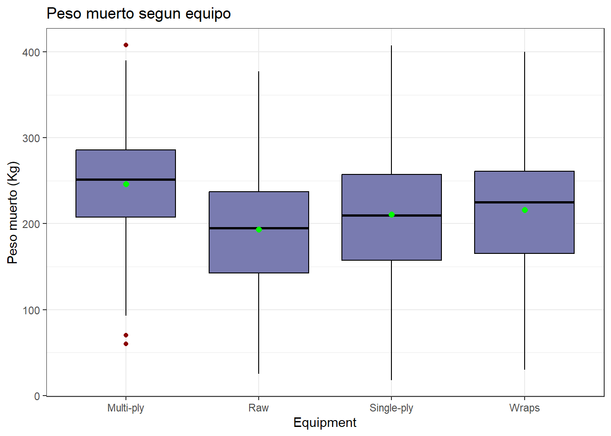

Se observa que Multi-ply presenta la mediana más alta de peso muerto, seguido de Wraps y Single-ply, mientras que Raw presenta la mediana más baja, coherente con el menor nivel de asistencia mecánica de esta modalidad. Multi-ply también muestra outliers en ambos extremos (uno muy alto y dos bajos), y su caja es más angosta, indicando menor dispersión que los demás grupos. La media (punto verde) se ubica cerca de la mediana en todos los casos, sugiriendo distribuciones relativamente simétricas dentro de cada equipo.

# Variables independientes vs variables independientes:

## variables numéricas vs numéricas

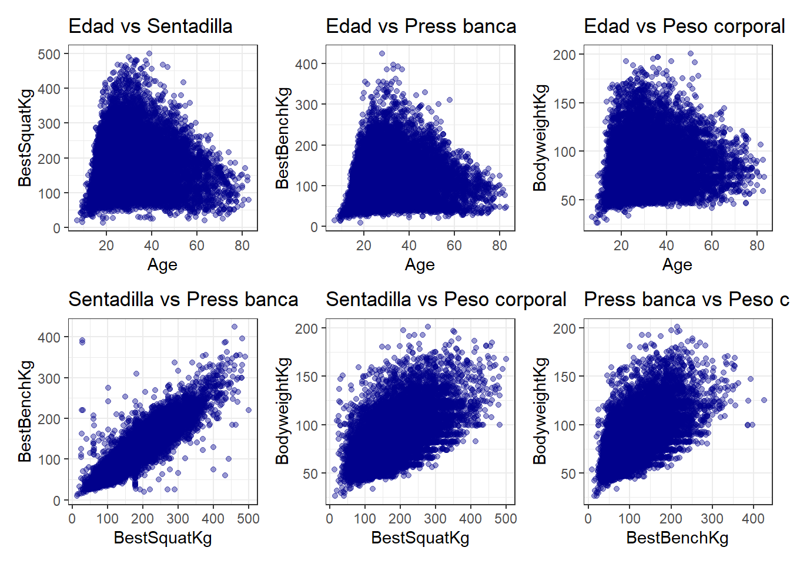

## Variables categoricas vs numéricas 

### Sex vs variables numericas

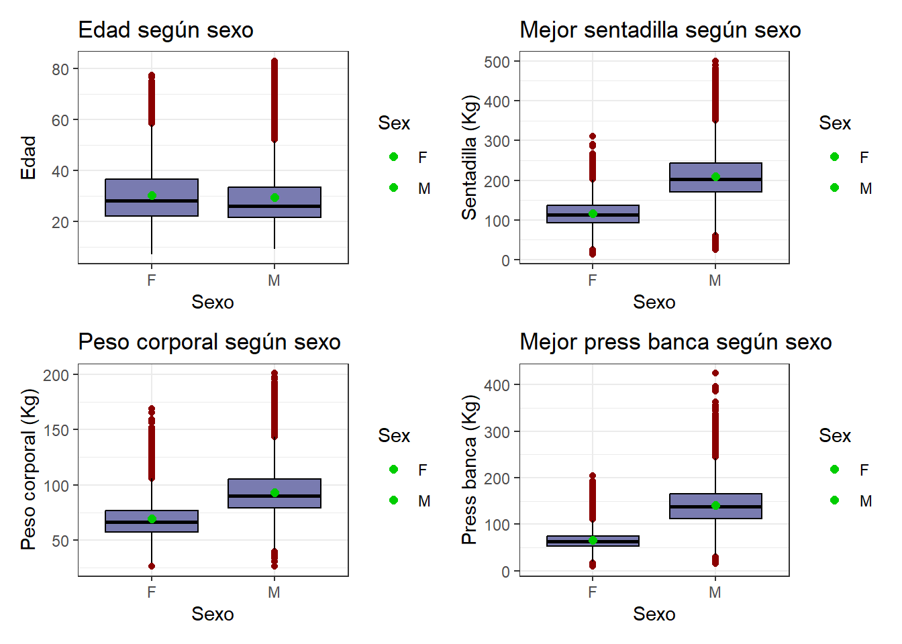

### Equipamiento vs variables numericas


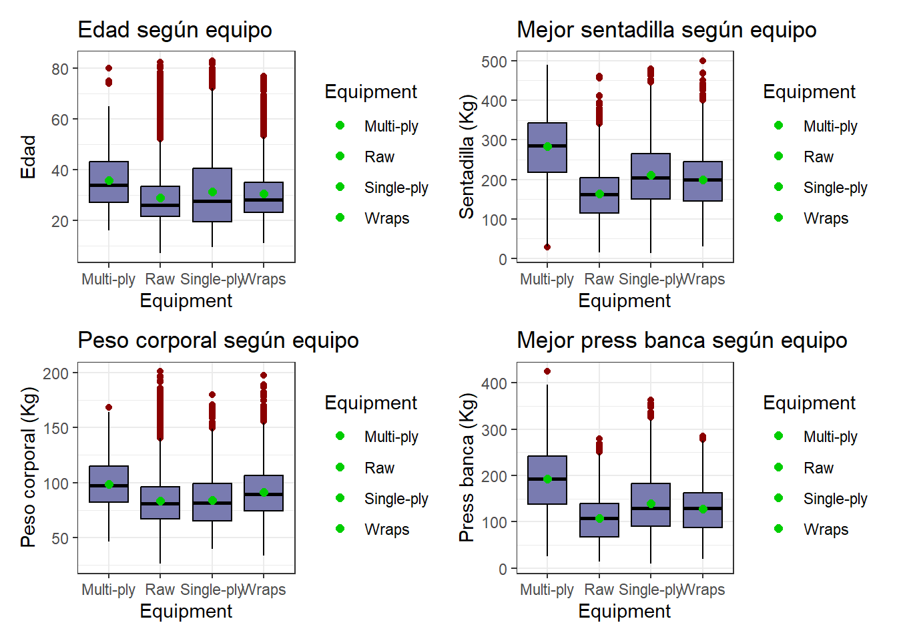

### Equipamiento vs Sexo
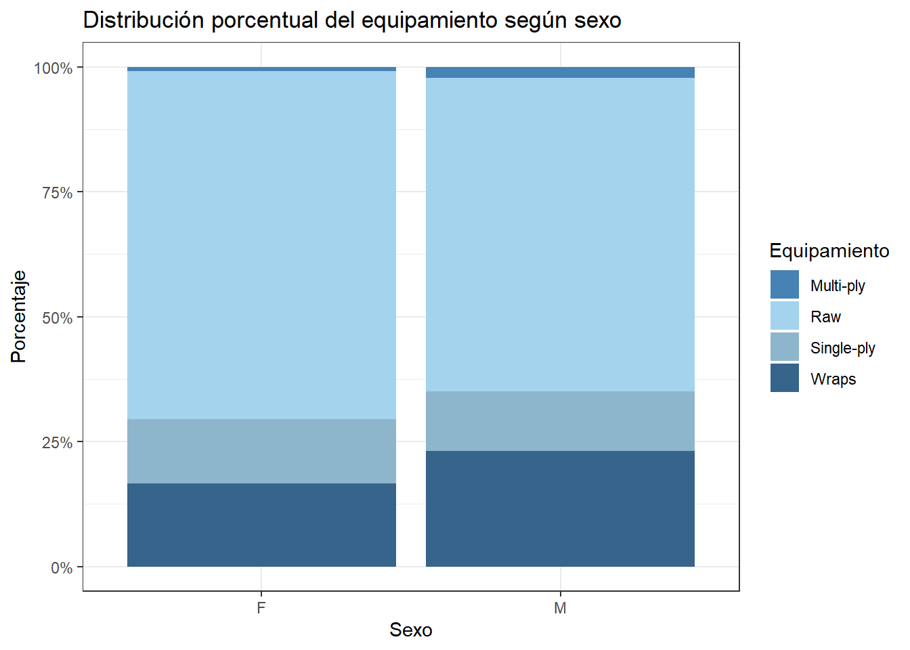

El gráfico muestra la distribución porcentual de los tipos de equipamiento utilizados por los atletas según su sexo.

Se observa que el equipamiento **Raw** es el más utilizado en ambos grupos, con una proporción del 69.70 % en mujeres y del 62.68 % en hombres.

Por otra parte, el equipamiento **Wraps** presenta una mayor proporción de uso en hombres (23.09 %) que en mujeres (16.58 %). En cuanto a **Single-ply**, las proporciones son similares, con un 12.84 % en mujeres y un 11.98 % en hombres.

Finalmente, **Multi-ply** es el equipamiento menos frecuente en ambos sexos, con porcentajes inferiores al 3 %.


# Ingenieria de caracterizacion (feature engineering)

La ingeniería de características (feature engineering) es el proceso de crear nuevas variables a partir de las que ya tenemos, con el fin de que representen mejor la información del dataset. Esto es útil porque, como se vio en la sección anterior, existen variables (como BestSquatKg y BestBenchKg) se mueven de forma muy parecida entre sí (visto en el grafico correspondiente a estas variables), ya que en el fondo ambas miden la fuerza de levantamiento del atleta. Usarlas tal cual en un modelo puede generar redundancia, así que en este caso las vamos a utilizar para crear variables que combinen esta información y que aporten un dato más claro, como por ejemplo conocer cuánto puede levantar (con exito) realmente el atleta, en lugar de manejar los totales por separado.

## Variables seleccionadas

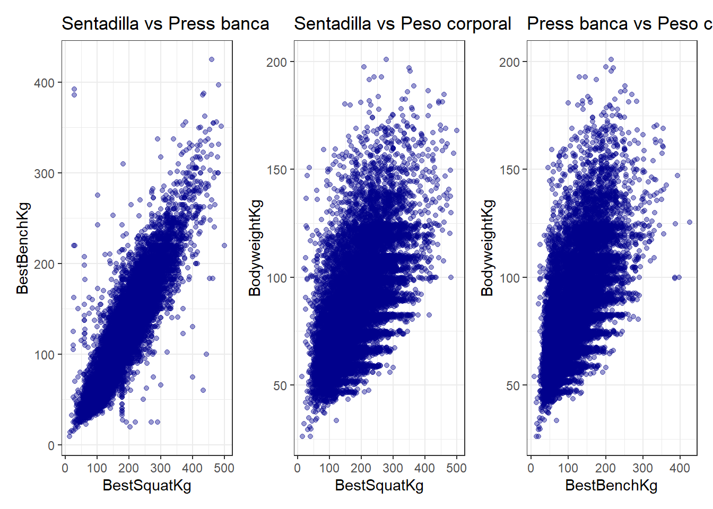

Se seleccionaron estas variables debido a la tendencia creciente (comportamiento lineal) que se obtuvo en la seccion anterior, donde se comparó cada variable independiente con respecto a las demás. Estas variables son las que presentan mayor riesgo de estar midiendo lo mismo, es decir, generando una multicolinealidad. Esto sirve como base para justificar por qué se crearon variables nuevas en lugar de usar los totales originales.


## Nuevas variables: 'upper_lower_total', 'ratio_squat_peso', 'ratio_bench_peso'


``` r
df_nuevo <- df %>%
  mutate(
    # Fuerza combinada de tren superior + inferior
    upper_lower_total = BestSquatKg + BestBenchKg,
    
    # ratio: cuánto pesa lo que levanta en sentadilla, relativo a su propio peso corporal
    ratio_squat_peso = BestSquatKg / BodyweightKg,
    
    # Ratio: lo mismo para press banca
    ratio_bench_peso = BestBenchKg / BodyweightKg
  )
```


### Verificar si no hay valores nulos:


``` r
df_nuevo %>%
  summarise(across(everything(), ~ sum(is.na(.)),.names="NA_{.col}")) %>%
  kable(caption = " Verificar datos faltantes ") %>%
  kable_styling(bootstrap_options = c("striped", "hover", "condensed"),
                full_width = TRUE) %>%
  scroll_box(width = "100%")
```

<div style="border: 1px solid #ddd; padding: 5px; overflow-x: scroll; width:100%; "><table class="table table-striped table-hover table-condensed" style="color: black; margin-left: auto; margin-right: auto;">
<caption>(\#tab:unnamed-chunk-10)(\#tab:unnamed-chunk-10) Verificar datos faltantes</caption>
 <thead>
  <tr>
   <th style="text-align:right;"> NA_playerId </th>
   <th style="text-align:right;"> NA_Name </th>
   <th style="text-align:right;"> NA_Sex </th>
   <th style="text-align:right;"> NA_Equipment </th>
   <th style="text-align:right;"> NA_Age </th>
   <th style="text-align:right;"> NA_BodyweightKg </th>
   <th style="text-align:right;"> NA_BestSquatKg </th>
   <th style="text-align:right;"> NA_BestDeadliftKg </th>
   <th style="text-align:right;"> NA_BestBenchKg </th>
   <th style="text-align:right;"> NA_upper_lower_total </th>
   <th style="text-align:right;"> NA_ratio_squat_peso </th>
   <th style="text-align:right;"> NA_ratio_bench_peso </th>
  </tr>
 </thead>
<tbody>
  <tr>
   <td style="text-align:right;"> 0 </td>
   <td style="text-align:right;"> 0 </td>
   <td style="text-align:right;"> 0 </td>
   <td style="text-align:right;"> 0 </td>
   <td style="text-align:right;"> 0 </td>
   <td style="text-align:right;"> 0 </td>
   <td style="text-align:right;"> 0 </td>
   <td style="text-align:right;"> 0 </td>
   <td style="text-align:right;"> 0 </td>
   <td style="text-align:right;"> 0 </td>
   <td style="text-align:right;"> 0 </td>
   <td style="text-align:right;"> 0 </td>
  </tr>
</tbody>
</table></div>


## Realizamos el resumen estadistico de nuestras nuevas variables


``` r
df_nuevo %>% 
  select(Age, BestDeadliftKg, upper_lower_total, ratio_squat_peso, ratio_bench_peso) %>% 
  summary() %>%  
kable(caption = " Dataset luego de realizar feature engineering") %>%
  kable_styling(bootstrap_options = c("striped", "hover", "condensed"),
                full_width = TRUE) %>%
  scroll_box(width = "100%")
```

<div style="border: 1px solid #ddd; padding: 5px; overflow-x: scroll; width:100%; "><table class="table table-striped table-hover table-condensed" style="color: black; margin-left: auto; margin-right: auto;">
<caption>(\#tab:caracterizacionnueva)(\#tab:caracterizacionnueva) Dataset luego de realizar feature engineering</caption>
 <thead>
  <tr>
   <th style="text-align:left;">  </th>
   <th style="text-align:left;"> Age </th>
   <th style="text-align:left;"> BestDeadliftKg </th>
   <th style="text-align:left;"> upper_lower_total </th>
   <th style="text-align:left;"> ratio_squat_peso </th>
   <th style="text-align:left;"> ratio_bench_peso </th>
  </tr>
 </thead>
<tbody>
  <tr>
   <td style="text-align:left;">  </td>
   <td style="text-align:left;"> Min.   : 7.00 </td>
   <td style="text-align:left;"> Min.   : 18.1 </td>
   <td style="text-align:left;"> Min.   : 22.7 </td>
   <td style="text-align:left;"> Min.   :0.1919 </td>
   <td style="text-align:left;"> Min.   :0.1686 </td>
  </tr>
  <tr>
   <td style="text-align:left;">  </td>
   <td style="text-align:left;"> 1st Qu.:21.50 </td>
   <td style="text-align:left;"> 1st Qu.:149.9 </td>
   <td style="text-align:left;"> 1st Qu.:200.0 </td>
   <td style="text-align:left;"> 1st Qu.:1.6888 </td>
   <td style="text-align:left;"> 1st Qu.:1.0204 </td>
  </tr>
  <tr>
   <td style="text-align:left;">  </td>
   <td style="text-align:left;"> Median :26.50 </td>
   <td style="text-align:left;"> Median :204.1 </td>
   <td style="text-align:left;"> Median :292.5 </td>
   <td style="text-align:left;"> Median :2.0708 </td>
   <td style="text-align:left;"> Median :1.3483 </td>
  </tr>
  <tr>
   <td style="text-align:left;">  </td>
   <td style="text-align:left;"> Mean   :29.66 </td>
   <td style="text-align:left;"> Mean   :201.1 </td>
   <td style="text-align:left;"> Mean   :296.1 </td>
   <td style="text-align:left;"> Mean   :2.0994 </td>
   <td style="text-align:left;"> Mean   :1.3552 </td>
  </tr>
  <tr>
   <td style="text-align:left;">  </td>
   <td style="text-align:left;"> 3rd Qu.:34.50 </td>
   <td style="text-align:left;"> 3rd Qu.:247.5 </td>
   <td style="text-align:left;"> 3rd Qu.:370.0 </td>
   <td style="text-align:left;"> 3rd Qu.:2.4663 </td>
   <td style="text-align:left;"> 3rd Qu.:1.6372 </td>
  </tr>
  <tr>
   <td style="text-align:left;">  </td>
   <td style="text-align:left;"> Max.   :83.00 </td>
   <td style="text-align:left;"> Max.   :408.2 </td>
   <td style="text-align:left;"> Max.   :885.0 </td>
   <td style="text-align:left;"> Max.   :5.1916 </td>
   <td style="text-align:left;"> Max.   :3.9689 </td>
  </tr>
</tbody>
</table></div>


La variable upper_lower_total representa la fuerza combinada del tren superior e inferior del atleta, sumando su mejor sentadilla y su mejor press de banca. Esta variable presenta una media de 296.1 kg y una mediana de 292.5 kg.

Los ratios ratio_squat_peso y ratio_bench_peso expresan cuántos kilogramos levanta el atleta por cada kilogramo de su propio peso corporal, permitiendo comparar la fuerza relativa entre atletas de distinto tamaño corporal. Se observa que la media de ratio_squat_peso es de 2.10, lo que indica que, en promedio, los atletas levantan aproximadamente 2.10 veces su propio peso corporal en sentadilla. La dispersión (DS = 0.61) sugiere que existe una variabilidad moderada en esta capacidad relativa entre los distintos atletas de la muestra.


## Veamos los graficos de las variables de nuestro dataframe nuevo.

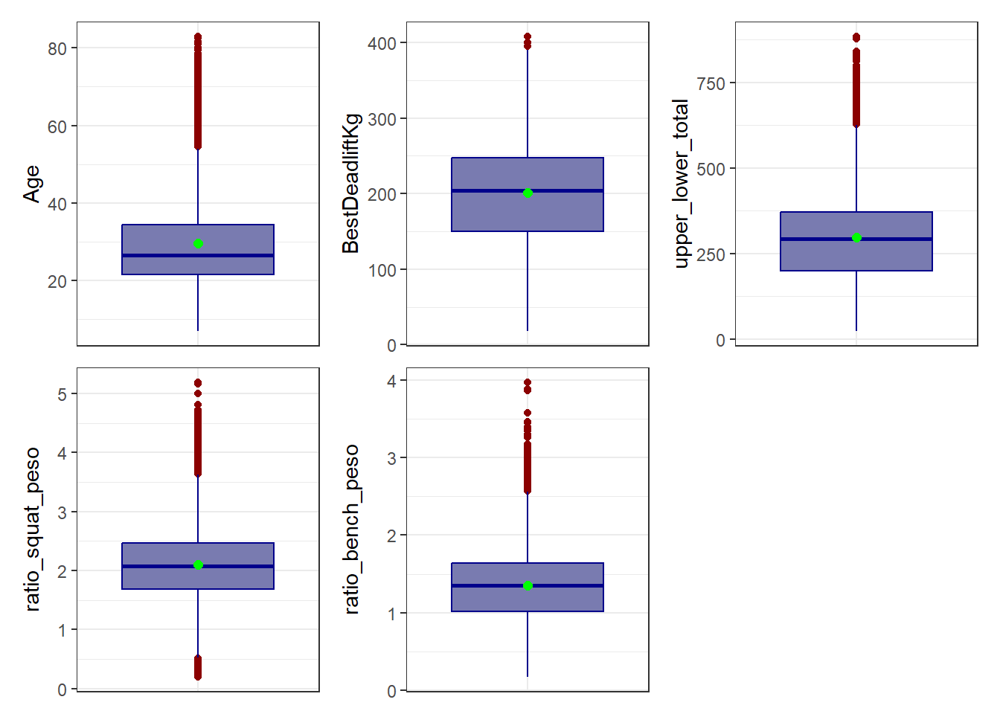


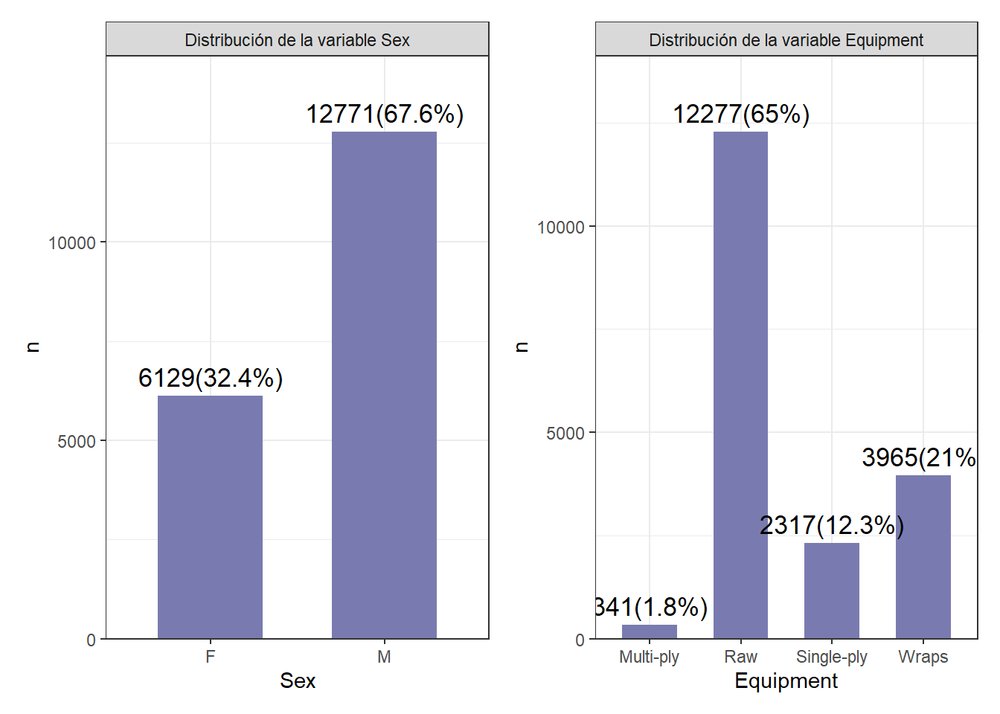


## Verificamos el éxito de la ingenieria de caracterizacion
Comparamos las nuevas variables (y las que no fueron eliminadas) con respecto a nuestra variable respuesta ‘BestDeadliftKg’


Muestra una relación no lineal y una asociación lineal prácticamente nula. La mayor concentración de datos y los valores máximos de peso muerto se ubican en el rango de 20 a 35 años. A partir de los 40–45 años se aprecia una tendencia decreciente en las marcas alcanzadas, junto con una menor densidad de competidores en edades avanzadas. 


Muestra una relación lineal positiva sumamente fuerte. A medida que aumenta la fuerza combinada del atleta (sentadilla + banca), el peso muerto levantado incrementa de manera directa y proporcional. Esta variable sintética sintetiza con alta precisión la capacidad de fuerza absoluta total del competidor. 

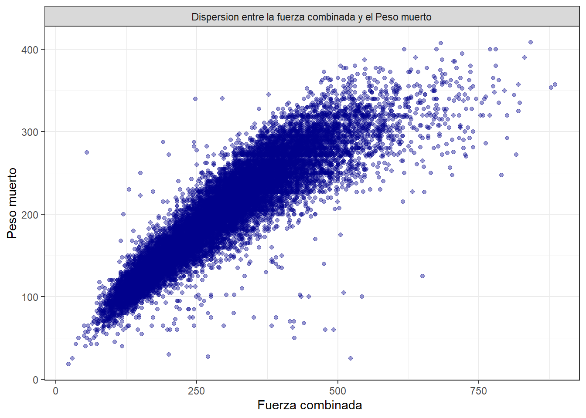

Presenta una tendencia ascendente moderada-alta. Refleja que los atletas con mayor fuerza relativa en el tren inferior (mayor ratio $\text{sentadilla}/\text{peso corporal}$) tienden a lograr marcas más altas en peso muerto.

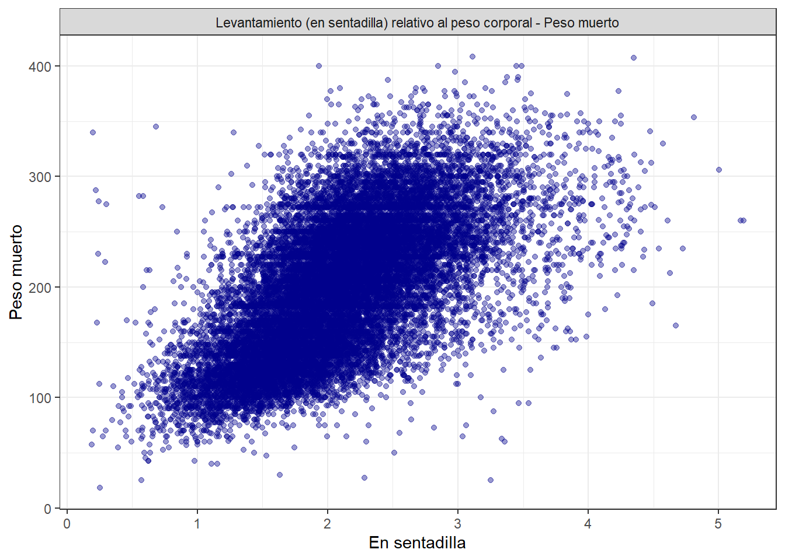

Muestra una asociación positiva moderada-alta. Un mayor rendimiento relativo en el press de banca (ratio $\text{banca}/\text{peso corporal}$) se asocia con un desempeño superior en peso muerto, evidenciando que la fuerza relativa del tren superior guarda una relación estrecha con el levantamiento máximo. 


# Tabla de contingencia

Utilizaremos la prueba de independencia chi-cuadrado, ya que se cuenta con una única muestra de atletas (no poblaciones separadas y predefinidas), clasificada según dos variables categóricas: Sexo y Equipamiento. El objetivo es determinar si estas dos variables están asociadas entre sí o si, por el contrario, son independientes.

$$H_0: \text{El sexo del atleta y el tipo de equipamiento utilizado son independientes}$$

$$H_1: \text{El sexo del atleta y el tipo de equipamiento utilizado están asociados (no son independientes)}$$


``` r
tabla <- table(df_nuevo$Sex, df_nuevo$Equipment)
tabla
```

```
##    
##     Multi-ply  Raw Single-ply Wraps
##   F        54 4272        787  1016
##   M       287 8005       1530  2949
```

## Crear tabla de contingencia

``` r
observados <- matrix(c(54, 4272, 787, 1016,
                        287, 8005, 1530, 2949),
                      nrow = 2, byrow = TRUE,
                      dimnames = list(
                        Sexo = c("F", "M"),
                        Equipamiento = c("Multi-ply", "Raw", "Single-ply", "Wraps")
                      )) 
observados
```

```
##     Equipamiento
## Sexo Multi-ply  Raw Single-ply Wraps
##    F        54 4272        787  1016
##    M       287 8005       1530  2949
```

## Totales por fila, columna y total general

``` r
fila_totales <- rowSums(observados)
col_totales <- colSums(observados)
total_general <- sum(observados)

fila_totales
```

```
##     F     M 
##  6129 12771
```

``` r
col_totales
```

```
##  Multi-ply        Raw Single-ply      Wraps 
##        341      12277       2317       3965
```

``` r
total_general
```

```
## [1] 18900
```

## Frecuencias esperadas bajo H0

``` r
esperados <- outer(fila_totales, col_totales, FUN = function(f, c) f * c / total_general)
dimnames(esperados) <- dimnames(observados)
esperados
```

```
##     Equipamiento
## Sexo Multi-ply      Raw Single-ply    Wraps
##    F  110.5814 3981.256     751.37 1285.793
##    M  230.4186 8295.744    1565.63 2679.207
```

## Estadistico Chi-cuadrado

``` r
chi_cuadrado <- sum((observados - esperados)^2 / esperados)
chi_cuadrado
```

```
## [1] 160.5454
```

``` r
df_gl <- (nrow(observados) - 1) * (ncol(observados) - 1)
df_gl
```

```
## [1] 3
```

``` r
alpha <- 0.05
valor_critico <- qchisq(1 - alpha, df_gl)
valor_critico
```

```
## [1] 7.814728
```

## Conclusion

``` r
# comparación
rechaza_H0 <- chi_cuadrado > valor_critico

if (rechaza_H0) {
  print("Se rechaza H0: existe una asociacion significativa entre el sexo del atleta y el tipo de equipamiento utilizado.")
} else {
  print("No se rechaza H0: no hay evidencia suficiente para afirmar que el sexo y el equipamiento están asociados.")
}
```

```
## [1] "Se rechaza H0: existe una asociacion significativa entre el sexo del atleta y el tipo de equipamiento utilizado."
```
 

``` r
valor_p <- pchisq(chi_cuadrado, df_gl, lower.tail = FALSE)
valor_p
```

```
## [1] 0.0000000000000000000000000000000001397723
```

## Verificamos con chisq.test

``` r
chisq.test(observados)
```

```
## 
## 	Pearson's Chi-squared test
## 
## data:  observados
## X-squared = 160.55, df = 3, p-value < 0.00000000000000022
```


``` r
chi_test <- chisq.test(tabla)
chi_test$expected
```

```
##    
##     Multi-ply      Raw Single-ply    Wraps
##   F  110.5814 3981.256     751.37 1285.793
##   M  230.4186 8295.744    1565.63 2679.207
```
Se aplicó la prueba de independencia chi-cuadrado para evaluar si el sexo del atleta y el tipo de equipamiento utilizado en competencia son independientes. El estadístico calculado ($χ²=160.55$, $gl=3$) supera ampliamente el valor crítico ($χ²=7.81$) para un nivel de significancia α=0.05, resultado que se confirma con un valor p prácticamente nulo. Por lo tanto, se rechaza H0, concluyendo que existe una asociación estadísticamente significativa entre el sexo del atleta y el tipo de equipamiento empleado.


# Estadistica paramétrica y no paramétrica

En esta sección realizaremos la estadistica inferencial para responder el objetivo general y los objetivos especificos.

## ¿Existe una diferencia significativa en el peso muerto promedio entre atletas de sexo masculino y femenino?

$$
H_0: \mu_1 = \mu_2 \quad 
\text {(el peso muerto promedio es igual entre hombres y mujeres)  } 
\text{ vs } 
$$
$$
\quad H_1: \mu_1 \neq \mu_2 \text { (el peso muerto promedio difiere entre hombres y mujeres)}
$$

### Verifiquemos supuestos de normalidad


``` r
ks.test(df_nuevo$BestDeadliftKg, "pnorm", mean=mean(df_nuevo$BestDeadliftKg), sd=sd(df_nuevo$BestDeadliftKg))
```

```
## Warning in ks.test.default(df_nuevo$BestDeadliftKg, "pnorm", mean = mean(df_nuevo$BestDeadliftKg), : ties should not be
## present for the one-sample Kolmogorov-Smirnov test
```

```
## 
## 	Asymptotic one-sample Kolmogorov-Smirnov test
## 
## data:  df_nuevo$BestDeadliftKg
## D = 0.058352, p-value < 0.00000000000000022
## alternative hypothesis: two-sided
```
La prueba de normalidad de Kolmogorov-Smirnov aplicada sobre la variable de rendimiento en peso muerto (BestDeadliftKg) indicó una desviación estadísticamente significativa de la distribución normal ($D = 0.058$, p < 0.001). En consecuencia, se rechazó la hipótesis nula de normalidad, justificando la selección de pruebas no paramétricas para la comparación de grupos.

Por esta razon, procedemos a utilizar la prueba de Wilcox (para datos no pareados) y realizar la comparacion (utilizando la mediana).

### comparación de grupos con método no paramétrico

``` r
wilcox.test(BestDeadliftKg ~ Sex, data = df_nuevo)
```

```
## 
## 	Wilcoxon rank sum test with continuity correction
## 
## data:  BestDeadliftKg by Sex
## W = 3967723, p-value < 0.00000000000000022
## alternative hypothesis: true location shift is not equal to 0
```

La prueba de suma de rangos de Wilcoxon indicó una diferencia estadísticamente
significativa en el rendimiento de peso muerto entre hombres y mujeres
($W = 3967723$, p < 0.001). Dado que el $p\text{-valor} < \alpha$ ($0.05$), se rechaza
la hipótesis nula $H_0$. Los resultados confirman que la mediana del peso muerto
levantado por los hombres es significativamente mayor a la alcanzada por las mujeres.

## ¿Existen diferencias significativas en el peso muerto promedio entre los distintos tipos de equipamiento utilizados por los atletas?


$$
H_0: \mu_1=\mu_2=\mu_3=\mu_4\\
H_1: \exists\ i\neq j:\ \mu_i\neq\mu_j

$$


### Verifiquemos el supuesto de normalidad de la variable 'Equipment'


``` r
df_nuevo %>%
  group_by(Equipment) %>%
  summarise(ks = ks.test(BestDeadliftKg, "pnorm", 
                          mean = mean(BestDeadliftKg), 
                          sd = sd(BestDeadliftKg))$p.value)
```

```
## Warning: There were 4 warnings in `summarise()`.
## The first warning was:
## ℹ In argument: `ks = `$`(...)`.
## ℹ In group 1: `Equipment = Multi-ply`.
## Caused by warning in `ks.test.default()`:
## ! ties should not be present for the one-sample Kolmogorov-Smirnov test
## ℹ Run `dplyr::last_dplyr_warnings()` to see the 3 remaining warnings.
```

```
## # A tibble: 4 × 2
##   Equipment        ks
##   <fct>         <dbl>
## 1 Multi-ply  6.93e- 2
## 2 Raw        2.92e-47
## 3 Single-ply 1.24e- 6
## 4 Wraps      1.64e-13
```

Se aplicó la prueba de Kolmogorov-Smirnov para evaluar el supuesto de normalidad de la variable BestDeadliftKg en cada categoría de Equipment. Los resultados muestran que el grupo Multi-ply presenta un valor $p = 0.069$, mayor al nivel de significancia $α = 0.05$, por lo que este grupo individualmente no presenta evidencia de desviación significativa de la normalidad. Sin embargo, los grupos Raw, Single-ply y Wraps presentaron valores p extremadamente pequeños (p < 0.001 en los tres casos), rechazando el supuesto de normalidad. Dado que no se cumple la normalidad en todos los grupos simultáneamente, se descarta el uso de ANOVA (paramétrico) y se opta por una alternativa no paramétrica, es decir, la prueba de Kruskal-Wallis (comprando medianas).

### comparacion de grupos con método no paramétrico


``` r
#como NO se cumplen los supuestos utilizamos Kruskal-Wallis
kruskal.test(BestDeadliftKg ~ factor(Equipment), data = df)
```

```
## 
## 	Kruskal-Wallis rank sum test
## 
## data:  BestDeadliftKg by factor(Equipment)
## Kruskal-Wallis chi-squared = 626.13, df = 3, p-value < 0.00000000000000022
```

El resultado ($χ²=626.13$, $gl=3$, p<0.001) indica que se rechaza la hipótesis nula, existiendo evidencia estadística suficiente para afirmar que al menos un tipo de equipamiento presenta un peso muerto con una distribución significativamente distinta a los demás. Al observar las medianas por grupo, se aprecia que Multi-ply presenta la mediana más alta (251.7 kg), seguido de Wraps (225 kg) y Single-ply (210 kg), mientras que Raw presenta la mediana más baja (195 kg), lo cual es coherente con el mayor nivel de asistencia mecánica que ofrece cada tipo de equipamiento.


# Coeficiente de correlación

En esta sección se analizará la relación entre pares de variables numéricas del estudio mediante un coeficiente de correlación. Se verificará el supuesto de normalidad de las variables seleccionadas, con el fin de determinar si corresponde aplicar el coeficiente de Pearson (en caso de cumplirse la normalidad) o el coeficiente de Spearman (en caso de no cumplirse la normalidad). Este análisis permitirá medir el grado y la dirección de la relación entre la variable respuesta BestDeadliftKg y las variables BodyweightKg y upper_lower_total, identificando así qué predictores presentan mayor relación con el rendimiento en peso muerto.

## Correlación entre peso corporal y mejor peso muerto alcanzado

### Veamos la distribucion entre ambas variables

``` r
df_nuevo %>%
  ggplot(aes(x = BodyweightKg, y = BestDeadliftKg)) +
  geom_point(alpha = 0.3, color = 'darkblue') +
  labs(x = 'Peso corporal (kg)', y = 'Mejor peso muerto (kg)',
       title = 'Relación entre peso corporal y peso muerto máximo') +
  theme_bw()
```

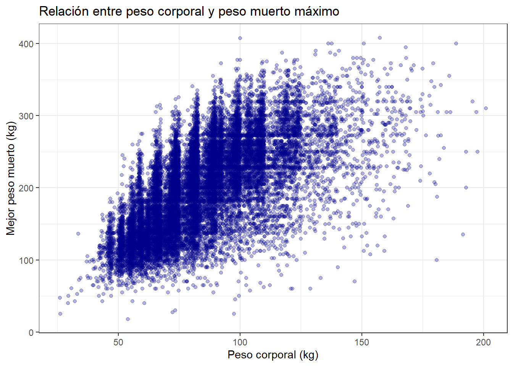

Se observa una tendencia creciente, es decir, a mayor peso corporal, mayor tiende a ser el peso muerto alcanzado (kg).

### Supuesto de normalidad


``` r
ks.test(df$BodyweightKg, "pnorm", mean = mean(df$BodyweightKg), sd = sd(df$BodyweightKg))
```

```
## Warning in ks.test.default(df$BodyweightKg, "pnorm", mean = mean(df$BodyweightKg), : ties should not be present for the
## one-sample Kolmogorov-Smirnov test
```

```
## 
## 	Asymptotic one-sample Kolmogorov-Smirnov test
## 
## data:  df$BodyweightKg
## D = 0.072876, p-value < 0.00000000000000022
## alternative hypothesis: two-sided
```

``` r
ks.test(df$BestDeadliftKg, "pnorm", mean = mean(df$BestDeadliftKg), sd = sd(df$BestDeadliftKg))
```

```
## Warning in ks.test.default(df$BestDeadliftKg, "pnorm", mean = mean(df$BestDeadliftKg), : ties should not be present for
## the one-sample Kolmogorov-Smirnov test
```

```
## 
## 	Asymptotic one-sample Kolmogorov-Smirnov test
## 
## data:  df$BestDeadliftKg
## D = 0.058352, p-value < 0.00000000000000022
## alternative hypothesis: two-sided
```
Se aplicó la prueba de Kolmogorov-Smirnov para evaluar el supuesto de normalidad de las variables BodyweightKg y BestDeadliftKg, comparando su distribución contra una distribución normal con la misma media y desviación estándar de los datos. En ambos casos se obtuvo un valor p considerablemente menor a 0.05, por lo que se rechaza la hipótesis nula de normalidad para las dos variables. Es importante señalar que, dado que ambas variables presentan valores registrados con precisión limitada (decimales), se generaron múltiples observaciones con valores iguales, lo que produjo una advertencia de "empates"; esto no invalida el resultado, pero muestra una ligera desviación respecto al supuesto de continuidad exigido por esta prueba. En consecuencia, dado que ninguna de las dos variables cumple el supuesto de normalidad, se requiere aplicar el coeficiente de correlación de Spearman en lugar de Pearson para el análisis respectivo.


### Coeficiente de correlación de Spearman

$$
H_0: ρs= 0 \quad \text{ (no hay relación monótona) vs } 
$$
$$
\quad H_1: ρs \neq 0 \text { (existe relación monótona)}
$$


``` r
cor.test(df$BodyweightKg, df$BestDeadliftKg, method = "spearman", exact = FALSE)
```

```
## 
## 	Spearman's rank correlation rho
## 
## data:  df$BodyweightKg and df$BestDeadliftKg
## S = 371210431086, p-value < 0.00000000000000022
## alternative hypothesis: true rho is not equal to 0
## sample estimates:
##       rho 
## 0.6700972
```

El análisis de correlación de Spearman entre el peso corporal (BodyweightKg) y el mejor peso muerto alcanzado (BestDeadliftKg) mostró un coeficiente ρ=0.6701, lo que indica una correlación positiva moderada-alta; es decir, a mayor peso corporal del atleta, mayor tiende a ser el peso muerto máximo levantado. La prueba de significancia (S=371,210,431,086, p-valor<0.001) permitió rechazar la hipótesis nula de ausencia de relacion monotona, confirmando que la relación observada es estadísticamente significativa.


## Correlación entre press banca + sentadilla y mejor peso muerto alcanzado.

### Veamos la distribución entre ambas variables

``` r
df_nuevo %>%
  ggplot(aes(x = upper_lower_total, y = BestDeadliftKg)) +
  geom_point(alpha = 0.3, color = 'darkblue') +
  labs(x = 'Fuerza combinada (sentadilla + banca) en kg', y = 'Mejor peso muerto (kg)',
       title = 'Relación entre fuerza combinada de tren superior/inferior y peso muerto') +
  theme_bw()
```

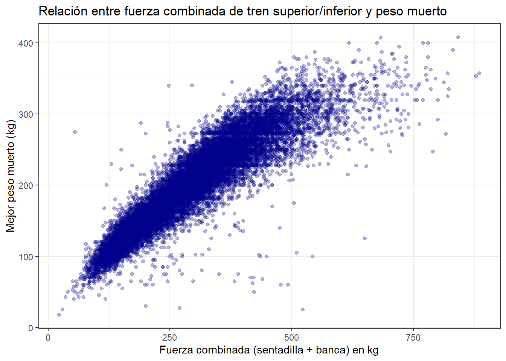

Se observa una tendencia fuertemente creciente, con los puntos muy pegados a la línea de tendencia — mucho menos dispersos que en el gráfico anterior de BodyweightKg.

### Supuesto de normalidad 


``` r
ks.test(df_nuevo$upper_lower_total, "pnorm", mean = mean(df_nuevo$upper_lower_total), 
        sd = sd(df_nuevo$upper_lower_total))
```

```
## Warning in ks.test.default(df_nuevo$upper_lower_total, "pnorm", mean = mean(df_nuevo$upper_lower_total), : ties should not
## be present for the one-sample Kolmogorov-Smirnov test
```

```
## 
## 	Asymptotic one-sample Kolmogorov-Smirnov test
## 
## data:  df_nuevo$upper_lower_total
## D = 0.04925, p-value < 0.00000000000000022
## alternative hypothesis: two-sided
```

``` r
ks.test(df_nuevo$BestDeadliftKg, "pnorm", mean = mean(df_nuevo$BestDeadliftKg), 
        sd = sd(df_nuevo$BestDeadliftKg))
```

```
## Warning in ks.test.default(df_nuevo$BestDeadliftKg, "pnorm", mean = mean(df_nuevo$BestDeadliftKg), : ties should not be
## present for the one-sample Kolmogorov-Smirnov test
```

```
## 
## 	Asymptotic one-sample Kolmogorov-Smirnov test
## 
## data:  df_nuevo$BestDeadliftKg
## D = 0.058352, p-value < 0.00000000000000022
## alternative hypothesis: two-sided
```

Comparando sus distribuciones contra una distribución normal con la misma media y desviación estándar de los datos, en ambos casos se obtuvo un valor p considerablemente menor a 0.05, por lo que se rechaza la hipótesis nula de normalidad para las dos variables. Por esta razon es necesario optar por el método de Spearman 

### Coeficiente de correlación de Spearman


$$
H_0: ρs= 0 \quad \text{ (no hay relación monótona) vs } 
$$
$$
\quad H_1: ρs \neq 0 \text { (existe relación monótona)}
$$


``` r
cor.test(df_nuevo$upper_lower_total, df_nuevo$BestDeadliftKg, method = "spearman")
```

```
## Warning in cor.test.default(df_nuevo$upper_lower_total, df_nuevo$BestDeadliftKg, : cannot compute exact p-value with ties
```

```
## 
## 	Spearman's rank correlation rho
## 
## data:  df_nuevo$upper_lower_total and df_nuevo$BestDeadliftKg
## S = 76417254693, p-value < 0.00000000000000022
## alternative hypothesis: true rho is not equal to 0
## sample estimates:
##       rho 
## 0.9320863
```
El análisis de correlación de Spearman entre la fuerza combinada de tren superior e inferior (upper_lower_total) y el peso muerto máximo alcanzado (BestDeadliftKg) mostró un coeficiente ρ=0.9321, lo que indica una correlación positiva muy alta; es decir, a mayor fuerza combinada de sentadilla y press de banca, mayor es el peso muerto máximo levantado. La prueba de significancia (S=76,417,254,693, p-valor<0.001) permitió rechazar la hipótesis nula de ausencia de correlación, confirmando que la relación observada es estadísticamente significativa. Este resultado es más fuerte que el obtenido con BodyweightKg (ρ=0.6701), es coherente con la naturaleza de la variable upper_lower_total, ya que al combinar dos levantamientos que miden capacidades de fuerza muy parecidas a las del peso muerto, es esperable una asociación más estrecha con la variable respuesta.


# Regresión Lineal Simple

La regresión lineal simple (RLS) es un método estadístico que permite estudiar y cuantificar la relación lineal entre una variable explicativa y una variable respuesta mediante el método de mínimos cuadrados ordinarios. En este proyecto se aplica la regresión lineal simple para analizar cómo se relaciona la fuerza combinada de sentadilla y press de banca, considerada como variable explicativa $x$, con el mejor levantamiento en peso muerto, considerado como variable respuesta $y$.

**¿Existe una relación lineal estadísticamente significativa entre la fuerza combinada de sentadilla y press de banca y el mejor levantamiento en peso muerto de los atletas de powerlifting?**


El objetivo principal es determinar la dirección, magnitud y significancia estadística de esta relación, identificando si un aumento en la fuerza combinada está asociado con un incremento en el rendimiento en peso muerto.

## Recapitulando los valores obtenidos:


``` r
# Variables seleccionadas

datos_rls <- df_nuevo %>%
  select(upper_lower_total, BestDeadliftKg)

# Número de observaciones
nrow(datos_rls)
```

```
## [1] 18900
```

``` r
# Correlación lineal de Pearson
cor(datos_rls$upper_lower_total,
    datos_rls$BestDeadliftKg,
    method = "pearson")
```

```
## [1] 0.912459
```

``` r
# Diagrama de dispersión con recta de regresión
ggplot(datos_rls,
       aes(x = upper_lower_total,
           y = BestDeadliftKg)) +
  geom_point(alpha = 0.2, color = "darkblue") +
  labs(
    title = "Fuerza combinada vs. peso muerto",
    x = "Sentadilla + press de banca (kg)",
    y = "Mejor peso muerto (kg)"
  ) +
  theme_bw()
```

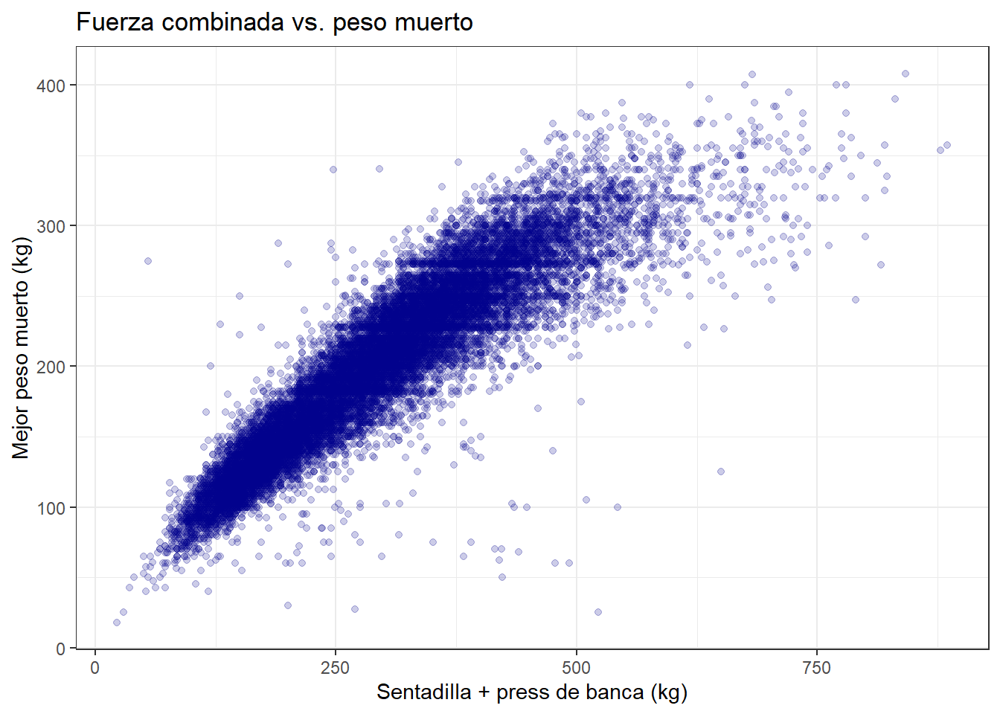

El coeficiente de correlación lineal de Pearson entre la fuerza combinada de sentadilla y press de banca y el mejor levantamiento en peso muerto fue de $r=0.912)$, lo que indica una relación lineal positiva y fuerte entre ambas variables.

Esto significa que los atletas con mayores registros de fuerza combinada tienden a alcanzar mayores marcas en peso muerto.

El diagrama de dispersión muestra una tendencia creciente.

## Estimación de minimos cuadrados


``` r
# Seleccionar las variables
datos_rls <- df_nuevo %>%
  select(upper_lower_total, BestDeadliftKg) %>%
  filter(is.finite(upper_lower_total),
         is.finite(BestDeadliftKg))

X <- datos_rls$upper_lower_total
Y <- datos_rls$BestDeadliftKg
n <- length(Y)

# 2. Calcular las medias
x_bar <- mean(X)
y_bar <- mean(Y)

# 3. Calcular Sxx y Sxy
Sxx <- sum((X - x_bar)^2)
Sxy <- sum((X - x_bar) * (Y - y_bar))

# 4. Estimar los coeficientes
beta1 <- Sxy / Sxx
beta0 <- y_bar - beta1 * x_bar

# 5. Ajustar el modelo con lm()
modelo_rls <- lm(
  BestDeadliftKg ~ upper_lower_total,
  data = datos_rls
)

# 6. Presentar resultados en tabla
tabla_parametros <- data.frame(
  Parametro = c("Intercepto (beta_0)",
                "Pendiente (beta_1)"),
  Estimacion = c(beta0, beta1)
)

knitr::kable(
  format= "html",
  tabla_parametros,
  digits = 4,
  row.names = FALSE
) %>%
  kableExtra::kable_styling(
    bootstrap_options = c("striped", "hover"),
    full_width = FALSE
  )
```

<table class="table table-striped table-hover" style="color: black; width: auto !important; margin-left: auto; margin-right: auto;">
 <thead>
  <tr>
   <th style="text-align:left;"> Parametro </th>
   <th style="text-align:right;"> Estimacion </th>
  </tr>
 </thead>
<tbody>
  <tr>
   <td style="text-align:left;"> Intercepto (beta_0) </td>
   <td style="text-align:right;"> 58.1713 </td>
  </tr>
  <tr>
   <td style="text-align:left;"> Pendiente (beta_1) </td>
   <td style="text-align:right;"> 0.4827 </td>
  </tr>
</tbody>
</table>

El modelo ajustado es:
$$ \hat y_i = 58.1713+0.4827x_i $$

El intercepto estimado es $\hat{\beta}_0=58.1713$, lo que indica que cuando la fuerza combinada de sentadilla y press de banca es igual a cero, el valor esperado del mejor levantamiento en peso muerto es de 58.1713 kg.

Sin embargo, dado que este valor de fuerza combinada se encuentra fuera del rango observado, el intercepto no tiene una interpretación practica real en el contexto del estudio.

La pendiente estimada es $\hat{\beta}_1=0.4827$, lo que indica que, por cada kilogramo adicional en la fuerza combinada de sentadilla y press de banca, se espera que el mejor levantamiento en peso muerto aumente aproximadamente 0.4827 kg, según el modelo de regresión lineal simple ajustado.


## Estimación de la varianza

``` r
## estimación de sigma
S2=summary(modelo_rls)$sigma

# 1. Valores ajustados
Y_hat <- fitted(modelo_rls)

# 2. Residuos
e <- residuals(modelo_rls)

# 3. Suma de cuadrados de los errores
SSE <- sum(e^2)

# 4. Grados de libertad
gl <- n - 2

# 5. Estimación de la varianza
MSE <- SSE / gl

# 6. Error estándar de la regresión
RSE <- sqrt(MSE)

# 7. Tabla de resultados
tabla_varianza <- data.frame(
  Estadistico = c("SSE", "MSE", "RSE"),
  Valor = c(SSE, MSE, RSE)
)

knitr::kable(
  format= "html",
  tabla_varianza,
  digits = 4,
  row.names = FALSE
) %>%
  kableExtra::kable_styling(
    bootstrap_options = c("striped", "hover"),
    full_width = FALSE
  )
```

<table class="table table-striped table-hover" style="color: black; width: auto !important; margin-left: auto; margin-right: auto;">
 <thead>
  <tr>
   <th style="text-align:left;"> Estadistico </th>
   <th style="text-align:right;"> Valor </th>
  </tr>
 </thead>
<tbody>
  <tr>
   <td style="text-align:left;"> SSE </td>
   <td style="text-align:right;"> 12230012.7309 </td>
  </tr>
  <tr>
   <td style="text-align:left;"> MSE </td>
   <td style="text-align:right;"> 647.1591 </td>
  </tr>
  <tr>
   <td style="text-align:left;"> RSE </td>
   <td style="text-align:right;"> 25.4393 </td>
  </tr>
</tbody>
</table>

El cuadrado medio residual obtenido fue $MSE=647.1591$, que corresponde a la estimación de la varianza de los errores del modelo de regresión lineal simple.Por otra parte, se obtuvo un error estándar de la regresión de $RSE=25.4393$ kg, el cual representa una estimación de la desviación estándar de los errores del  delo.

Este último resultado se expresa en kilogramos, las mismas unidades de la variable respuesta `BestDeadliftKg`.


## Coeficiente de determinacion


``` r
# PASO 4.3: COEFICIENTE DE DETERMINACIÓN

# 1. Suma total de cuadrados
SST <- sum((Y - y_bar)^2)

# 2. Suma de cuadrados de regresión
SSR <- SST - SSE

# 3. Coeficiente de determinación
R2 <- SSR / SST

# 4. Verificar el resultado usando lm()
R2_lm <- summary(modelo_rls)$r.squared

# 5. Mostrar resultados en tabla
tabla_ajuste <- data.frame(
  Estadistico = c(
    "SST",
    "SSR",
    "SSE",
    "R cuadrado",
    "R cuadrado con lm"
  ),
  Valor = c(
    SST,
    SSR,
    SSE,
    R2,
    R2_lm
  )
)

knitr::kable(
  format= "html",
  tabla_ajuste,
  digits = 4,
  row.names = FALSE
) %>%
  kableExtra::kable_styling(
    bootstrap_options = c("striped", "hover"),
    full_width = FALSE
  )
```

<table class="table table-striped table-hover" style="color: black; width: auto !important; margin-left: auto; margin-right: auto;">
 <thead>
  <tr>
   <th style="text-align:left;"> Estadistico </th>
   <th style="text-align:right;"> Valor </th>
  </tr>
 </thead>
<tbody>
  <tr>
   <td style="text-align:left;"> SST </td>
   <td style="text-align:right;"> 73050523.0029 </td>
  </tr>
  <tr>
   <td style="text-align:left;"> SSR </td>
   <td style="text-align:right;"> 60820510.2720 </td>
  </tr>
  <tr>
   <td style="text-align:left;"> SSE </td>
   <td style="text-align:right;"> 12230012.7309 </td>
  </tr>
  <tr>
   <td style="text-align:left;"> R cuadrado </td>
   <td style="text-align:right;"> 0.8326 </td>
  </tr>
  <tr>
   <td style="text-align:left;"> R cuadrado con lm </td>
   <td style="text-align:right;"> 0.8326 </td>
  </tr>
</tbody>
</table>

El coeficiente de determinación obtenido fue $R^2=0.8326$, lo que indica que aproximadamente el 83.26 % de la variabilidad observada en el mejor levantamiento en peso muerto (`BestDeadliftKg`) es explicada por el modelo de regresión lineal simple que utiliza la fuerza combinada de sentadilla y press de banca (`upper_lower_total`) como variable explicativa. Esto implica que el 16.74 % restante de la variabilidad no es explicado por el modelo ajustado.

Este resultado demuestra que el modelo explica una proporción elevada de la variabilidad de la variable respuesta.


## Intervalos de confianza para el modelo de regresión lineal simple

### Intervalo de confianza para la pendiente beta_1:


``` r
# Nivel de significancia
alpha_ic <- 0.05

# Información del modelo
n_ic <- nobs(modelo_rls)
gl_ic <- df.residual(modelo_rls)

x_ic <- model.frame(modelo_rls)$upper_lower_total
x_bar_ic <- mean(x_ic)

Sxx_ic <- sum((x_ic - x_bar_ic)^2)

# Estimación de sigma cuadrado
sigma2_ic <- sum(resid(modelo_rls)^2) / gl_ic

# Valor crítico t
t_crit_ic <- qt(1 - alpha_ic/2, df = gl_ic)

# Estimación de la pendiente
b1_ic <- unname(coef(modelo_rls)[2])

# Error estándar de beta1
se_b1_ic <- sqrt(sigma2_ic / Sxx_ic)

# Límites del intervalo
LI_b1 <- b1_ic - t_crit_ic * se_b1_ic
LS_b1 <- b1_ic + t_crit_ic * se_b1_ic

# Tabla de resultados
tabla_ic_b1 <- data.frame(
  "Parámetro" = "Pendiente (beta1)",
  "Estimación" = b1_ic,
  "Error estándar" = se_b1_ic,
  "Límite inferior" = LI_b1,
  "Límite superior" = LS_b1,
  check.names = FALSE
)

knitr::kable(
  format= "html",
  tabla_ic_b1,
  digits = 4,
  row.names = FALSE
) %>%
  kableExtra::kable_styling(
    bootstrap_options = c("striped", "hover"),
    full_width = FALSE
  )
```

<table class="table table-striped table-hover" style="color: black; width: auto !important; margin-left: auto; margin-right: auto;">
 <thead>
  <tr>
   <th style="text-align:left;"> Parámetro </th>
   <th style="text-align:right;"> Estimación </th>
   <th style="text-align:right;"> Error estándar </th>
   <th style="text-align:right;"> Límite inferior </th>
   <th style="text-align:right;"> Límite superior </th>
  </tr>
 </thead>
<tbody>
  <tr>
   <td style="text-align:left;"> Pendiente (beta1) </td>
   <td style="text-align:right;"> 0.4827 </td>
   <td style="text-align:right;"> 0.0016 </td>
   <td style="text-align:right;"> 0.4796 </td>
   <td style="text-align:right;"> 0.4858 </td>
  </tr>
</tbody>
</table>

El intervalo de confianza del 95 % para la pendiente es:
$$
{\beta_1\in(0.4796,\ 0.4858)}
$$

Como ambos límites son positivos y el intervalo no contiene el valor cero, el procedimiento indica que la pendiente es estadísticamente diferente de cero.

### Intervalo de confianza para el intercepto beta_0:


``` r
b0_ic <- unname(coef(modelo_rls)[1])

# Error estándar del intercepto
se_b0_ic <- sqrt(
  sigma2_ic * (1/n_ic + x_bar_ic^2/Sxx_ic)
)

# Límites del intervalo
LI_b0 <- b0_ic - t_crit_ic * se_b0_ic
LS_b0 <- b0_ic + t_crit_ic * se_b0_ic

# Tabla de resultados
tabla_ic_b0 <- data.frame(
  "Parámetro" = "Intercepto (beta0)",
  "Estimación" = b0_ic,
  "Error estándar" = se_b0_ic,
  "Límite inferior" = LI_b0,
  "Límite superior" = LS_b0,
  check.names = FALSE
)

knitr::kable(
  format= "html",
  tabla_ic_b0,
  digits = 4,
  row.names = FALSE
) %>%
  kableExtra::kable_styling(
    bootstrap_options = c("striped", "hover"),
    full_width = FALSE
  )
```

<table class="table table-striped table-hover" style="color: black; width: auto !important; margin-left: auto; margin-right: auto;">
 <thead>
  <tr>
   <th style="text-align:left;"> Parámetro </th>
   <th style="text-align:right;"> Estimación </th>
   <th style="text-align:right;"> Error estándar </th>
   <th style="text-align:right;"> Límite inferior </th>
   <th style="text-align:right;"> Límite superior </th>
  </tr>
 </thead>
<tbody>
  <tr>
   <td style="text-align:left;"> Intercepto (beta0) </td>
   <td style="text-align:right;"> 58.1713 </td>
   <td style="text-align:right;"> 0.5017 </td>
   <td style="text-align:right;"> 57.1879 </td>
   <td style="text-align:right;"> 59.1546 </td>
  </tr>
</tbody>
</table>


El intervalo obtenido es:
$${\beta_0\in(57.1879,\ 59.1546)}$$

Como el intervalo no contiene el cero, el procedimiento indica que el intercepto es significativamente diferente de cero.

Sin embargo, no podemos darle una interpretación práctica directa, porque una fuerza combinada de cero kilogramos no se encuentra dentro del rango observado en nuestro estudio.


## Intervalo de confianza para sigma^2


``` r
alpha <- 0.05
n <- nobs(modelo_rls)

sigma <- summary(modelo_rls)$sigma

gl <- n - 2

lim_inf <- gl * sigma^2 / qchisq(1-alpha/2, gl)

lim_sup <- gl * sigma^2 / qchisq(alpha/2, gl)

# Tabla de resultados
tabla_ic_sigma2 <- data.frame(
  lim_inf = lim_inf,
  sigma2_hat = sigma^2,
  lim_sup = lim_sup
)

knitr::kable(
  format= "html",
  tabla_ic_sigma2,
  digits = 4,
  row.names = FALSE
) %>%
  kableExtra::kable_styling(
    bootstrap_options = c("striped", "hover"),
    full_width = FALSE
  )
```

<table class="table table-striped table-hover" style="color: black; width: auto !important; margin-left: auto; margin-right: auto;">
 <thead>
  <tr>
   <th style="text-align:right;"> lim_inf </th>
   <th style="text-align:right;"> sigma2_hat </th>
   <th style="text-align:right;"> lim_sup </th>
  </tr>
 </thead>
<tbody>
  <tr>
   <td style="text-align:right;"> 634.3061 </td>
   <td style="text-align:right;"> 647.1591 </td>
   <td style="text-align:right;"> 660.4086 </td>
  </tr>
</tbody>
</table>


El resultado es:
$${\sigma^2\in(634.3061,\ 660.4086)}$$

Esto significa que, con una confianza del 95 %, estimamos que la varianza poblacional de los errores se encuentra entre 634.3061 y 660.4086 kg², bajo los supuestos de la regresión lineal simple.

## Pruebas de hipótesis

### Prueba de hipótesis para beta1

$$
H_0: \beta_1 = 0\\
H_1: \beta_1 \neq 0
$$

``` r
alpha <- 0.05
n <- nobs(modelo_rls)

# Variable explicativa utilizada
x <- model.frame(modelo_rls)$upper_lower_total
x_bar <- mean(x)

# Sxx
Sxx <- sum((x - x_bar)^2)

# Pendiente
b1 <- unname(coef(modelo_rls)[2])

# Estimación de sigma
sigma_hat <- summary(modelo_rls)$sigma

# Varianza y error estándar de beta1
var_b1 <- sigma_hat^2 / Sxx
se_b1 <- sqrt(var_b1)

# H0: beta1 = 0 vs H1: beta1 != 0
t_calc <- (b1 - 0) / se_b1
gl <- n - 2

# Valor p bilateral
p_valor <- 2 * pt(-abs(t_calc), df = gl)

# Tabla de resultados
resultados_b1 <- data.frame(
  beta1_hat = b1,
  se_beta1 = se_b1,
  estadistico_t = t_calc,
  gl = gl,
  p_value = format.pval(p_valor, digits = 4)
)

knitr::kable(
  format= "html",
  resultados_b1,
  digits = 4,
  row.names = FALSE
) %>%
  kableExtra::kable_styling(
    bootstrap_options = c("striped", "hover"),
    full_width = FALSE
  )
```

<table class="table table-striped table-hover" style="color: black; width: auto !important; margin-left: auto; margin-right: auto;">
 <thead>
  <tr>
   <th style="text-align:right;"> beta1_hat </th>
   <th style="text-align:right;"> se_beta1 </th>
   <th style="text-align:right;"> estadistico_t </th>
   <th style="text-align:right;"> gl </th>
   <th style="text-align:left;"> p_value </th>
  </tr>
 </thead>
<tbody>
  <tr>
   <td style="text-align:right;"> 0.4827 </td>
   <td style="text-align:right;"> 0.0016 </td>
   <td style="text-align:right;"> 306.5628 </td>
   <td style="text-align:right;"> 18898 </td>
   <td style="text-align:left;"> &lt; 0.00000000000000022 </td>
  </tr>
</tbody>
</table>

Se realizó una prueba de hipótesis bilateral para determinar si la pendiente del modelo de regresión lineal simple es significativamente diferente de cero. Se obtuvo un estadístico $t=306.5628$, con 18898 grados de libertad y un valor $p<0.001$. Dado que el valor p es menor que el nivel de significancia $\alpha=0.05$, se rechaza la hipótesis nula $H_0:\beta_1=0$.

Por lo tanto, existe evidencia estadísticamente significativa de una relación lineal entre la fuerza combinada de sentadilla y press de banca y el mejor levantamiento en peso muerto. Además, como la pendiente estimada es positiva ($\hat{\beta}_1=0.4827$), se concluye que, según el modelo ajustado, mayores valores de fuerza combinada están asociados con mayores valores esperados de peso muerto.


### Prueba de hipótesis para beta0:

$$
H_0: \beta_0 = 0 \\
H_1: \beta_0 \neq 0
$$


``` r
b0 <- unname(coef(modelo_rls)[1])

# Varianza y error estándar de beta0
var_b0 <- sigma_hat^2 * (1/n + x_bar^2/Sxx)
se_b0 <- sqrt(var_b0)

# H0: beta0 = 0 vs H1: beta0 != 0
t_calc <- (b0 - 0) / se_b0
gl <- n - 2

# Valor p bilateral
p_valor <- 2 * pt(-abs(t_calc), df = gl)

# Tabla de resultados
resultados_b0 <- data.frame(
  beta0_hat = b0,
  se_beta0 = se_b0,
  estadistico_t = t_calc,
  gl = gl,
  p_value = format.pval(p_valor, digits = 4)
)

knitr::kable(
  format= "html",
  resultados_b0,
  digits = 4,
  row.names = FALSE
) %>%
  kableExtra::kable_styling(
    bootstrap_options = c("striped", "hover"),
    full_width = FALSE
  )
```

<table class="table table-striped table-hover" style="color: black; width: auto !important; margin-left: auto; margin-right: auto;">
 <thead>
  <tr>
   <th style="text-align:right;"> beta0_hat </th>
   <th style="text-align:right;"> se_beta0 </th>
   <th style="text-align:right;"> estadistico_t </th>
   <th style="text-align:right;"> gl </th>
   <th style="text-align:left;"> p_value </th>
  </tr>
 </thead>
<tbody>
  <tr>
   <td style="text-align:right;"> 58.1713 </td>
   <td style="text-align:right;"> 0.5017 </td>
   <td style="text-align:right;"> 115.9534 </td>
   <td style="text-align:right;"> 18898 </td>
   <td style="text-align:left;"> &lt; 0.00000000000000022 </td>
  </tr>
</tbody>
</table>

Se realizó una prueba de hipótesis bilateral para determinar si el intercepto del modelo de regresión lineal simple es significativamente diferente de cero.Se obtuvo un estadístico $t=115.9534$, con 18898 grados de libertad y un valor $p<0.001$. Como el valor p es menor que el nivel de significancia $\alpha=0.05$, se rechaza la hipótesis nula $H_0:\beta_0=0$.

Por lo tanto, existe evidencia estadísticamente significativa de que el intercepto poblacional es diferente de cero.


### Prueba de hipótesis para sigma^2

$$
H_0: \sigma^2 = \sigma_0^2\\
H_1: \sigma^2 \neq \sigma_0^2
$$

Para la varianza de los errores del modelo se obtuvo una estimación de $\hat{\sigma}^2=647.1591$ kg² y un intervalo de confianza del 95 % de $(634.3061,\ 660.4086)$ kg². No se realizó una prueba de hipótesis para este parámetro, debido a que no se cuenra con un valor de referencia $\sigma_0^2$ previamente establecido que permita formular una hipótesis nula realmente fundamentada.

En consecuencia, se presenta la estimación de la varianza y su intervalo de confianza, sujetos al cumplimiento de los supuestos del modelo de regresión lineal simple.


# Análisis de los errores

Para evaluar la adecuación del modelo de regresión lineal simple se analizan los supuestos de independencia, normalidad, media cero y varianza constante de los errores


``` r
r <- residuals(modelo_rls)
alpha <- 0.05
n <- nobs(modelo_rls)

# Tabla resumen de los residuales
resumen_residuales <- data.frame(
  "Observaciones" = n,
  "Media residual" = mean(r),
  "Desviación residual" = sd(r),
  "Mínimo" = min(r),
  "Máximo" = max(r),
  check.names = FALSE
)
knitr::kable(resumen_residuales, digits=4, row.names=FALSE, format= "html") %>%
  kableExtra::kable_styling(
    bootstrap_options = c("striped", "hover"),
    full_width = FALSE
  )
```

<table class="table table-striped table-hover" style="color: black; width: auto !important; margin-left: auto; margin-right: auto;">
 <thead>
  <tr>
   <th style="text-align:right;"> Observaciones </th>
   <th style="text-align:right;"> Media residual </th>
   <th style="text-align:right;"> Desviación residual </th>
   <th style="text-align:right;"> Mínimo </th>
   <th style="text-align:right;"> Máximo </th>
  </tr>
 </thead>
<tbody>
  <tr>
   <td style="text-align:right;"> 18900 </td>
   <td style="text-align:right;"> 0 </td>
   <td style="text-align:right;"> 25.4386 </td>
   <td style="text-align:right;"> -285.3994 </td>
   <td style="text-align:right;"> 190.2784 </td>
  </tr>
</tbody>
</table>

## Supuestos de los errores

El modelo supone que los errores son independientes, siguen una distribución normal con media cero y presentan varianza constante.

### Independencia de los errores


$$
H_0: \rho=0\\
H_1: \rho\neq0
$$


``` r
df_resid <- data.frame(
  Orden = seq_along(r),
  Residuales = r
)

ggplot(df_resid, aes(x=Orden, y=Residuales)) +
  geom_point(color="blue", alpha=0.35, size=0.6) +
  geom_hline(yintercept=0, linetype="dashed", color="black") +
  labs(title="Residuales vs orden de registro",
       x="Orden de las observaciones (no necesariamente temporal)",
       y="Residuales (kg)") +
  theme_bw()
```

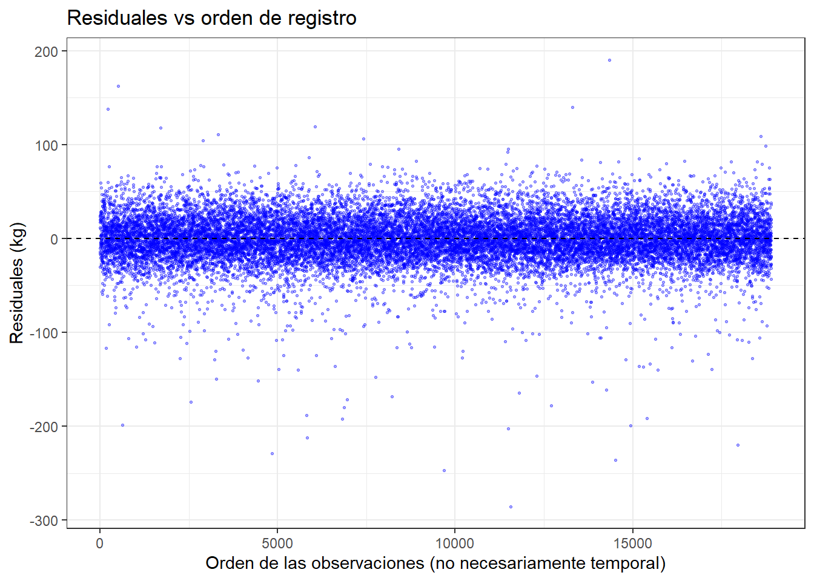


``` r
dw <- car::durbinWatsonTest(modelo_rls, simulate=FALSE)
dw_est <- as.numeric(dw$dw[1])
dw_p <- if (is.null(dw$p)) NA_real_ else as.numeric(dw$p[1])

tabla_dw <- data.frame(
  "Estadístico Durbin-Watson" = dw_est,
  "Valor p" = if (is.na(dw_p)) "No disponible" else
    format.pval(dw_p, digits=4, eps=0.001),
  check.names=FALSE
)
knitr::kable(tabla_dw, digits=4, row.names=FALSE, format= "html") %>%
  kableExtra::kable_styling(
    bootstrap_options = c("striped", "hover"),
    full_width = FALSE
  )
```

<table class="table table-striped table-hover" style="color: black; width: auto !important; margin-left: auto; margin-right: auto;">
 <thead>
  <tr>
   <th style="text-align:right;"> Estadístico Durbin-Watson </th>
   <th style="text-align:left;"> Valor p </th>
  </tr>
 </thead>
<tbody>
  <tr>
   <td style="text-align:right;"> 1.996 </td>
   <td style="text-align:left;"> No disponible </td>
  </tr>
</tbody>
</table>

Se obtuvo un estadístico de Durbin-Watson aproximadamente igual a 1.996, cercano al valor de referencia 2, que en observaciones ordenadas temporalmente sería compatible con la ausencia de autocorrelación de primer orden.Sin embargo, los datos del proyecto corresponden a registros de levantamientos de powerlifting y no constituyen una serie temporal con un orden cronológico definido. Por consiguiente, el resultado de Durbin-Watson no permite establecer la independencia de los errores. En este contexto, la independencia debe analizarse principalmente a partir de la estructura de los datos y del proceso de recolección, considerando especialmente la posible presencia de registros de un mismo atleta en diferentes competencias.

Por lo tanto, con la información disponible, no es posible confirmar que se cumple el supuesto de independencia.

## Normalidad de los errores


$$
H_0: \varepsilon_i \sim N(0,\sigma^2)\\
H_1: \varepsilon_i \not\sim N(0,\sigma^2)
$$


``` r
prueba_lillie <- lillie.test(r)

tabla_lillie <- data.frame(
  "Observaciones" = length(r),
  "Estadístico D" = unname(prueba_lillie$statistic),
  "Valor p" = format.pval(prueba_lillie$p.value, digits=4, eps=0.001),
  "Decisión" = if (prueba_lillie$p.value < alpha) "Rechazar H0" else "No rechazar H0",
  check.names=FALSE
)
knitr::kable(
  format= "html",
  tabla_lillie,
  digits=4,
  row.names=FALSE
) %>%
  kableExtra::kable_styling(
    bootstrap_options=c("striped", "hover"),
    full_width=FALSE
  )
```

<table class="table table-striped table-hover" style="color: black; width: auto !important; margin-left: auto; margin-right: auto;">
 <thead>
  <tr>
   <th style="text-align:right;"> Observaciones </th>
   <th style="text-align:right;"> Estadístico D </th>
   <th style="text-align:left;"> Valor p </th>
   <th style="text-align:left;"> Decisión </th>
  </tr>
 </thead>
<tbody>
  <tr>
   <td style="text-align:right;"> 18900 </td>
   <td style="text-align:right;"> 0.0444 </td>
   <td style="text-align:left;"> &lt; 0.001 </td>
   <td style="text-align:left;"> Rechazar H0 </td>
  </tr>
</tbody>
</table>


``` r
qqnorm(r, main="Gráfico Q-Q de los residuales", cex=0.45, pch=16)
qqline(r, col="blue", lwd=2)
```

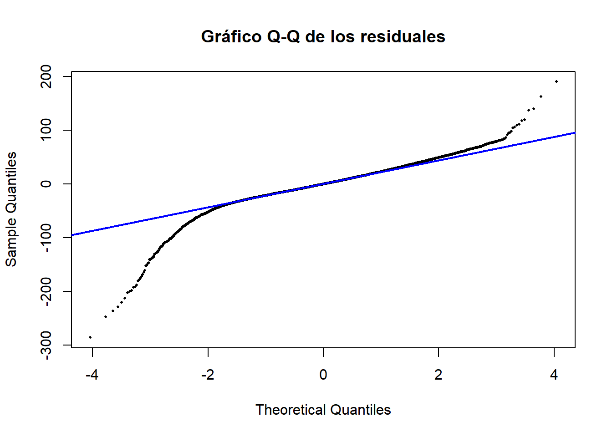

La prueba de Lilliefors (Kolmogorov-Smirnov corregida), aplicada a los residuos del modelo, arrojó un valor p menor que 0.05, por lo tanto, se rechaza la hipótesis nula: existe evidencia de desviación respecto a la normalidad. En el gráfico Q-Q, las desviaciones de los puntos respecto a la recta de referencia, especialmente en las colas, permiten evaluar la importancia visual de esta falta de normalidad. Con un tamaño muestral tan elevado, una prueba formal puede ser sensible a desviaciones pequeñas.

## Media cero de los errores

$$
H_0: \mu_{\varepsilon}=0\\
H_1: \mu_{\varepsilon}\neq0
$$

``` r
media_res <- mean(r)

prueba_media <- t.test(r, mu=0)

tabla_media <- data.frame(
  "Media de residuales" = media_res,
  "Estadístico t" = unname(prueba_media$statistic),
  "Valor p" = format.pval(prueba_media$p.value, digits=4),
  check.names=FALSE
)
knitr::kable(tabla_media, digits=8, row.names=FALSE, format= "html") %>%
  kableExtra::kable_styling(
    bootstrap_options = c("striped", "hover"),
    full_width = FALSE
  )
```

<table class="table table-striped table-hover" style="color: black; width: auto !important; margin-left: auto; margin-right: auto;">
 <thead>
  <tr>
   <th style="text-align:right;"> Media de residuales </th>
   <th style="text-align:right;"> Estadístico t </th>
   <th style="text-align:left;"> Valor p </th>
  </tr>
 </thead>
<tbody>
  <tr>
   <td style="text-align:right;"> 0 </td>
   <td style="text-align:right;"> 0 </td>
   <td style="text-align:left;"> 1 </td>
  </tr>
</tbody>
</table>

La media muestral de los residuales fue aproximadamente 0.

## Varianza constante de los errores (homocedasticidad)

$$
H_0: \sigma^2\ \text{es constante}\\
H_1: \sigma^2\ \text{no es constante}
$$


``` r
# Residuales frente a valores ajustados (gráfico del profesor)
diag_df <- data.frame(
  Ajustados = fitted(modelo_rls),
  Residuales = resid(modelo_rls),
  ResStd = rstandard(modelo_rls)
)

ggplot(diag_df, aes(x=Ajustados, y=Residuales)) +
  geom_point(size=0.6, alpha=0.3) +
  geom_hline(yintercept=0, linetype="dashed") +
  geom_smooth(method="loess", se=FALSE, span=0.9, color="blue") +
  labs(title="Residuales vs valores ajustados",
       x="Valores ajustados de peso muerto (kg)",
       y="Residuales (kg)") +
  theme_bw()
```

```
## `geom_smooth()` using formula = 'y ~ x'
```

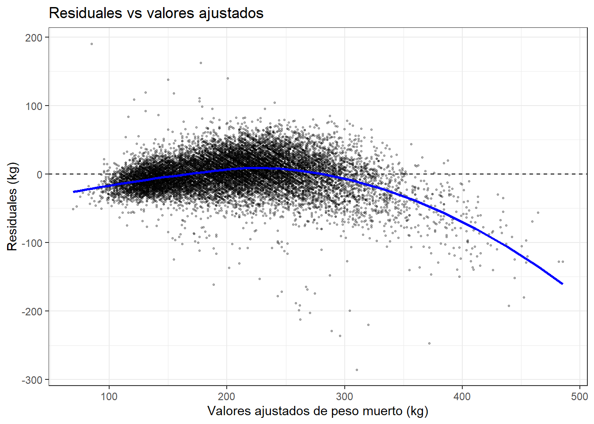


``` r
bp <- lmtest::bptest(modelo_rls)

tabla_bp <- data.frame(
  "Prueba" = c("Breusch-Pagan (lmtest)"),
  "Estadístico" = c(unname(bp$statistic)),
  "Grados de libertad" = c(unname(bp$parameter)),
  "Valor p" = c(format.pval(bp$p.value, digits=4, eps=0.001)),
  check.names=FALSE
)
knitr::kable(tabla_bp, digits=4, row.names=FALSE, format= "html") %>%
  kableExtra::kable_styling(
    bootstrap_options = c("striped", "hover"),
    full_width = FALSE
  )
```

<table class="table table-striped table-hover" style="color: black; width: auto !important; margin-left: auto; margin-right: auto;">
 <thead>
  <tr>
   <th style="text-align:left;"> Prueba </th>
   <th style="text-align:right;"> Estadístico </th>
   <th style="text-align:right;"> Grados de libertad </th>
   <th style="text-align:left;"> Valor p </th>
  </tr>
 </thead>
<tbody>
  <tr>
   <td style="text-align:left;"> Breusch-Pagan (lmtest) </td>
   <td style="text-align:right;"> 1054.205 </td>
   <td style="text-align:right;"> 1 </td>
   <td style="text-align:left;"> &lt; 0.001 </td>
  </tr>
</tbody>
</table>

La prueba de Breusch-Pagan presentó un valor p inferior a 0.001. Dado que este valor es menor que el nivel de significancia de 0.05, se rechaza la hipótesis nula de varianza constante. Por tanto, existe evidencia estadísticamente significativa de heterocedasticidad en los errores del modelo de regresión lineal simple. Esto indica que la variabilidad de los errores no permanece constante y representa una limitación para la inferencia estadística clásica.


# Transformaciones para mejorar el ajuste del modelo

Con el propósito de mejorar el ajuste de la regresión lineal simple, se decidió aplicar una transformación de raíz cuadrada a la variable explicativa (X), correspondiente a la fuerza combinada de sentadilla y press de banca. De esta manera, el nuevo modelo se expresa como:

$$
y_i=\beta_0+\beta_1\sqrt{x_i}+\varepsilon_i
$$

El modelo original presentó un coeficiente de determinación de (R^2=0.8326) y un error estándar residual de 25.4393 kg. Aunque estos resultados indican una elevada capacidad explicativa, el análisis de residuos reveló problemas de normalidad y heterocedasticidad, lo que limita la validez de la inferencia estadística clásica, por lo tanto, pasaremos a aplicar transformación. 


<table class="table table-striped table-hover" style="color: black; width: auto !important; margin-left: auto; margin-right: auto;">
 <thead>
  <tr>
   <th style="text-align:left;"> Variable </th>
   <th style="text-align:left;"> Valor </th>
  </tr>
 </thead>
<tbody>
  <tr>
   <td style="text-align:left;"> Modelo </td>
   <td style="text-align:left;"> Y = beta0 + beta1 * sqrt(X) </td>
  </tr>
  <tr>
   <td style="text-align:left;"> Observaciones </td>
   <td style="text-align:left;"> 18900 </td>
  </tr>
  <tr>
   <td style="text-align:left;"> Intercepto (beta0) </td>
   <td style="text-align:left;"> -81.7123 </td>
  </tr>
  <tr>
   <td style="text-align:left;"> Pendiente (beta1) </td>
   <td style="text-align:left;"> 16.7719 </td>
  </tr>
  <tr>
   <td style="text-align:left;"> IC 95% de beta0 </td>
   <td style="text-align:left;"> (-83.4078, -80.0168) </td>
  </tr>
  <tr>
   <td style="text-align:left;"> IC 95% de beta1 </td>
   <td style="text-align:left;"> (16.6733, 16.8704) </td>
  </tr>
  <tr>
   <td style="text-align:left;"> R2 </td>
   <td style="text-align:left;"> 0.8549 </td>
  </tr>
  <tr>
   <td style="text-align:left;"> R2 ajustado </td>
   <td style="text-align:left;"> 0.8549 </td>
  </tr>
  <tr>
   <td style="text-align:left;"> SST </td>
   <td style="text-align:left;"> 73050523.0029 </td>
  </tr>
  <tr>
   <td style="text-align:left;"> SSR </td>
   <td style="text-align:left;"> 62449704.6004 </td>
  </tr>
  <tr>
   <td style="text-align:left;"> SSE </td>
   <td style="text-align:left;"> 10600818.4026 </td>
  </tr>
  <tr>
   <td style="text-align:left;"> MSE </td>
   <td style="text-align:left;"> 560.9492 </td>
  </tr>
  <tr>
   <td style="text-align:left;"> RSE (kg) </td>
   <td style="text-align:left;"> 23.6844 </td>
  </tr>
  <tr>
   <td style="text-align:left;"> IC 95% de sigma^2 </td>
   <td style="text-align:left;"> (549.8084, 572.4337) </td>
  </tr>
  <tr>
   <td style="text-align:left;"> H0 para beta0 </td>
   <td style="text-align:left;"> beta0 = 0 </td>
  </tr>
  <tr>
   <td style="text-align:left;"> H1 para beta0 </td>
   <td style="text-align:left;"> beta0 != 0 </td>
  </tr>
  <tr>
   <td style="text-align:left;"> Estadistico t de beta0 </td>
   <td style="text-align:left;"> -94.4645 </td>
  </tr>
  <tr>
   <td style="text-align:left;"> Valor p de beta0 </td>
   <td style="text-align:left;"> &lt; 0.001 </td>
  </tr>
  <tr>
   <td style="text-align:left;"> Conclusion beta0 </td>
   <td style="text-align:left;"> Se rechaza H0: beta0 es distinto de cero </td>
  </tr>
  <tr>
   <td style="text-align:left;"> H0 para beta1 </td>
   <td style="text-align:left;"> beta1 = 0 </td>
  </tr>
  <tr>
   <td style="text-align:left;"> H1 para beta1 </td>
   <td style="text-align:left;"> beta1 != 0 </td>
  </tr>
  <tr>
   <td style="text-align:left;"> Estadistico t de beta1 </td>
   <td style="text-align:left;"> 333.6594 </td>
  </tr>
  <tr>
   <td style="text-align:left;"> Valor p de beta1 </td>
   <td style="text-align:left;"> &lt; 0.001 </td>
  </tr>
  <tr>
   <td style="text-align:left;"> Conclusion beta1 </td>
   <td style="text-align:left;"> Se rechaza H0: existe asociacion lineal en sqrt(X) </td>
  </tr>
  <tr>
   <td style="text-align:left;"> Estadistico F </td>
   <td style="text-align:left;"> 111328.6232 </td>
  </tr>
  <tr>
   <td style="text-align:left;"> Valor p de F </td>
   <td style="text-align:left;"> &lt; 0.001 </td>
  </tr>
  <tr>
   <td style="text-align:left;"> Conclusion prueba F </td>
   <td style="text-align:left;"> Se rechaza H0: el modelo es significativo </td>
  </tr>
  <tr>
   <td style="text-align:left;"> Error estandar robusto HC3 de beta1 </td>
   <td style="text-align:left;"> 0.0586 </td>
  </tr>
  <tr>
   <td style="text-align:left;"> Valor p robusto de beta1 </td>
   <td style="text-align:left;"> &lt; 0.001 </td>
  </tr>
  <tr>
   <td style="text-align:left;"> IC robusto 95% de beta1 </td>
   <td style="text-align:left;"> (16.6569, 16.8868) </td>
  </tr>
  <tr>
   <td style="text-align:left;"> Conclusion robusta de beta1 </td>
   <td style="text-align:left;"> Existe evidencia de asociacion positiva </td>
  </tr>
  <tr>
   <td style="text-align:left;"> Media residual </td>
   <td style="text-align:left;"> 0.0000 </td>
  </tr>
  <tr>
   <td style="text-align:left;"> Desviacion residual </td>
   <td style="text-align:left;"> 23.6837 </td>
  </tr>
  <tr>
   <td style="text-align:left;"> Residuo minimo </td>
   <td style="text-align:left;"> -276.6635 </td>
  </tr>
  <tr>
   <td style="text-align:left;"> Residuo maximo </td>
   <td style="text-align:left;"> 232.3288 </td>
  </tr>
  <tr>
   <td style="text-align:left;"> Normalidad: prueba </td>
   <td style="text-align:left;"> Lilliefors </td>
  </tr>
  <tr>
   <td style="text-align:left;"> Normalidad: estadistico D </td>
   <td style="text-align:left;"> 0.0430 </td>
  </tr>
  <tr>
   <td style="text-align:left;"> Normalidad: valor p </td>
   <td style="text-align:left;"> &lt; 0.001 </td>
  </tr>
  <tr>
   <td style="text-align:left;"> Normalidad: conclusion </td>
   <td style="text-align:left;"> Se rechaza H0: no hay normalidad </td>
  </tr>
  <tr>
   <td style="text-align:left;"> Homocedasticidad: prueba </td>
   <td style="text-align:left;"> Breusch-Pagan </td>
  </tr>
  <tr>
   <td style="text-align:left;"> Homocedasticidad: estadistico BP </td>
   <td style="text-align:left;"> 520.1488 </td>
  </tr>
  <tr>
   <td style="text-align:left;"> Homocedasticidad: valor p </td>
   <td style="text-align:left;"> &lt; 0.001 </td>
  </tr>
  <tr>
   <td style="text-align:left;"> Homocedasticidad: conclusion </td>
   <td style="text-align:left;"> Se rechaza H0: existe heterocedasticidad </td>
  </tr>
  <tr>
   <td style="text-align:left;"> Media cero: conclusion </td>
   <td style="text-align:left;"> Media residual cercana a cero por construccion </td>
  </tr>
  <tr>
   <td style="text-align:left;"> Independencia: estadistico DW </td>
   <td style="text-align:left;"> 1.9908 </td>
  </tr>
  <tr>
   <td style="text-align:left;"> Independencia: conclusion </td>
   <td style="text-align:left;"> No verificable sin un orden pertinente de las observaciones </td>
  </tr>
</tbody>
</table>


El modelo transformado mediante la raíz cuadrada de la fuerza combinada presentó un coeficiente de determinación de 0.8549, explicando aproximadamente el 85.49 % de la variabilidad observada en el mejor levantamiento en peso muerto. El error estándar residual fue de 23.6844 kg, lo que representa una mejora respecto al modelo original.

La pendiente estimada fue positiva, con un valor aproximado de 16.7719. Su prueba de significancia clásica presentó un valor p inferior a 0.001, por lo que se rechazó la hipótesis nula de que el coeficiente es igual a cero. Esto indica una asociación positiva estadísticamente significativa entre la raíz cuadrada de la fuerza combinada y el rendimiento en peso muerto.

Sin embargo, el análisis de residuos mostró evidencia de falta de normalidad y heterocedasticidad, por lo que no se cumplen todos los supuestos clásicos de regresión. Debido a esto, se complementó la inferencia de la pendiente mediante errores estándar robustos HC3.

En conclusión, se selecciona el modelo con transformación de raíz cuadrada debido a su mayor capacidad explicativa y menor error estándar residual, conservando la variable respuesta en kilogramos. Sin embargo, se reconoce que la transformación no soluciona todos los problemas identificados en los residuos, por lo que sus resultados inferenciales deberán interpretarse con precaución.


# Regresion lineal multiple


## Analisis de multicolinealidad


### Matriz de correlaciones


``` r
correlaciones_rlm <- cor(df_nuevo[, c(
  "Age",
  "BestSquatKg",
  "BestBenchKg",
  "BodyweightKg"
)])

knitr::kable(
  round(correlaciones_rlm, 4), format= "html",
  caption = "Matriz de correlaciones entre predictores"
) %>%
  kableExtra::kable_styling(
    bootstrap_options = c("striped", "hover", "condensed"),
    full_width = FALSE
  )
```

<table class="table table-striped table-hover table-condensed" style="color: black; width: auto !important; margin-left: auto; margin-right: auto;">
<caption>(\#tab:rlm-correlaciones)Matriz de correlaciones entre predictores</caption>
 <thead>
  <tr>
   <th style="text-align:left;">   </th>
   <th style="text-align:right;"> Age </th>
   <th style="text-align:right;"> BestSquatKg </th>
   <th style="text-align:right;"> BestBenchKg </th>
   <th style="text-align:right;"> BodyweightKg </th>
  </tr>
 </thead>
<tbody>
  <tr>
   <td style="text-align:left;"> Age </td>
   <td style="text-align:right;"> 1.0000 </td>
   <td style="text-align:right;"> -0.0310 </td>
   <td style="text-align:right;"> 0.0369 </td>
   <td style="text-align:right;"> 0.1102 </td>
  </tr>
  <tr>
   <td style="text-align:left;"> BestSquatKg </td>
   <td style="text-align:right;"> -0.0310 </td>
   <td style="text-align:right;"> 1.0000 </td>
   <td style="text-align:right;"> 0.9057 </td>
   <td style="text-align:right;"> 0.6473 </td>
  </tr>
  <tr>
   <td style="text-align:left;"> BestBenchKg </td>
   <td style="text-align:right;"> 0.0369 </td>
   <td style="text-align:right;"> 0.9057 </td>
   <td style="text-align:right;"> 1.0000 </td>
   <td style="text-align:right;"> 0.6588 </td>
  </tr>
  <tr>
   <td style="text-align:left;"> BodyweightKg </td>
   <td style="text-align:right;"> 0.1102 </td>
   <td style="text-align:right;"> 0.6473 </td>
   <td style="text-align:right;"> 0.6588 </td>
   <td style="text-align:right;"> 1.0000 </td>
  </tr>
</tbody>
</table>

La matriz de correlaciones muestra una asociacion positiva muy fuerte entre BestSquatKg y BestBenchKg, con un coeficiente de correlacion de 0.9057.

Asimismo, el peso corporal presenta una correlacion de 0.6473 con el mejor levantamiento en sentadilla y de 0.6588 con el mejor press de banca.

Por otro lado, la edad presenta correlaciones debiles con las demas variables cuantitativas.

Estos resultados permiten identificar una posible problematica de multicolinealidad entre los levantamientos de sentadilla y press de banca, debido a que ambas variables representan capacidades fisicas estrechamente relacionadas.

### Ajuste del modelo completo


``` r
modelo_completo <- lm(
  BestDeadliftKg ~ Age + BestSquatKg +
    BestBenchKg + BodyweightKg + Sex + Equipment,
  data = df_nuevo
)

tabla_coef(modelo_completo,
           caption = "Coeficientes del modelo completo")
```

<table class="table table-striped table-hover table-condensed" style="color: black; width: auto !important; margin-left: auto; margin-right: auto;">
<caption>(\#tab:rlm-completo)Coeficientes del modelo completo</caption>
 <thead>
  <tr>
   <th style="text-align:left;"> Coeficiente </th>
   <th style="text-align:right;"> Estimación </th>
   <th style="text-align:right;"> Error estándar </th>
   <th style="text-align:right;"> Estadístico t </th>
   <th style="text-align:left;"> Valor p </th>
  </tr>
 </thead>
<tbody>
  <tr>
   <td style="text-align:left;"> (Intercept) </td>
   <td style="text-align:right;"> 11.8148 </td>
   <td style="text-align:right;"> 1.5425 </td>
   <td style="text-align:right;"> 7.6597 </td>
   <td style="text-align:left;"> &lt; 0.001 </td>
  </tr>
  <tr>
   <td style="text-align:left;"> Age </td>
   <td style="text-align:right;"> 0.0017 </td>
   <td style="text-align:right;"> 0.0146 </td>
   <td style="text-align:right;"> 0.1160 </td>
   <td style="text-align:left;"> 0.9077 </td>
  </tr>
  <tr>
   <td style="text-align:left;"> BestSquatKg </td>
   <td style="text-align:right;"> 0.5879 </td>
   <td style="text-align:right;"> 0.0058 </td>
   <td style="text-align:right;"> 100.9528 </td>
   <td style="text-align:left;"> &lt; 0.001 </td>
  </tr>
  <tr>
   <td style="text-align:left;"> BestBenchKg </td>
   <td style="text-align:right;"> 0.2366 </td>
   <td style="text-align:right;"> 0.0084 </td>
   <td style="text-align:right;"> 28.3339 </td>
   <td style="text-align:left;"> &lt; 0.001 </td>
  </tr>
  <tr>
   <td style="text-align:left;"> BodyweightKg </td>
   <td style="text-align:right;"> 0.0288 </td>
   <td style="text-align:right;"> 0.0099 </td>
   <td style="text-align:right;"> 2.9098 </td>
   <td style="text-align:left;"> 0.0036 </td>
  </tr>
  <tr>
   <td style="text-align:left;"> SexM </td>
   <td style="text-align:right;"> 22.7160 </td>
   <td style="text-align:right;"> 0.4909 </td>
   <td style="text-align:right;"> 46.2720 </td>
   <td style="text-align:left;"> &lt; 0.001 </td>
  </tr>
  <tr>
   <td style="text-align:left;"> EquipmentRaw </td>
   <td style="text-align:right;"> 42.3975 </td>
   <td style="text-align:right;"> 1.2880 </td>
   <td style="text-align:right;"> 32.9183 </td>
   <td style="text-align:left;"> &lt; 0.001 </td>
  </tr>
  <tr>
   <td style="text-align:left;"> EquipmentSingle-ply </td>
   <td style="text-align:right;"> 24.3489 </td>
   <td style="text-align:right;"> 1.3126 </td>
   <td style="text-align:right;"> 18.5500 </td>
   <td style="text-align:left;"> &lt; 0.001 </td>
  </tr>
  <tr>
   <td style="text-align:left;"> EquipmentWraps </td>
   <td style="text-align:right;"> 37.7533 </td>
   <td style="text-align:right;"> 1.2996 </td>
   <td style="text-align:right;"> 29.0506 </td>
   <td style="text-align:left;"> &lt; 0.001 </td>
  </tr>
</tbody>
</table>

``` r
tabla_ajuste_modelo(modelo_completo,
                    caption = "Medidas de ajuste del modelo completo")
```

<table class="table table-striped table-hover table-condensed" style="color: black; width: auto !important; margin-left: auto; margin-right: auto;">
<caption>(\#tab:rlm-completo)Medidas de ajuste del modelo completo</caption>
 <thead>
  <tr>
   <th style="text-align:left;"> Medida </th>
   <th style="text-align:left;"> Valor </th>
  </tr>
 </thead>
<tbody>
  <tr>
   <td style="text-align:left;"> R² </td>
   <td style="text-align:left;"> 0.8712 </td>
  </tr>
  <tr>
   <td style="text-align:left;"> R² ajustado </td>
   <td style="text-align:left;"> 0.8712 </td>
  </tr>
  <tr>
   <td style="text-align:left;"> Error estándar residual (kg) </td>
   <td style="text-align:left;"> 22.3157 </td>
  </tr>
  <tr>
   <td style="text-align:left;"> Estadístico F </td>
   <td style="text-align:left;"> 15975.00 </td>
  </tr>
  <tr>
   <td style="text-align:left;"> GL numerador </td>
   <td style="text-align:left;"> 8 </td>
  </tr>
  <tr>
   <td style="text-align:left;"> GL denominador </td>
   <td style="text-align:left;"> 18891 </td>
  </tr>
  <tr>
   <td style="text-align:left;"> Valor p (F) </td>
   <td style="text-align:left;"> &lt; 0.001 </td>
  </tr>
</tbody>
</table>

El modelo completo presenta un coeficiente de determinacion de 0.8712, lo que indica que aproximadamente el 87.12% de la variabilidad observada en peso muerto es explicada por el conjunto de predictores seleccionados.

La variable Age presenta un valor p aproximado de 0.908, superior al nivel de significancia del 5%. Por tanto, bajo la inferencia clasica, no existe evidencia suficiente para afirmar que su coeficiente sea diferente de cero en este modelo.

### Factor de inflacion de varianza


``` r
tabla_vif(modelo_completo,
          caption = "Factor de inflación de varianza del modelo completo")
```

<table class="table table-striped table-hover table-condensed" style="color: black; width: auto !important; margin-left: auto; margin-right: auto;">
<caption>(\#tab:rlm-vif)Factor de inflación de varianza del modelo completo</caption>
 <thead>
  <tr>
   <th style="text-align:left;"> Variable </th>
   <th style="text-align:right;"> GVIF </th>
   <th style="text-align:right;"> GL </th>
   <th style="text-align:right;"> GVIF^(1/(2·GL)) </th>
  </tr>
 </thead>
<tbody>
  <tr>
   <td style="text-align:left;"> Age </td>
   <td style="text-align:right;"> 1.0749 </td>
   <td style="text-align:right;"> 1 </td>
   <td style="text-align:right;"> 1.0368 </td>
  </tr>
  <tr>
   <td style="text-align:left;"> BestSquatKg </td>
   <td style="text-align:right;"> 6.1433 </td>
   <td style="text-align:right;"> 1 </td>
   <td style="text-align:right;"> 2.4786 </td>
  </tr>
  <tr>
   <td style="text-align:left;"> BestBenchKg </td>
   <td style="text-align:right;"> 6.9464 </td>
   <td style="text-align:right;"> 1 </td>
   <td style="text-align:right;"> 2.6356 </td>
  </tr>
  <tr>
   <td style="text-align:left;"> BodyweightKg </td>
   <td style="text-align:right;"> 1.9573 </td>
   <td style="text-align:right;"> 1 </td>
   <td style="text-align:right;"> 1.3991 </td>
  </tr>
  <tr>
   <td style="text-align:left;"> Sex </td>
   <td style="text-align:right;"> 2.0043 </td>
   <td style="text-align:right;"> 1 </td>
   <td style="text-align:right;"> 1.4157 </td>
  </tr>
  <tr>
   <td style="text-align:left;"> Equipment </td>
   <td style="text-align:right;"> 1.2765 </td>
   <td style="text-align:right;"> 3 </td>
   <td style="text-align:right;"> 1.0415 </td>
  </tr>
</tbody>
</table>

Los resultados confirman la existencia de multicolinealidad importante entre BestSquatKg y BestBenchKg, cuyos valores VIF superan el umbral orientativo de 5.

En contraste, Age y BodyweightKg presentan valores inferiores a dicho umbral.

Esta situacion es coherente con la elevada correlacion observada entre ambos levantamientos y respalda la evaluacion de una alternativa que utilice la variable de fuerza combinada construida anteriormente.

Para las variables categoricas con varios grados de libertad, el GVIF ajustado permite evaluar la inflacion de varianza teniendo en cuenta su dimensionalidad.

## Seleccion del modelo


``` r
modelo_transformado_rlm <- lm(
  BestDeadliftKg ~ sqrt(upper_lower_total) +
    Age + BodyweightKg + Sex + Equipment,
  data = df_nuevo
)

tabla_coef(modelo_transformado_rlm,
           caption = "Coeficientes del modelo transformado")
```

<table class="table table-striped table-hover table-condensed" style="color: black; width: auto !important; margin-left: auto; margin-right: auto;">
<caption>(\#tab:rlm-transformado)Coeficientes del modelo transformado</caption>
 <thead>
  <tr>
   <th style="text-align:left;"> Coeficiente </th>
   <th style="text-align:right;"> Estimación </th>
   <th style="text-align:right;"> Error estándar </th>
   <th style="text-align:right;"> Estadístico t </th>
   <th style="text-align:left;"> Valor p </th>
  </tr>
 </thead>
<tbody>
  <tr>
   <td style="text-align:left;"> (Intercept) </td>
   <td style="text-align:right;"> -111.2925 </td>
   <td style="text-align:right;"> 1.8171 </td>
   <td style="text-align:right;"> -61.2469 </td>
   <td style="text-align:left;"> &lt; 0.001 </td>
  </tr>
  <tr>
   <td style="text-align:left;"> sqrt(upper_lower_total) </td>
   <td style="text-align:right;"> 16.1093 </td>
   <td style="text-align:right;"> 0.0841 </td>
   <td style="text-align:right;"> 191.4902 </td>
   <td style="text-align:left;"> &lt; 0.001 </td>
  </tr>
  <tr>
   <td style="text-align:left;"> Age </td>
   <td style="text-align:right;"> -0.0450 </td>
   <td style="text-align:right;"> 0.0142 </td>
   <td style="text-align:right;"> -3.1565 </td>
   <td style="text-align:left;"> 0.0016 </td>
  </tr>
  <tr>
   <td style="text-align:left;"> BodyweightKg </td>
   <td style="text-align:right;"> 0.0284 </td>
   <td style="text-align:right;"> 0.0097 </td>
   <td style="text-align:right;"> 2.9323 </td>
   <td style="text-align:left;"> 0.0034 </td>
  </tr>
  <tr>
   <td style="text-align:left;"> SexM </td>
   <td style="text-align:right;"> 11.6003 </td>
   <td style="text-align:right;"> 0.4946 </td>
   <td style="text-align:right;"> 23.4533 </td>
   <td style="text-align:left;"> &lt; 0.001 </td>
  </tr>
  <tr>
   <td style="text-align:left;"> EquipmentRaw </td>
   <td style="text-align:right;"> 35.3711 </td>
   <td style="text-align:right;"> 1.2599 </td>
   <td style="text-align:right;"> 28.0744 </td>
   <td style="text-align:left;"> &lt; 0.001 </td>
  </tr>
  <tr>
   <td style="text-align:left;"> EquipmentSingle-ply </td>
   <td style="text-align:right;"> 18.0417 </td>
   <td style="text-align:right;"> 1.2915 </td>
   <td style="text-align:right;"> 13.9693 </td>
   <td style="text-align:left;"> &lt; 0.001 </td>
  </tr>
  <tr>
   <td style="text-align:left;"> EquipmentWraps </td>
   <td style="text-align:right;"> 31.6169 </td>
   <td style="text-align:right;"> 1.2731 </td>
   <td style="text-align:right;"> 24.8341 </td>
   <td style="text-align:left;"> &lt; 0.001 </td>
  </tr>
</tbody>
</table>

``` r
tabla_ajuste_modelo(modelo_transformado_rlm,
                    caption = "Medidas de ajuste del modelo transformado")
```

<table class="table table-striped table-hover table-condensed" style="color: black; width: auto !important; margin-left: auto; margin-right: auto;">
<caption>(\#tab:rlm-transformado)Medidas de ajuste del modelo transformado</caption>
 <thead>
  <tr>
   <th style="text-align:left;"> Medida </th>
   <th style="text-align:left;"> Valor </th>
  </tr>
 </thead>
<tbody>
  <tr>
   <td style="text-align:left;"> R² </td>
   <td style="text-align:left;"> 0.8744 </td>
  </tr>
  <tr>
   <td style="text-align:left;"> R² ajustado </td>
   <td style="text-align:left;"> 0.8744 </td>
  </tr>
  <tr>
   <td style="text-align:left;"> Error estándar residual (kg) </td>
   <td style="text-align:left;"> 22.0347 </td>
  </tr>
  <tr>
   <td style="text-align:left;"> Estadístico F </td>
   <td style="text-align:left;"> 18794.76 </td>
  </tr>
  <tr>
   <td style="text-align:left;"> GL numerador </td>
   <td style="text-align:left;"> 7 </td>
  </tr>
  <tr>
   <td style="text-align:left;"> GL denominador </td>
   <td style="text-align:left;"> 18892 </td>
  </tr>
  <tr>
   <td style="text-align:left;"> Valor p (F) </td>
   <td style="text-align:left;"> &lt; 0.001 </td>
  </tr>
</tbody>
</table>

``` r
tabla_vif(modelo_transformado_rlm,
          caption = "VIF / GVIF del modelo transformado")
```

<table class="table table-striped table-hover table-condensed" style="color: black; width: auto !important; margin-left: auto; margin-right: auto;">
<caption>(\#tab:rlm-transformado)VIF / GVIF del modelo transformado</caption>
 <thead>
  <tr>
   <th style="text-align:left;"> Variable </th>
   <th style="text-align:right;"> GVIF </th>
   <th style="text-align:right;"> GL </th>
   <th style="text-align:right;"> GVIF^(1/(2·GL)) </th>
  </tr>
 </thead>
<tbody>
  <tr>
   <td style="text-align:left;"> sqrt(upper_lower_total) </td>
   <td style="text-align:right;"> 3.2360 </td>
   <td style="text-align:right;"> 1 </td>
   <td style="text-align:right;"> 1.7989 </td>
  </tr>
  <tr>
   <td style="text-align:left;"> Age </td>
   <td style="text-align:right;"> 1.0457 </td>
   <td style="text-align:right;"> 1 </td>
   <td style="text-align:right;"> 1.0226 </td>
  </tr>
  <tr>
   <td style="text-align:left;"> BodyweightKg </td>
   <td style="text-align:right;"> 1.9284 </td>
   <td style="text-align:right;"> 1 </td>
   <td style="text-align:right;"> 1.3887 </td>
  </tr>
  <tr>
   <td style="text-align:left;"> Sex </td>
   <td style="text-align:right;"> 2.0867 </td>
   <td style="text-align:right;"> 1 </td>
   <td style="text-align:right;"> 1.4446 </td>
  </tr>
  <tr>
   <td style="text-align:left;"> Equipment </td>
   <td style="text-align:right;"> 1.2369 </td>
   <td style="text-align:right;"> 3 </td>
   <td style="text-align:right;"> 1.0361 </td>
  </tr>
</tbody>
</table>

El modelo transformado presenta un coeficiente de determinacion de 0.8744, superior al obtenido por el modelo completo con los levantamientos separados.

La transformacion permite representar una relacion no lineal entre la fuerza combinada y el peso muerto, conservando la linealidad respecto a los coeficientes del modelo.

En el modelo transformado, para las variables categoricas se evalua el GVIF ajustado, GVIF^(1/(2*Df)), cuyo umbral equivalente a un VIF de 5 es aproximadamente 2.24.

Al reemplazar los levantamientos separados por la fuerza combinada, se elimina la multicolinealidad entre sentadilla y press de banca observada en el modelo completo.

### Seleccion mediante el criterio AIC


``` r
modelo_step_original <- MASS::stepAIC(
  modelo_completo,
  direction = "both",
  trace = FALSE
)

modelo_step_transformado <- MASS::stepAIC(
  modelo_transformado_rlm,
  direction = "both",
  trace = FALSE
)
```


``` r
aic_resultado <- AIC(
  modelo_completo,
  modelo_step_original,
  modelo_transformado_rlm
)

tabla_aic <- data.frame(
  Modelo = c("Modelo completo",
             "Stepwise (original)",
             "Modelo transformado"),
  `Parámetros (gl)` = aic_resultado$df,
  AIC = aic_resultado$AIC,
  check.names = FALSE
)

tabla_bonita(tabla_aic, caption = "Comparación de modelos según el criterio AIC")
```

<table class="table table-striped table-hover table-condensed" style="color: black; width: auto !important; margin-left: auto; margin-right: auto;">
<caption>(\#tab:rlm-comparacion-aic)Comparación de modelos según el criterio AIC</caption>
 <thead>
  <tr>
   <th style="text-align:left;"> Modelo </th>
   <th style="text-align:right;"> Parámetros (gl) </th>
   <th style="text-align:right;"> AIC </th>
  </tr>
 </thead>
<tbody>
  <tr>
   <td style="text-align:left;"> Modelo completo </td>
   <td style="text-align:right;"> 10 </td>
   <td style="text-align:right;"> 171026.8 </td>
  </tr>
  <tr>
   <td style="text-align:left;"> Stepwise (original) </td>
   <td style="text-align:right;"> 9 </td>
   <td style="text-align:right;"> 171024.8 </td>
  </tr>
  <tr>
   <td style="text-align:left;"> Modelo transformado </td>
   <td style="text-align:right;"> 9 </td>
   <td style="text-align:right;"> 170546.9 </td>
  </tr>
</tbody>
</table>

En el modelo original, el procedimiento Stepwise favorece la eliminacion de la variable Age, reduciendo ligeramente el criterio AIC.

Sin embargo, el modelo transformado presenta un AIC considerablemente inferior, con una diferencia aproximada de 477.90 unidades respecto al modelo original reducido.

Por tanto, se selecciona el modelo transformado, debido a que representa la alternativa mas favorable entre los modelos considerados segun el criterio AIC.

En este modelo se conservan la edad, el peso corporal, el sexo, el equipamiento y la raiz cuadrada de la fuerza combinada.


``` r
modelo_optimo_rlm <- modelo_step_transformado

tabla_bonita(
  data.frame(
    `Fórmula del modelo seleccionado` =
      paste(deparse(formula(modelo_optimo_rlm)), collapse = " "),
    check.names = FALSE
  )
)
```

<table class="table table-striped table-hover table-condensed" style="color: black; width: auto !important; margin-left: auto; margin-right: auto;">
 <thead>
  <tr>
   <th style="text-align:left;"> Fórmula del modelo seleccionado </th>
  </tr>
 </thead>
<tbody>
  <tr>
   <td style="text-align:left;"> BestDeadliftKg ~ sqrt(upper_lower_total) + Age + BodyweightKg +      Sex + Equipment </td>
  </tr>
</tbody>
</table>

``` r
tabla_coef(modelo_optimo_rlm,
           caption = "Coeficientes del modelo seleccionado")
```

<table class="table table-striped table-hover table-condensed" style="color: black; width: auto !important; margin-left: auto; margin-right: auto;">
<caption>(\#tab:rlm-modelo-optimo)Coeficientes del modelo seleccionado</caption>
 <thead>
  <tr>
   <th style="text-align:left;"> Coeficiente </th>
   <th style="text-align:right;"> Estimación </th>
   <th style="text-align:right;"> Error estándar </th>
   <th style="text-align:right;"> Estadístico t </th>
   <th style="text-align:left;"> Valor p </th>
  </tr>
 </thead>
<tbody>
  <tr>
   <td style="text-align:left;"> (Intercept) </td>
   <td style="text-align:right;"> -111.2925 </td>
   <td style="text-align:right;"> 1.8171 </td>
   <td style="text-align:right;"> -61.2469 </td>
   <td style="text-align:left;"> &lt; 0.001 </td>
  </tr>
  <tr>
   <td style="text-align:left;"> sqrt(upper_lower_total) </td>
   <td style="text-align:right;"> 16.1093 </td>
   <td style="text-align:right;"> 0.0841 </td>
   <td style="text-align:right;"> 191.4902 </td>
   <td style="text-align:left;"> &lt; 0.001 </td>
  </tr>
  <tr>
   <td style="text-align:left;"> Age </td>
   <td style="text-align:right;"> -0.0450 </td>
   <td style="text-align:right;"> 0.0142 </td>
   <td style="text-align:right;"> -3.1565 </td>
   <td style="text-align:left;"> 0.0016 </td>
  </tr>
  <tr>
   <td style="text-align:left;"> BodyweightKg </td>
   <td style="text-align:right;"> 0.0284 </td>
   <td style="text-align:right;"> 0.0097 </td>
   <td style="text-align:right;"> 2.9323 </td>
   <td style="text-align:left;"> 0.0034 </td>
  </tr>
  <tr>
   <td style="text-align:left;"> SexM </td>
   <td style="text-align:right;"> 11.6003 </td>
   <td style="text-align:right;"> 0.4946 </td>
   <td style="text-align:right;"> 23.4533 </td>
   <td style="text-align:left;"> &lt; 0.001 </td>
  </tr>
  <tr>
   <td style="text-align:left;"> EquipmentRaw </td>
   <td style="text-align:right;"> 35.3711 </td>
   <td style="text-align:right;"> 1.2599 </td>
   <td style="text-align:right;"> 28.0744 </td>
   <td style="text-align:left;"> &lt; 0.001 </td>
  </tr>
  <tr>
   <td style="text-align:left;"> EquipmentSingle-ply </td>
   <td style="text-align:right;"> 18.0417 </td>
   <td style="text-align:right;"> 1.2915 </td>
   <td style="text-align:right;"> 13.9693 </td>
   <td style="text-align:left;"> &lt; 0.001 </td>
  </tr>
  <tr>
   <td style="text-align:left;"> EquipmentWraps </td>
   <td style="text-align:right;"> 31.6169 </td>
   <td style="text-align:right;"> 1.2731 </td>
   <td style="text-align:right;"> 24.8341 </td>
   <td style="text-align:left;"> &lt; 0.001 </td>
  </tr>
</tbody>
</table>

``` r
tabla_ajuste_modelo(modelo_optimo_rlm,
                    caption = "Medidas de ajuste del modelo seleccionado")
```

<table class="table table-striped table-hover table-condensed" style="color: black; width: auto !important; margin-left: auto; margin-right: auto;">
<caption>(\#tab:rlm-modelo-optimo)Medidas de ajuste del modelo seleccionado</caption>
 <thead>
  <tr>
   <th style="text-align:left;"> Medida </th>
   <th style="text-align:left;"> Valor </th>
  </tr>
 </thead>
<tbody>
  <tr>
   <td style="text-align:left;"> R² </td>
   <td style="text-align:left;"> 0.8744 </td>
  </tr>
  <tr>
   <td style="text-align:left;"> R² ajustado </td>
   <td style="text-align:left;"> 0.8744 </td>
  </tr>
  <tr>
   <td style="text-align:left;"> Error estándar residual (kg) </td>
   <td style="text-align:left;"> 22.0347 </td>
  </tr>
  <tr>
   <td style="text-align:left;"> Estadístico F </td>
   <td style="text-align:left;"> 18794.76 </td>
  </tr>
  <tr>
   <td style="text-align:left;"> GL numerador </td>
   <td style="text-align:left;"> 7 </td>
  </tr>
  <tr>
   <td style="text-align:left;"> GL denominador </td>
   <td style="text-align:left;"> 18892 </td>
  </tr>
  <tr>
   <td style="text-align:left;"> Valor p (F) </td>
   <td style="text-align:left;"> &lt; 0.001 </td>
  </tr>
</tbody>
</table>

## Estimacion matricial de los coeficientes

### Construccion de la matriz de diseno


``` r
X_rlm <- model.matrix(modelo_optimo_rlm)

y_rlm <- model.response(
  model.frame(modelo_optimo_rlm)
)

tabla_matriz(head(X_rlm), digits = 3,
             caption = "Primeras 6 filas de la matriz de diseño X")
```

<div style="border: 1px solid #ddd; padding: 5px; overflow-x: scroll; width:100%; "><table class="table table-striped table-hover table-condensed" style="color: black; width: auto !important; margin-left: auto; margin-right: auto;">
<caption>(\#tab:rlm-matriz-diseno)Primeras 6 filas de la matriz de diseño X</caption>
 <thead>
  <tr>
   <th style="text-align:right;"> (Intercept) </th>
   <th style="text-align:right;"> sqrt(upper_lower_total) </th>
   <th style="text-align:right;"> Age </th>
   <th style="text-align:right;"> BodyweightKg </th>
   <th style="text-align:right;"> SexM </th>
   <th style="text-align:right;"> EquipmentRaw </th>
   <th style="text-align:right;"> EquipmentSingle-ply </th>
   <th style="text-align:right;"> EquipmentWraps </th>
  </tr>
 </thead>
<tbody>
  <tr>
   <td style="text-align:right;"> 1 </td>
   <td style="text-align:right;"> 18.166 </td>
   <td style="text-align:right;"> 23.0 </td>
   <td style="text-align:right;"> 87.30 </td>
   <td style="text-align:right;"> 1 </td>
   <td style="text-align:right;"> 1 </td>
   <td style="text-align:right;"> 0 </td>
   <td style="text-align:right;"> 0 </td>
  </tr>
  <tr>
   <td style="text-align:right;"> 1 </td>
   <td style="text-align:right;"> 19.429 </td>
   <td style="text-align:right;"> 23.0 </td>
   <td style="text-align:right;"> 73.48 </td>
   <td style="text-align:right;"> 1 </td>
   <td style="text-align:right;"> 0 </td>
   <td style="text-align:right;"> 0 </td>
   <td style="text-align:right;"> 1 </td>
  </tr>
  <tr>
   <td style="text-align:right;"> 1 </td>
   <td style="text-align:right;"> 16.956 </td>
   <td style="text-align:right;"> 26.0 </td>
   <td style="text-align:right;"> 112.40 </td>
   <td style="text-align:right;"> 1 </td>
   <td style="text-align:right;"> 1 </td>
   <td style="text-align:right;"> 0 </td>
   <td style="text-align:right;"> 0 </td>
  </tr>
  <tr>
   <td style="text-align:right;"> 1 </td>
   <td style="text-align:right;"> 12.450 </td>
   <td style="text-align:right;"> 35.0 </td>
   <td style="text-align:right;"> 59.42 </td>
   <td style="text-align:right;"> 0 </td>
   <td style="text-align:right;"> 1 </td>
   <td style="text-align:right;"> 0 </td>
   <td style="text-align:right;"> 0 </td>
  </tr>
  <tr>
   <td style="text-align:right;"> 1 </td>
   <td style="text-align:right;"> 12.845 </td>
   <td style="text-align:right;"> 26.5 </td>
   <td style="text-align:right;"> 61.40 </td>
   <td style="text-align:right;"> 0 </td>
   <td style="text-align:right;"> 1 </td>
   <td style="text-align:right;"> 0 </td>
   <td style="text-align:right;"> 0 </td>
  </tr>
  <tr>
   <td style="text-align:right;"> 1 </td>
   <td style="text-align:right;"> 20.494 </td>
   <td style="text-align:right;"> 23.0 </td>
   <td style="text-align:right;"> 113.50 </td>
   <td style="text-align:right;"> 1 </td>
   <td style="text-align:right;"> 0 </td>
   <td style="text-align:right;"> 0 </td>
   <td style="text-align:right;"> 1 </td>
  </tr>
</tbody>
</table></div>

``` r
tabla_bonita(
  data.frame(
    Observación = 1:6,
    `Peso muerto observado (kg)` = as.numeric(head(y_rlm)),
    check.names = FALSE
  ),
  caption = "Primeros 6 valores del vector de respuesta y"
)
```

<table class="table table-striped table-hover table-condensed" style="color: black; width: auto !important; margin-left: auto; margin-right: auto;">
<caption>(\#tab:rlm-matriz-diseno)Primeros 6 valores del vector de respuesta y</caption>
 <thead>
  <tr>
   <th style="text-align:right;"> Observación </th>
   <th style="text-align:right;"> Peso muerto observado (kg) </th>
  </tr>
 </thead>
<tbody>
  <tr>
   <td style="text-align:right;"> 1 </td>
   <td style="text-align:right;"> 235.0 </td>
  </tr>
  <tr>
   <td style="text-align:right;"> 2 </td>
   <td style="text-align:right;"> 260.0 </td>
  </tr>
  <tr>
   <td style="text-align:right;"> 3 </td>
   <td style="text-align:right;"> 220.0 </td>
  </tr>
  <tr>
   <td style="text-align:right;"> 4 </td>
   <td style="text-align:right;"> 102.5 </td>
  </tr>
  <tr>
   <td style="text-align:right;"> 5 </td>
   <td style="text-align:right;"> 127.5 </td>
  </tr>
  <tr>
   <td style="text-align:right;"> 6 </td>
   <td style="text-align:right;"> 285.0 </td>
  </tr>
</tbody>
</table>

``` r
tabla_bonita(
  data.frame(
    Elemento = c("Filas de X (observaciones)",
                 "Columnas de X (coeficientes)",
                 "Longitud de y"),
    Valor = c(nrow(X_rlm), ncol(X_rlm), length(y_rlm))
  ),
  caption = "Dimensiones de X y y"
)
```

<table class="table table-striped table-hover table-condensed" style="color: black; width: auto !important; margin-left: auto; margin-right: auto;">
<caption>(\#tab:rlm-matriz-diseno)Dimensiones de X y y</caption>
 <thead>
  <tr>
   <th style="text-align:left;"> Elemento </th>
   <th style="text-align:right;"> Valor </th>
  </tr>
 </thead>
<tbody>
  <tr>
   <td style="text-align:left;"> Filas de X (observaciones) </td>
   <td style="text-align:right;"> 18900 </td>
  </tr>
  <tr>
   <td style="text-align:left;"> Columnas de X (coeficientes) </td>
   <td style="text-align:right;"> 8 </td>
  </tr>
  <tr>
   <td style="text-align:left;"> Longitud de y </td>
   <td style="text-align:right;"> 18900 </td>
  </tr>
</tbody>
</table>

La matriz de diseno presenta dimensiones de 18900 por 8, correspondientes a las 18900 observaciones y los ocho coeficientes del modelo, incluyendo el intercepto.

Las variables categoricas Sex y Equipment se representan mediante variables indicadoras.

Las categorias de referencia son F para Sex y Multi-ply para Equipment, de acuerdo con el orden de los niveles de los factores.

### Operaciones matriciales


``` r
XtX_rlm <- t(X_rlm) %*% X_rlm

XtX_inv_rlm <- solve(XtX_rlm)

Xty_rlm <- t(X_rlm) %*% y_rlm

tabla_matriz(XtX_rlm, digits = 2,
             caption = "Matriz X'X")
```

<div style="border: 1px solid #ddd; padding: 5px; overflow-x: scroll; width:100%; "><table class="table table-striped table-hover table-condensed" style="color: black; width: auto !important; margin-left: auto; margin-right: auto;">
<caption>(\#tab:rlm-operaciones)Matriz X'X</caption>
 <thead>
  <tr>
   <th style="text-align:left;">   </th>
   <th style="text-align:right;"> (Intercept) </th>
   <th style="text-align:right;"> sqrt(upper_lower_total) </th>
   <th style="text-align:right;"> Age </th>
   <th style="text-align:right;"> BodyweightKg </th>
   <th style="text-align:right;"> SexM </th>
   <th style="text-align:right;"> EquipmentRaw </th>
   <th style="text-align:right;"> EquipmentSingle-ply </th>
   <th style="text-align:right;"> EquipmentWraps </th>
  </tr>
 </thead>
<tbody>
  <tr>
   <td style="text-align:left;"> (Intercept) </td>
   <td style="text-align:right;"> 18900.0 </td>
   <td style="text-align:right;"> 318723.13 </td>
   <td style="text-align:right;"> 560662.82 </td>
   <td style="text-align:right;"> 1614543.0 </td>
   <td style="text-align:right;"> 12771.0 </td>
   <td style="text-align:right;"> 12277.0 </td>
   <td style="text-align:right;"> 2317.00 </td>
   <td style="text-align:right;"> 3965.00 </td>
  </tr>
  <tr>
   <td style="text-align:left;"> sqrt(upper_lower_total) </td>
   <td style="text-align:right;"> 318723.1 </td>
   <td style="text-align:right;"> 5596844.95 </td>
   <td style="text-align:right;"> 9447194.67 </td>
   <td style="text-align:right;"> 28217491.8 </td>
   <td style="text-align:right;"> 236645.4 </td>
   <td style="text-align:right;"> 198553.6 </td>
   <td style="text-align:right;"> 42478.98 </td>
   <td style="text-align:right;"> 70353.12 </td>
  </tr>
  <tr>
   <td style="text-align:left;"> Age </td>
   <td style="text-align:right;"> 560662.8 </td>
   <td style="text-align:right;"> 9447194.67 </td>
   <td style="text-align:right;"> 19132785.77 </td>
   <td style="text-align:right;"> 48444962.5 </td>
   <td style="text-align:right;"> 374896.6 </td>
   <td style="text-align:right;"> 355383.6 </td>
   <td style="text-align:right;"> 72321.46 </td>
   <td style="text-align:right;"> 120766.92 </td>
  </tr>
  <tr>
   <td style="text-align:left;"> BodyweightKg </td>
   <td style="text-align:right;"> 1614543.0 </td>
   <td style="text-align:right;"> 28217491.78 </td>
   <td style="text-align:right;"> 48444962.55 </td>
   <td style="text-align:right;"> 147885821.4 </td>
   <td style="text-align:right;"> 1190093.8 </td>
   <td style="text-align:right;"> 1023880.4 </td>
   <td style="text-align:right;"> 194220.11 </td>
   <td style="text-align:right;"> 362771.12 </td>
  </tr>
  <tr>
   <td style="text-align:left;"> SexM </td>
   <td style="text-align:right;"> 12771.0 </td>
   <td style="text-align:right;"> 236645.36 </td>
   <td style="text-align:right;"> 374896.58 </td>
   <td style="text-align:right;"> 1190093.8 </td>
   <td style="text-align:right;"> 12771.0 </td>
   <td style="text-align:right;"> 8005.0 </td>
   <td style="text-align:right;"> 1530.00 </td>
   <td style="text-align:right;"> 2949.00 </td>
  </tr>
  <tr>
   <td style="text-align:left;"> EquipmentRaw </td>
   <td style="text-align:right;"> 12277.0 </td>
   <td style="text-align:right;"> 198553.61 </td>
   <td style="text-align:right;"> 355383.62 </td>
   <td style="text-align:right;"> 1023880.4 </td>
   <td style="text-align:right;"> 8005.0 </td>
   <td style="text-align:right;"> 12277.0 </td>
   <td style="text-align:right;"> 0.00 </td>
   <td style="text-align:right;"> 0.00 </td>
  </tr>
  <tr>
   <td style="text-align:left;"> EquipmentSingle-ply </td>
   <td style="text-align:right;"> 2317.0 </td>
   <td style="text-align:right;"> 42478.98 </td>
   <td style="text-align:right;"> 72321.46 </td>
   <td style="text-align:right;"> 194220.1 </td>
   <td style="text-align:right;"> 1530.0 </td>
   <td style="text-align:right;"> 0.0 </td>
   <td style="text-align:right;"> 2317.00 </td>
   <td style="text-align:right;"> 0.00 </td>
  </tr>
  <tr>
   <td style="text-align:left;"> EquipmentWraps </td>
   <td style="text-align:right;"> 3965.0 </td>
   <td style="text-align:right;"> 70353.12 </td>
   <td style="text-align:right;"> 120766.92 </td>
   <td style="text-align:right;"> 362771.1 </td>
   <td style="text-align:right;"> 2949.0 </td>
   <td style="text-align:right;"> 0.0 </td>
   <td style="text-align:right;"> 0.00 </td>
   <td style="text-align:right;"> 3965.00 </td>
  </tr>
</tbody>
</table></div>

``` r
tabla_matriz(XtX_inv_rlm, cientifica = TRUE,
             caption = "Matriz (X'X)^-1 (notación científica)")
```

<div style="border: 1px solid #ddd; padding: 5px; overflow-x: scroll; width:100%; "><table class="table table-striped table-hover table-condensed" style="color: black; width: auto !important; margin-left: auto; margin-right: auto;">
<caption>(\#tab:rlm-operaciones)Matriz (X'X)^-1 (notación científica)</caption>
 <thead>
  <tr>
   <th style="text-align:left;">   </th>
   <th style="text-align:left;"> (Intercept) </th>
   <th style="text-align:left;"> sqrt(upper_lower_total) </th>
   <th style="text-align:left;"> Age </th>
   <th style="text-align:left;"> BodyweightKg </th>
   <th style="text-align:left;"> SexM </th>
   <th style="text-align:left;"> EquipmentRaw </th>
   <th style="text-align:left;"> EquipmentSingle-ply </th>
   <th style="text-align:left;"> EquipmentWraps </th>
  </tr>
 </thead>
<tbody>
  <tr>
   <td style="text-align:left;"> (Intercept) </td>
   <td style="text-align:left;"> 6.80e-03 </td>
   <td style="text-align:left;"> -1.90e-04 </td>
   <td style="text-align:left;"> -1.60e-05 </td>
   <td style="text-align:left;"> 2.25e-06 </td>
   <td style="text-align:left;"> 6.79e-04 </td>
   <td style="text-align:left;"> -3.89e-03 </td>
   <td style="text-align:left;"> -3.45e-03 </td>
   <td style="text-align:left;"> -3.65e-03 </td>
  </tr>
  <tr>
   <td style="text-align:left;"> sqrt(upper_lower_total) </td>
   <td style="text-align:left;"> -1.90e-04 </td>
   <td style="text-align:left;"> 1.46e-05 </td>
   <td style="text-align:left;"> 2.68e-07 </td>
   <td style="text-align:left;"> -9.09e-07 </td>
   <td style="text-align:left;"> -5.17e-05 </td>
   <td style="text-align:left;"> 5.60e-05 </td>
   <td style="text-align:left;"> 2.47e-05 </td>
   <td style="text-align:left;"> 4.48e-05 </td>
  </tr>
  <tr>
   <td style="text-align:left;"> Age </td>
   <td style="text-align:left;"> -1.60e-05 </td>
   <td style="text-align:left;"> 2.68e-07 </td>
   <td style="text-align:left;"> 4.18e-07 </td>
   <td style="text-align:left;"> -5.00e-08 </td>
   <td style="text-align:left;"> 2.98e-07 </td>
   <td style="text-align:left;"> 3.57e-06 </td>
   <td style="text-align:left;"> 2.06e-06 </td>
   <td style="text-align:left;"> 2.89e-06 </td>
  </tr>
  <tr>
   <td style="text-align:left;"> BodyweightKg </td>
   <td style="text-align:left;"> 2.25e-06 </td>
   <td style="text-align:left;"> -9.09e-07 </td>
   <td style="text-align:left;"> -5.00e-08 </td>
   <td style="text-align:left;"> 1.94e-07 </td>
   <td style="text-align:left;"> -1.97e-08 </td>
   <td style="text-align:left;"> -2.23e-06 </td>
   <td style="text-align:left;"> -2.36e-07 </td>
   <td style="text-align:left;"> -2.29e-06 </td>
  </tr>
  <tr>
   <td style="text-align:left;"> SexM </td>
   <td style="text-align:left;"> 6.79e-04 </td>
   <td style="text-align:left;"> -5.17e-05 </td>
   <td style="text-align:left;"> 2.98e-07 </td>
   <td style="text-align:left;"> -1.97e-08 </td>
   <td style="text-align:left;"> 5.04e-04 </td>
   <td style="text-align:left;"> -1.79e-04 </td>
   <td style="text-align:left;"> -7.21e-05 </td>
   <td style="text-align:left;"> -1.44e-04 </td>
  </tr>
  <tr>
   <td style="text-align:left;"> EquipmentRaw </td>
   <td style="text-align:left;"> -3.89e-03 </td>
   <td style="text-align:left;"> 5.60e-05 </td>
   <td style="text-align:left;"> 3.57e-06 </td>
   <td style="text-align:left;"> -2.23e-06 </td>
   <td style="text-align:left;"> -1.79e-04 </td>
   <td style="text-align:left;"> 3.27e-03 </td>
   <td style="text-align:left;"> 3.06e-03 </td>
   <td style="text-align:left;"> 3.13e-03 </td>
  </tr>
  <tr>
   <td style="text-align:left;"> EquipmentSingle-ply </td>
   <td style="text-align:left;"> -3.45e-03 </td>
   <td style="text-align:left;"> 2.47e-05 </td>
   <td style="text-align:left;"> 2.06e-06 </td>
   <td style="text-align:left;"> -2.36e-07 </td>
   <td style="text-align:left;"> -7.21e-05 </td>
   <td style="text-align:left;"> 3.06e-03 </td>
   <td style="text-align:left;"> 3.44e-03 </td>
   <td style="text-align:left;"> 3.03e-03 </td>
  </tr>
  <tr>
   <td style="text-align:left;"> EquipmentWraps </td>
   <td style="text-align:left;"> -3.65e-03 </td>
   <td style="text-align:left;"> 4.48e-05 </td>
   <td style="text-align:left;"> 2.89e-06 </td>
   <td style="text-align:left;"> -2.29e-06 </td>
   <td style="text-align:left;"> -1.44e-04 </td>
   <td style="text-align:left;"> 3.13e-03 </td>
   <td style="text-align:left;"> 3.03e-03 </td>
   <td style="text-align:left;"> 3.34e-03 </td>
  </tr>
</tbody>
</table></div>

``` r
tabla_matriz(Xty_rlm, digits = 2,
             caption = "Vector X'y")
```

<div style="border: 1px solid #ddd; padding: 5px; overflow-x: scroll; width:100%; "><table class="table table-striped table-hover table-condensed" style="color: black; width: auto !important; margin-left: auto; margin-right: auto;">
<caption>(\#tab:rlm-operaciones)Vector X'y</caption>
 <thead>
  <tr>
   <th style="text-align:left;">   </th>
   <th style="text-align:right;"> Valor </th>
  </tr>
 </thead>
<tbody>
  <tr>
   <td style="text-align:left;"> (Intercept) </td>
   <td style="text-align:right;"> 3801220.4 </td>
  </tr>
  <tr>
   <td style="text-align:left;"> sqrt(upper_lower_total) </td>
   <td style="text-align:right;"> 67825956.5 </td>
  </tr>
  <tr>
   <td style="text-align:left;"> Age </td>
   <td style="text-align:right;"> 112349056.1 </td>
  </tr>
  <tr>
   <td style="text-align:left;"> BodyweightKg </td>
   <td style="text-align:right;"> 341897564.7 </td>
  </tr>
  <tr>
   <td style="text-align:left;"> SexM </td>
   <td style="text-align:right;"> 2959979.0 </td>
  </tr>
  <tr>
   <td style="text-align:left;"> EquipmentRaw </td>
   <td style="text-align:right;"> 2372454.9 </td>
  </tr>
  <tr>
   <td style="text-align:left;"> EquipmentSingle-ply </td>
   <td style="text-align:right;"> 488261.3 </td>
  </tr>
  <tr>
   <td style="text-align:left;"> EquipmentWraps </td>
   <td style="text-align:right;"> 856516.0 </td>
  </tr>
</tbody>
</table></div>

La matriz $X^TX$ presenta dimensiones de 8 por 8, mientras que $X^Ty$ corresponde a un vector columna de dimension 8.

### Estimacion de los coeficientes


``` r
beta_hat_rlm <- XtX_inv_rlm %*% Xty_rlm

tabla_bonita(
  data.frame(
    Coeficiente = rownames(beta_hat_rlm),
    `Estimación matricial` = as.vector(beta_hat_rlm),
    `Estimación con lm()` = as.vector(coef(modelo_optimo_rlm)),
    check.names = FALSE
  ),
  caption = "Coeficientes estimados: método matricial vs lm()"
)
```

<table class="table table-striped table-hover table-condensed" style="color: black; width: auto !important; margin-left: auto; margin-right: auto;">
<caption>(\#tab:rlm-beta)Coeficientes estimados: método matricial vs lm()</caption>
 <thead>
  <tr>
   <th style="text-align:left;"> Coeficiente </th>
   <th style="text-align:right;"> Estimación matricial </th>
   <th style="text-align:right;"> Estimación con lm() </th>
  </tr>
 </thead>
<tbody>
  <tr>
   <td style="text-align:left;"> (Intercept) </td>
   <td style="text-align:right;"> -111.2925 </td>
   <td style="text-align:right;"> -111.2925 </td>
  </tr>
  <tr>
   <td style="text-align:left;"> sqrt(upper_lower_total) </td>
   <td style="text-align:right;"> 16.1093 </td>
   <td style="text-align:right;"> 16.1093 </td>
  </tr>
  <tr>
   <td style="text-align:left;"> Age </td>
   <td style="text-align:right;"> -0.0450 </td>
   <td style="text-align:right;"> -0.0450 </td>
  </tr>
  <tr>
   <td style="text-align:left;"> BodyweightKg </td>
   <td style="text-align:right;"> 0.0284 </td>
   <td style="text-align:right;"> 0.0284 </td>
  </tr>
  <tr>
   <td style="text-align:left;"> SexM </td>
   <td style="text-align:right;"> 11.6003 </td>
   <td style="text-align:right;"> 11.6003 </td>
  </tr>
  <tr>
   <td style="text-align:left;"> EquipmentRaw </td>
   <td style="text-align:right;"> 35.3711 </td>
   <td style="text-align:right;"> 35.3711 </td>
  </tr>
  <tr>
   <td style="text-align:left;"> EquipmentSingle-ply </td>
   <td style="text-align:right;"> 18.0417 </td>
   <td style="text-align:right;"> 18.0417 </td>
  </tr>
  <tr>
   <td style="text-align:left;"> EquipmentWraps </td>
   <td style="text-align:right;"> 31.6169 </td>
   <td style="text-align:right;"> 31.6169 </td>
  </tr>
</tbody>
</table>

### Interpretacion de los coeficientes

Fuerza combinada: por cada incremento de una unidad en la raiz cuadrada de la fuerza combinada, el peso muerto esperado aumenta aproximadamente 16.1093 kg, manteniendo constantes las demas variables.

Esto no equivale a un incremento de 16.1093 kg de peso muerto por cada kilogramo adicional de fuerza combinada, debido a la transformacion aplicada.

Por ejemplo, pasar de 300 a 310 kg de fuerza combinada representa un incremento esperado aproximado de 4.61 kg en peso muerto.

Edad: por cada ano adicional de edad, el peso muerto esperado disminuye aproximadamente 0.045 kg, manteniendo constantes las demas caracteristicas.

Aunque la asociacion es negativa, su magnitud es pequena desde una perspectiva practica.

Peso corporal: por cada kilogramo adicional de peso corporal, el peso muerto esperado aumenta aproximadamente 0.0284 kg, manteniendo constantes los demas predictores.

Sexo: los participantes de la categoria M presentan un peso muerto esperado aproximadamente 11.60 kg superior al de los participantes de la categoria F, al comparar individuos con los mismos valores de los demas predictores.

Equipamiento Raw: los deportistas de esta categoria presentan un peso muerto esperado aproximadamente 35.37 kg superior al de la categoria Multi-ply, manteniendo constantes las demas variables.

Este resultado es condicional a la fuerza combinada de sentadilla y press de banca, la cual en Multi-ply se encuentra aumentada por el equipo utilizado. Por ello, a igual fuerza combinada, el peso muerto esperado resulta mayor en Raw.

Equipamiento Single-ply: presenta una diferencia esperada positiva de aproximadamente 18.04 kg respecto a Multi-ply.

Equipamiento Wraps: presenta una diferencia esperada positiva de aproximadamente 31.62 kg respecto a Multi-ply.

Estas diferencias corresponden a asociaciones condicionadas por el modelo y no demuestran que utilizar determinado equipamiento produzca causalmente un aumento del rendimiento.

El intercepto no presenta una interpretacion practica relevante, puesto que corresponde a un escenario con predictores numericos iguales a cero, ajeno a las condiciones habituales de los deportistas.

## Analisis de varianza

### Valores ajustados y residuos


``` r
y_hat_rlm <- X_rlm %*% beta_hat_rlm

e_rlm <- y_rlm - y_hat_rlm

tabla_bonita(
  data.frame(
    Observación = 1:6,
    `Peso muerto observado (kg)` = as.numeric(head(y_rlm)),
    `Peso muerto ajustado (kg)` = as.numeric(head(y_hat_rlm)),
    `Residuo (kg)` = as.numeric(head(e_rlm)),
    check.names = FALSE
  ),
  caption = "Primeras 6 observaciones: valor observado, ajustado y residuo"
)
```

<table class="table table-striped table-hover table-condensed" style="color: black; width: auto !important; margin-left: auto; margin-right: auto;">
<caption>(\#tab:rlm-residuos)Primeras 6 observaciones: valor observado, ajustado y residuo</caption>
 <thead>
  <tr>
   <th style="text-align:right;"> Observación </th>
   <th style="text-align:right;"> Peso muerto observado (kg) </th>
   <th style="text-align:right;"> Peso muerto ajustado (kg) </th>
   <th style="text-align:right;"> Residuo (kg) </th>
  </tr>
 </thead>
<tbody>
  <tr>
   <td style="text-align:right;"> 1 </td>
   <td style="text-align:right;"> 235.0 </td>
   <td style="text-align:right;"> 229.7661 </td>
   <td style="text-align:right;"> 5.2339 </td>
  </tr>
  <tr>
   <td style="text-align:right;"> 2 </td>
   <td style="text-align:right;"> 260.0 </td>
   <td style="text-align:right;"> 245.9725 </td>
   <td style="text-align:right;"> 14.0275 </td>
  </tr>
  <tr>
   <td style="text-align:right;"> 3 </td>
   <td style="text-align:right;"> 220.0 </td>
   <td style="text-align:right;"> 210.8512 </td>
   <td style="text-align:right;"> 9.1488 </td>
  </tr>
  <tr>
   <td style="text-align:right;"> 4 </td>
   <td style="text-align:right;"> 102.5 </td>
   <td style="text-align:right;"> 124.7527 </td>
   <td style="text-align:right;"> -22.2527 </td>
  </tr>
  <tr>
   <td style="text-align:right;"> 5 </td>
   <td style="text-align:right;"> 127.5 </td>
   <td style="text-align:right;"> 131.5598 </td>
   <td style="text-align:right;"> -4.0598 </td>
  </tr>
  <tr>
   <td style="text-align:right;"> 6 </td>
   <td style="text-align:right;"> 285.0 </td>
   <td style="text-align:right;"> 264.2591 </td>
   <td style="text-align:right;"> 20.7409 </td>
  </tr>
</tbody>
</table>

Los residuos corresponden a las diferencias entre el peso muerto observado y el estimado mediante el modelo.

$$
e_i=y_i-\hat{y}_i
$$

### Sumas de cuadrados


``` r
SCT_rlm <- sum((y_rlm - mean(y_rlm))^2)

SCReg_rlm <- sum((y_hat_rlm - mean(y_rlm))^2)

SCE_rlm <- sum(e_rlm^2)

tabla_bonita(
  data.frame(
    `Suma de cuadrados` = c("SCT (total)", "SCReg (regresión)",
                            "SCE (error)", "SCReg + SCE"),
    `Valor (kg²)` = c(SCT_rlm, SCReg_rlm, SCE_rlm, SCReg_rlm + SCE_rlm),
    check.names = FALSE
  ),
  caption = "Sumas de cuadrados del modelo",
  digits = 2
)
```

<table class="table table-striped table-hover table-condensed" style="color: black; width: auto !important; margin-left: auto; margin-right: auto;">
<caption>(\#tab:rlm-sumas)Sumas de cuadrados del modelo</caption>
 <thead>
  <tr>
   <th style="text-align:left;"> Suma de cuadrados </th>
   <th style="text-align:right;"> Valor (kg²) </th>
  </tr>
 </thead>
<tbody>
  <tr>
   <td style="text-align:left;"> SCT (total) </td>
   <td style="text-align:right;"> 73050523 </td>
  </tr>
  <tr>
   <td style="text-align:left;"> SCReg (regresión) </td>
   <td style="text-align:right;"> 63877896 </td>
  </tr>
  <tr>
   <td style="text-align:left;"> SCE (error) </td>
   <td style="text-align:right;"> 9172627 </td>
  </tr>
  <tr>
   <td style="text-align:left;"> SCReg + SCE </td>
   <td style="text-align:right;"> 73050523 </td>
  </tr>
</tbody>
</table>

La variabilidad total observada en peso muerto corresponde a 73050523.00 kg cuadrados, de los cuales 63877896.10 son explicados por el modelo y 9172626.90 corresponden a la variabilidad residual.


### Coeficiente de determinacion


``` r
R2_rlm <- SCReg_rlm / SCT_rlm

tabla_bonita(
  data.frame(
    Medida = c("R²", "R² ajustado"),
    Valor = c(R2_rlm, summary(modelo_optimo_rlm)$adj.r.squared)
  ),
  caption = "Coeficiente de determinación del modelo seleccionado"
)
```

<table class="table table-striped table-hover table-condensed" style="color: black; width: auto !important; margin-left: auto; margin-right: auto;">
<caption>(\#tab:rlm-r2)Coeficiente de determinación del modelo seleccionado</caption>
 <thead>
  <tr>
   <th style="text-align:left;"> Medida </th>
   <th style="text-align:right;"> Valor </th>
  </tr>
 </thead>
<tbody>
  <tr>
   <td style="text-align:left;"> R² </td>
   <td style="text-align:right;"> 0.8744 </td>
  </tr>
  <tr>
   <td style="text-align:left;"> R² ajustado </td>
   <td style="text-align:right;"> 0.8744 </td>
  </tr>
</tbody>
</table>

El coeficiente de determinacion obtenido es:

$$
R^2=0.8744
$$

Esto significa que aproximadamente el 87.44% de la variabilidad observada en el rendimiento de peso muerto es explicada por el modelo seleccionado.

El 12.56% restante corresponde a variabilidad no explicada por los predictores considerados.

### Grados de libertad


``` r
n_rlm <- length(y_rlm)

k_rlm <- ncol(X_rlm) - 1

gl_reg_rlm <- k_rlm

gl_error_rlm <- n_rlm - k_rlm - 1

gl_total_rlm <- n_rlm - 1

tabla_bonita(
  data.frame(
    Fuente = c("Regresión", "Error", "Total"),
    `Grados de libertad` = c(gl_reg_rlm, gl_error_rlm, gl_total_rlm),
    check.names = FALSE
  ),
  caption = "Grados de libertad"
)
```

<table class="table table-striped table-hover table-condensed" style="color: black; width: auto !important; margin-left: auto; margin-right: auto;">
<caption>(\#tab:rlm-gl)Grados de libertad</caption>
 <thead>
  <tr>
   <th style="text-align:left;"> Fuente </th>
   <th style="text-align:right;"> Grados de libertad </th>
  </tr>
 </thead>
<tbody>
  <tr>
   <td style="text-align:left;"> Regresión </td>
   <td style="text-align:right;"> 7 </td>
  </tr>
  <tr>
   <td style="text-align:left;"> Error </td>
   <td style="text-align:right;"> 18892 </td>
  </tr>
  <tr>
   <td style="text-align:left;"> Total </td>
   <td style="text-align:right;"> 18899 </td>
  </tr>
</tbody>
</table>

Los grados de libertad correspondientes a regresion, error y total son 7, 18892 y 18899, respectivamente.

Aunque se utilizan cinco variables explicativas conceptuales, existen siete coeficientes asociados a los predictores debido a la representacion de las variables categoricas mediante indicadores.

### Cuadrados medios


``` r
CMReg_rlm <- SCReg_rlm / gl_reg_rlm

CME_rlm <- SCE_rlm / gl_error_rlm

tabla_bonita(
  data.frame(
    `Cuadrado medio` = c("CM Regresión", "CM Error"),
    Valor = c(CMReg_rlm, CME_rlm),
    check.names = FALSE
  ),
  caption = "Cuadrados medios",
  digits = 2
)
```

<table class="table table-striped table-hover table-condensed" style="color: black; width: auto !important; margin-left: auto; margin-right: auto;">
<caption>(\#tab:rlm-cm)Cuadrados medios</caption>
 <thead>
  <tr>
   <th style="text-align:left;"> Cuadrado medio </th>
   <th style="text-align:right;"> Valor </th>
  </tr>
 </thead>
<tbody>
  <tr>
   <td style="text-align:left;"> CM Regresión </td>
   <td style="text-align:right;"> 9125413.73 </td>
  </tr>
  <tr>
   <td style="text-align:left;"> CM Error </td>
   <td style="text-align:right;"> 485.53 </td>
  </tr>
</tbody>
</table>

El cuadrado medio de regresion obtenido es aproximadamente 9125413.73, mientras que el cuadrado medio del error es 485.53.

### Tabla ANOVA


``` r
F_rlm <- CMReg_rlm / CME_rlm

p_global_rlm <- pf(
  F_rlm,
  gl_reg_rlm,
  gl_error_rlm,
  lower.tail = FALSE
)

tabla_anova_rlm <- data.frame(
  Fuente = c("Regresion", "Error", "Total"),
  SC = c(SCReg_rlm, SCE_rlm, SCT_rlm),
  GL = c(gl_reg_rlm, gl_error_rlm, gl_total_rlm),
  CM = c(CMReg_rlm, CME_rlm, NA),
  F = c(F_rlm, NA, NA),
  Valor_p = c(fmt_p(p_global_rlm), NA, NA)
)

tabla_bonita(tabla_anova_rlm, caption = "Tabla ANOVA del modelo múltiple",
             digits = 2)
```

<table class="table table-striped table-hover table-condensed" style="color: black; width: auto !important; margin-left: auto; margin-right: auto;">
<caption>(\#tab:rlm-anova)Tabla ANOVA del modelo múltiple</caption>
 <thead>
  <tr>
   <th style="text-align:left;"> Fuente </th>
   <th style="text-align:right;"> SC </th>
   <th style="text-align:right;"> GL </th>
   <th style="text-align:right;"> CM </th>
   <th style="text-align:right;"> F </th>
   <th style="text-align:left;"> Valor_p </th>
  </tr>
 </thead>
<tbody>
  <tr>
   <td style="text-align:left;"> Regresion </td>
   <td style="text-align:right;"> 63877896 </td>
   <td style="text-align:right;"> 7 </td>
   <td style="text-align:right;"> 9125413.73 </td>
   <td style="text-align:right;"> 18794.76 </td>
   <td style="text-align:left;"> &lt; 0.001 </td>
  </tr>
  <tr>
   <td style="text-align:left;"> Error </td>
   <td style="text-align:right;"> 9172627 </td>
   <td style="text-align:right;"> 18892 </td>
   <td style="text-align:right;"> 485.53 </td>
   <td style="text-align:right;">  </td>
   <td style="text-align:left;">  </td>
  </tr>
  <tr>
   <td style="text-align:left;"> Total </td>
   <td style="text-align:right;"> 73050523 </td>
   <td style="text-align:right;"> 18899 </td>
   <td style="text-align:right;">  </td>
   <td style="text-align:right;">  </td>
   <td style="text-align:left;">  </td>
  </tr>
</tbody>
</table>

## Prueba de significancia global

Se plantean las siguientes hipotesis:

$$
H_0:\beta_1=\beta_2=\cdots=\beta_7=0
$$

$$
H_1:\exists j,\ \beta_j\neq0
$$

Se establece un nivel de significancia de:

$$
\alpha=0.05
$$


``` r
alpha_rlm <- 0.05

F_critico_rlm <- qf(
  1 - alpha_rlm,
  gl_reg_rlm,
  gl_error_rlm
)

tabla_bonita(
  data.frame(
    Elemento = c("Estadístico F",
                 "Valor crítico F (α = 0.05)",
                 "Valor p",
                 "Decisión"),
    Valor = c(sprintf("%.2f", F_rlm),
              sprintf("%.4f", F_critico_rlm),
              fmt_p(p_global_rlm),
              ifelse(F_rlm > F_critico_rlm,
                     "Se rechaza H0", "No se rechaza H0"))
  ),
  caption = "Prueba de significancia global"
)
```

<table class="table table-striped table-hover table-condensed" style="color: black; width: auto !important; margin-left: auto; margin-right: auto;">
<caption>(\#tab:rlm-prueba-global)Prueba de significancia global</caption>
 <thead>
  <tr>
   <th style="text-align:left;"> Elemento </th>
   <th style="text-align:left;"> Valor </th>
  </tr>
 </thead>
<tbody>
  <tr>
   <td style="text-align:left;"> Estadístico F </td>
   <td style="text-align:left;"> 18794.76 </td>
  </tr>
  <tr>
   <td style="text-align:left;"> Valor crítico F (α = 0.05) </td>
   <td style="text-align:left;"> 2.0101 </td>
  </tr>
  <tr>
   <td style="text-align:left;"> Valor p </td>
   <td style="text-align:left;"> &lt; 0.001 </td>
  </tr>
  <tr>
   <td style="text-align:left;"> Decisión </td>
   <td style="text-align:left;"> Se rechaza H0 </td>
  </tr>
</tbody>
</table>

El estadistico F obtenido es aproximadamente 18794.76, muy superior al valor critico, con un valor p inferior a 0.001.

Bajo los supuestos clasicos del modelo, se rechaza la hipotesis nula y se concluye que existe evidencia estadistica de que al menos uno de los coeficientes asociados a los predictores es diferente de cero.

Por tanto, la prueba clasica indica que el modelo es globalmente significativo. No obstante, esta conclusion debe complementarse con el diagnostico de los supuestos y la inferencia robusta.

## Estimacion de la varianza residual


``` r
sigma2_hat_rlm <- CME_rlm

tabla_bonita(
  data.frame(
    Estadístico = c("Varianza residual (kg²)",
                    "Error estándar residual (kg)"),
    Valor = c(sigma2_hat_rlm, sqrt(sigma2_hat_rlm))
  ),
  caption = "Estimación de la varianza residual"
)
```

<table class="table table-striped table-hover table-condensed" style="color: black; width: auto !important; margin-left: auto; margin-right: auto;">
<caption>(\#tab:rlm-sigma)Estimación de la varianza residual</caption>
 <thead>
  <tr>
   <th style="text-align:left;"> Estadístico </th>
   <th style="text-align:right;"> Valor </th>
  </tr>
 </thead>
<tbody>
  <tr>
   <td style="text-align:left;"> Varianza residual (kg²) </td>
   <td style="text-align:right;"> 485.5297 </td>
  </tr>
  <tr>
   <td style="text-align:left;"> Error estándar residual (kg) </td>
   <td style="text-align:right;"> 22.0347 </td>
  </tr>
</tbody>
</table>

La varianza residual estimada bajo el modelo clasico es aproximadamente 485.53 kg cuadrados.

El error estandar residual es aproximadamente 22.03 kg, lo que representa la escala de dispersion de las observaciones alrededor del modelo ajustado.

Este resultado no debe interpretarse como un error maximo de prediccion.

## Matriz de varianzas y covarianzas


``` r
V_beta_rlm <- sigma2_hat_rlm * XtX_inv_rlm

tabla_matriz(V_beta_rlm, cientifica = TRUE,
             caption = "Matriz de varianzas y covarianzas de los coeficientes")
```

<div style="border: 1px solid #ddd; padding: 5px; overflow-x: scroll; width:100%; "><table class="table table-striped table-hover table-condensed" style="color: black; width: auto !important; margin-left: auto; margin-right: auto;">
<caption>(\#tab:rlm-var-cov)Matriz de varianzas y covarianzas de los coeficientes</caption>
 <thead>
  <tr>
   <th style="text-align:left;">   </th>
   <th style="text-align:left;"> (Intercept) </th>
   <th style="text-align:left;"> sqrt(upper_lower_total) </th>
   <th style="text-align:left;"> Age </th>
   <th style="text-align:left;"> BodyweightKg </th>
   <th style="text-align:left;"> SexM </th>
   <th style="text-align:left;"> EquipmentRaw </th>
   <th style="text-align:left;"> EquipmentSingle-ply </th>
   <th style="text-align:left;"> EquipmentWraps </th>
  </tr>
 </thead>
<tbody>
  <tr>
   <td style="text-align:left;"> (Intercept) </td>
   <td style="text-align:left;"> 3.30e+00 </td>
   <td style="text-align:left;"> -9.23e-02 </td>
   <td style="text-align:left;"> -7.78e-03 </td>
   <td style="text-align:left;"> 1.09e-03 </td>
   <td style="text-align:left;"> 3.30e-01 </td>
   <td style="text-align:left;"> -1.89e+00 </td>
   <td style="text-align:left;"> -1.68e+00 </td>
   <td style="text-align:left;"> -1.77e+00 </td>
  </tr>
  <tr>
   <td style="text-align:left;"> sqrt(upper_lower_total) </td>
   <td style="text-align:left;"> -9.23e-02 </td>
   <td style="text-align:left;"> 7.08e-03 </td>
   <td style="text-align:left;"> 1.30e-04 </td>
   <td style="text-align:left;"> -4.41e-04 </td>
   <td style="text-align:left;"> -2.51e-02 </td>
   <td style="text-align:left;"> 2.72e-02 </td>
   <td style="text-align:left;"> 1.20e-02 </td>
   <td style="text-align:left;"> 2.17e-02 </td>
  </tr>
  <tr>
   <td style="text-align:left;"> Age </td>
   <td style="text-align:left;"> -7.78e-03 </td>
   <td style="text-align:left;"> 1.30e-04 </td>
   <td style="text-align:left;"> 2.03e-04 </td>
   <td style="text-align:left;"> -2.43e-05 </td>
   <td style="text-align:left;"> 1.45e-04 </td>
   <td style="text-align:left;"> 1.73e-03 </td>
   <td style="text-align:left;"> 1.00e-03 </td>
   <td style="text-align:left;"> 1.40e-03 </td>
  </tr>
  <tr>
   <td style="text-align:left;"> BodyweightKg </td>
   <td style="text-align:left;"> 1.09e-03 </td>
   <td style="text-align:left;"> -4.41e-04 </td>
   <td style="text-align:left;"> -2.43e-05 </td>
   <td style="text-align:left;"> 9.40e-05 </td>
   <td style="text-align:left;"> -9.54e-06 </td>
   <td style="text-align:left;"> -1.08e-03 </td>
   <td style="text-align:left;"> -1.15e-04 </td>
   <td style="text-align:left;"> -1.11e-03 </td>
  </tr>
  <tr>
   <td style="text-align:left;"> SexM </td>
   <td style="text-align:left;"> 3.30e-01 </td>
   <td style="text-align:left;"> -2.51e-02 </td>
   <td style="text-align:left;"> 1.45e-04 </td>
   <td style="text-align:left;"> -9.54e-06 </td>
   <td style="text-align:left;"> 2.45e-01 </td>
   <td style="text-align:left;"> -8.68e-02 </td>
   <td style="text-align:left;"> -3.50e-02 </td>
   <td style="text-align:left;"> -7.00e-02 </td>
  </tr>
  <tr>
   <td style="text-align:left;"> EquipmentRaw </td>
   <td style="text-align:left;"> -1.89e+00 </td>
   <td style="text-align:left;"> 2.72e-02 </td>
   <td style="text-align:left;"> 1.73e-03 </td>
   <td style="text-align:left;"> -1.08e-03 </td>
   <td style="text-align:left;"> -8.68e-02 </td>
   <td style="text-align:left;"> 1.59e+00 </td>
   <td style="text-align:left;"> 1.49e+00 </td>
   <td style="text-align:left;"> 1.52e+00 </td>
  </tr>
  <tr>
   <td style="text-align:left;"> EquipmentSingle-ply </td>
   <td style="text-align:left;"> -1.68e+00 </td>
   <td style="text-align:left;"> 1.20e-02 </td>
   <td style="text-align:left;"> 1.00e-03 </td>
   <td style="text-align:left;"> -1.15e-04 </td>
   <td style="text-align:left;"> -3.50e-02 </td>
   <td style="text-align:left;"> 1.49e+00 </td>
   <td style="text-align:left;"> 1.67e+00 </td>
   <td style="text-align:left;"> 1.47e+00 </td>
  </tr>
  <tr>
   <td style="text-align:left;"> EquipmentWraps </td>
   <td style="text-align:left;"> -1.77e+00 </td>
   <td style="text-align:left;"> 2.17e-02 </td>
   <td style="text-align:left;"> 1.40e-03 </td>
   <td style="text-align:left;"> -1.11e-03 </td>
   <td style="text-align:left;"> -7.00e-02 </td>
   <td style="text-align:left;"> 1.52e+00 </td>
   <td style="text-align:left;"> 1.47e+00 </td>
   <td style="text-align:left;"> 1.62e+00 </td>
  </tr>
</tbody>
</table></div>

La matriz estimada presenta dimensiones de 8 por 8. Los elementos de la diagonal principal corresponden a las varianzas estimadas de los coeficientes, mientras que los elementos restantes representan las covarianzas entre estimadores.

Esta matriz corresponde a la formulacion clasica que supone homocedasticidad.

### Errores estandar


``` r
ee_rlm <- sqrt(diag(V_beta_rlm))

tabla_bonita(
  data.frame(
    Coeficiente = names(ee_rlm),
    `Error estándar` = as.numeric(ee_rlm),
    check.names = FALSE
  ),
  caption = "Errores estándar clásicos de los coeficientes"
)
```

<table class="table table-striped table-hover table-condensed" style="color: black; width: auto !important; margin-left: auto; margin-right: auto;">
<caption>(\#tab:rlm-ee)Errores estándar clásicos de los coeficientes</caption>
 <thead>
  <tr>
   <th style="text-align:left;"> Coeficiente </th>
   <th style="text-align:right;"> Error estándar </th>
  </tr>
 </thead>
<tbody>
  <tr>
   <td style="text-align:left;"> (Intercept) </td>
   <td style="text-align:right;"> 1.8171 </td>
  </tr>
  <tr>
   <td style="text-align:left;"> sqrt(upper_lower_total) </td>
   <td style="text-align:right;"> 0.0841 </td>
  </tr>
  <tr>
   <td style="text-align:left;"> Age </td>
   <td style="text-align:right;"> 0.0142 </td>
  </tr>
  <tr>
   <td style="text-align:left;"> BodyweightKg </td>
   <td style="text-align:right;"> 0.0097 </td>
  </tr>
  <tr>
   <td style="text-align:left;"> SexM </td>
   <td style="text-align:right;"> 0.4946 </td>
  </tr>
  <tr>
   <td style="text-align:left;"> EquipmentRaw </td>
   <td style="text-align:right;"> 1.2599 </td>
  </tr>
  <tr>
   <td style="text-align:left;"> EquipmentSingle-ply </td>
   <td style="text-align:right;"> 1.2915 </td>
  </tr>
  <tr>
   <td style="text-align:left;"> EquipmentWraps </td>
   <td style="text-align:right;"> 1.2731 </td>
  </tr>
</tbody>
</table>

## Prueba de significancia individual

Para cada coeficiente se plantean las hipotesis:

$$
H_0:\beta_j=0
$$

$$
H_1:\beta_j\neq0
$$


``` r
t_rlm <- as.vector(beta_hat_rlm) / ee_rlm

p_individual_rlm <- 2 * pt(
  abs(t_rlm),
  df = gl_error_rlm,
  lower.tail = FALSE
)

tabla_t_rlm <- data.frame(
  Coeficiente = rownames(beta_hat_rlm),
  `Estimación` = as.vector(beta_hat_rlm),
  `Error estándar` = as.numeric(ee_rlm),
  `Estadístico t` = as.numeric(t_rlm),
  `Valor p` = fmt_p(p_individual_rlm),
  check.names = FALSE
)

tabla_bonita(tabla_t_rlm,
             caption = "Pruebas de significancia individual (inferencia clásica)")
```

<table class="table table-striped table-hover table-condensed" style="color: black; width: auto !important; margin-left: auto; margin-right: auto;">
<caption>(\#tab:rlm-t)Pruebas de significancia individual (inferencia clásica)</caption>
 <thead>
  <tr>
   <th style="text-align:left;"> Coeficiente </th>
   <th style="text-align:right;"> Estimación </th>
   <th style="text-align:right;"> Error estándar </th>
   <th style="text-align:right;"> Estadístico t </th>
   <th style="text-align:left;"> Valor p </th>
  </tr>
 </thead>
<tbody>
  <tr>
   <td style="text-align:left;"> (Intercept) </td>
   <td style="text-align:right;"> -111.2925 </td>
   <td style="text-align:right;"> 1.8171 </td>
   <td style="text-align:right;"> -61.2469 </td>
   <td style="text-align:left;"> &lt; 0.001 </td>
  </tr>
  <tr>
   <td style="text-align:left;"> sqrt(upper_lower_total) </td>
   <td style="text-align:right;"> 16.1093 </td>
   <td style="text-align:right;"> 0.0841 </td>
   <td style="text-align:right;"> 191.4902 </td>
   <td style="text-align:left;"> &lt; 0.001 </td>
  </tr>
  <tr>
   <td style="text-align:left;"> Age </td>
   <td style="text-align:right;"> -0.0450 </td>
   <td style="text-align:right;"> 0.0142 </td>
   <td style="text-align:right;"> -3.1565 </td>
   <td style="text-align:left;"> 0.0016 </td>
  </tr>
  <tr>
   <td style="text-align:left;"> BodyweightKg </td>
   <td style="text-align:right;"> 0.0284 </td>
   <td style="text-align:right;"> 0.0097 </td>
   <td style="text-align:right;"> 2.9323 </td>
   <td style="text-align:left;"> 0.0034 </td>
  </tr>
  <tr>
   <td style="text-align:left;"> SexM </td>
   <td style="text-align:right;"> 11.6003 </td>
   <td style="text-align:right;"> 0.4946 </td>
   <td style="text-align:right;"> 23.4533 </td>
   <td style="text-align:left;"> &lt; 0.001 </td>
  </tr>
  <tr>
   <td style="text-align:left;"> EquipmentRaw </td>
   <td style="text-align:right;"> 35.3711 </td>
   <td style="text-align:right;"> 1.2599 </td>
   <td style="text-align:right;"> 28.0744 </td>
   <td style="text-align:left;"> &lt; 0.001 </td>
  </tr>
  <tr>
   <td style="text-align:left;"> EquipmentSingle-ply </td>
   <td style="text-align:right;"> 18.0417 </td>
   <td style="text-align:right;"> 1.2915 </td>
   <td style="text-align:right;"> 13.9693 </td>
   <td style="text-align:left;"> &lt; 0.001 </td>
  </tr>
  <tr>
   <td style="text-align:left;"> EquipmentWraps </td>
   <td style="text-align:right;"> 31.6169 </td>
   <td style="text-align:right;"> 1.2731 </td>
   <td style="text-align:right;"> 24.8341 </td>
   <td style="text-align:left;"> &lt; 0.001 </td>
  </tr>
</tbody>
</table>


Todos los coeficientes presentan valores p inferiores a 0.05 en el analisis.

Es importante destacar que Age no resultaba significativa en el modelo original, pero presenta una asociacion estadisticamente significativa en el modelo transformado. Esto evidencia que la significancia individual depende de la especificacion del modelo y de las variables incluidas.

## Intervalos de confianza


``` r
t_critico_rlm <- qt(
  0.975,
  df = gl_error_rlm
)

lim_inf_rlm <- as.vector(beta_hat_rlm) -
  t_critico_rlm * ee_rlm

lim_sup_rlm <- as.vector(beta_hat_rlm) +
  t_critico_rlm * ee_rlm

tabla_ic_rlm <- data.frame(
  Coeficiente = rownames(beta_hat_rlm),
  `Límite inferior` = as.numeric(lim_inf_rlm),
  `Límite superior` = as.numeric(lim_sup_rlm),
  check.names = FALSE
)

tabla_bonita(tabla_ic_rlm,
             caption = "Intervalos de confianza del 95% (clásicos)")
```

<table class="table table-striped table-hover table-condensed" style="color: black; width: auto !important; margin-left: auto; margin-right: auto;">
<caption>(\#tab:rlm-ic)Intervalos de confianza del 95% (clásicos)</caption>
 <thead>
  <tr>
   <th style="text-align:left;"> Coeficiente </th>
   <th style="text-align:right;"> Límite inferior </th>
   <th style="text-align:right;"> Límite superior </th>
  </tr>
 </thead>
<tbody>
  <tr>
   <td style="text-align:left;"> (Intercept) </td>
   <td style="text-align:right;"> -114.8542 </td>
   <td style="text-align:right;"> -107.7308 </td>
  </tr>
  <tr>
   <td style="text-align:left;"> sqrt(upper_lower_total) </td>
   <td style="text-align:right;"> 15.9444 </td>
   <td style="text-align:right;"> 16.2742 </td>
  </tr>
  <tr>
   <td style="text-align:left;"> Age </td>
   <td style="text-align:right;"> -0.0729 </td>
   <td style="text-align:right;"> -0.0170 </td>
  </tr>
  <tr>
   <td style="text-align:left;"> BodyweightKg </td>
   <td style="text-align:right;"> 0.0094 </td>
   <td style="text-align:right;"> 0.0474 </td>
  </tr>
  <tr>
   <td style="text-align:left;"> SexM </td>
   <td style="text-align:right;"> 10.6309 </td>
   <td style="text-align:right;"> 12.5698 </td>
  </tr>
  <tr>
   <td style="text-align:left;"> EquipmentRaw </td>
   <td style="text-align:right;"> 32.9016 </td>
   <td style="text-align:right;"> 37.8406 </td>
  </tr>
  <tr>
   <td style="text-align:left;"> EquipmentSingle-ply </td>
   <td style="text-align:right;"> 15.5102 </td>
   <td style="text-align:right;"> 20.5732 </td>
  </tr>
  <tr>
   <td style="text-align:left;"> EquipmentWraps </td>
   <td style="text-align:right;"> 29.1215 </td>
   <td style="text-align:right;"> 34.1124 </td>
  </tr>
</tbody>
</table>


Ninguno de los intervalos de confianza contiene el cero.

La edad presenta una asociacion negativa con el peso muerto, mientras que la fuerza combinada transformada, el peso corporal y los indicadores de sexo y equipamiento presentan asociaciones positivas respecto a sus correspondientes unidades o categorias de referencia.

### Verificacion mediante las funciones de R


``` r
tabla_coef(modelo_optimo_rlm,
           caption = "Verificación con summary(): coeficientes del modelo seleccionado")
```

<table class="table table-striped table-hover table-condensed" style="color: black; width: auto !important; margin-left: auto; margin-right: auto;">
<caption>(\#tab:rlm-verificacion)Verificación con summary(): coeficientes del modelo seleccionado</caption>
 <thead>
  <tr>
   <th style="text-align:left;"> Coeficiente </th>
   <th style="text-align:right;"> Estimación </th>
   <th style="text-align:right;"> Error estándar </th>
   <th style="text-align:right;"> Estadístico t </th>
   <th style="text-align:left;"> Valor p </th>
  </tr>
 </thead>
<tbody>
  <tr>
   <td style="text-align:left;"> (Intercept) </td>
   <td style="text-align:right;"> -111.2925 </td>
   <td style="text-align:right;"> 1.8171 </td>
   <td style="text-align:right;"> -61.2469 </td>
   <td style="text-align:left;"> &lt; 0.001 </td>
  </tr>
  <tr>
   <td style="text-align:left;"> sqrt(upper_lower_total) </td>
   <td style="text-align:right;"> 16.1093 </td>
   <td style="text-align:right;"> 0.0841 </td>
   <td style="text-align:right;"> 191.4902 </td>
   <td style="text-align:left;"> &lt; 0.001 </td>
  </tr>
  <tr>
   <td style="text-align:left;"> Age </td>
   <td style="text-align:right;"> -0.0450 </td>
   <td style="text-align:right;"> 0.0142 </td>
   <td style="text-align:right;"> -3.1565 </td>
   <td style="text-align:left;"> 0.0016 </td>
  </tr>
  <tr>
   <td style="text-align:left;"> BodyweightKg </td>
   <td style="text-align:right;"> 0.0284 </td>
   <td style="text-align:right;"> 0.0097 </td>
   <td style="text-align:right;"> 2.9323 </td>
   <td style="text-align:left;"> 0.0034 </td>
  </tr>
  <tr>
   <td style="text-align:left;"> SexM </td>
   <td style="text-align:right;"> 11.6003 </td>
   <td style="text-align:right;"> 0.4946 </td>
   <td style="text-align:right;"> 23.4533 </td>
   <td style="text-align:left;"> &lt; 0.001 </td>
  </tr>
  <tr>
   <td style="text-align:left;"> EquipmentRaw </td>
   <td style="text-align:right;"> 35.3711 </td>
   <td style="text-align:right;"> 1.2599 </td>
   <td style="text-align:right;"> 28.0744 </td>
   <td style="text-align:left;"> &lt; 0.001 </td>
  </tr>
  <tr>
   <td style="text-align:left;"> EquipmentSingle-ply </td>
   <td style="text-align:right;"> 18.0417 </td>
   <td style="text-align:right;"> 1.2915 </td>
   <td style="text-align:right;"> 13.9693 </td>
   <td style="text-align:left;"> &lt; 0.001 </td>
  </tr>
  <tr>
   <td style="text-align:left;"> EquipmentWraps </td>
   <td style="text-align:right;"> 31.6169 </td>
   <td style="text-align:right;"> 1.2731 </td>
   <td style="text-align:right;"> 24.8341 </td>
   <td style="text-align:left;"> &lt; 0.001 </td>
  </tr>
</tbody>
</table>

``` r
tabla_ajuste_modelo(modelo_optimo_rlm,
                    caption = "Verificación con summary(): medidas de ajuste")
```

<table class="table table-striped table-hover table-condensed" style="color: black; width: auto !important; margin-left: auto; margin-right: auto;">
<caption>(\#tab:rlm-verificacion)Verificación con summary(): medidas de ajuste</caption>
 <thead>
  <tr>
   <th style="text-align:left;"> Medida </th>
   <th style="text-align:left;"> Valor </th>
  </tr>
 </thead>
<tbody>
  <tr>
   <td style="text-align:left;"> R² </td>
   <td style="text-align:left;"> 0.8744 </td>
  </tr>
  <tr>
   <td style="text-align:left;"> R² ajustado </td>
   <td style="text-align:left;"> 0.8744 </td>
  </tr>
  <tr>
   <td style="text-align:left;"> Error estándar residual (kg) </td>
   <td style="text-align:left;"> 22.0347 </td>
  </tr>
  <tr>
   <td style="text-align:left;"> Estadístico F </td>
   <td style="text-align:left;"> 18794.76 </td>
  </tr>
  <tr>
   <td style="text-align:left;"> GL numerador </td>
   <td style="text-align:left;"> 7 </td>
  </tr>
  <tr>
   <td style="text-align:left;"> GL denominador </td>
   <td style="text-align:left;"> 18892 </td>
  </tr>
  <tr>
   <td style="text-align:left;"> Valor p (F) </td>
   <td style="text-align:left;"> &lt; 0.001 </td>
  </tr>
</tbody>
</table>

``` r
ci_lm_rlm <- confint(modelo_optimo_rlm, level = 0.95)

tabla_bonita(
  data.frame(
    Coeficiente = rownames(ci_lm_rlm),
    `Límite inferior` = as.numeric(ci_lm_rlm[, 1]),
    `Límite superior` = as.numeric(ci_lm_rlm[, 2]),
    check.names = FALSE
  ),
  caption = "Verificación con confint()"
)
```

<table class="table table-striped table-hover table-condensed" style="color: black; width: auto !important; margin-left: auto; margin-right: auto;">
<caption>(\#tab:rlm-verificacion)Verificación con confint()</caption>
 <thead>
  <tr>
   <th style="text-align:left;"> Coeficiente </th>
   <th style="text-align:right;"> Límite inferior </th>
   <th style="text-align:right;"> Límite superior </th>
  </tr>
 </thead>
<tbody>
  <tr>
   <td style="text-align:left;"> (Intercept) </td>
   <td style="text-align:right;"> -114.8542 </td>
   <td style="text-align:right;"> -107.7308 </td>
  </tr>
  <tr>
   <td style="text-align:left;"> sqrt(upper_lower_total) </td>
   <td style="text-align:right;"> 15.9444 </td>
   <td style="text-align:right;"> 16.2742 </td>
  </tr>
  <tr>
   <td style="text-align:left;"> Age </td>
   <td style="text-align:right;"> -0.0729 </td>
   <td style="text-align:right;"> -0.0170 </td>
  </tr>
  <tr>
   <td style="text-align:left;"> BodyweightKg </td>
   <td style="text-align:right;"> 0.0094 </td>
   <td style="text-align:right;"> 0.0474 </td>
  </tr>
  <tr>
   <td style="text-align:left;"> SexM </td>
   <td style="text-align:right;"> 10.6309 </td>
   <td style="text-align:right;"> 12.5698 </td>
  </tr>
  <tr>
   <td style="text-align:left;"> EquipmentRaw </td>
   <td style="text-align:right;"> 32.9016 </td>
   <td style="text-align:right;"> 37.8406 </td>
  </tr>
  <tr>
   <td style="text-align:left;"> EquipmentSingle-ply </td>
   <td style="text-align:right;"> 15.5102 </td>
   <td style="text-align:right;"> 20.5732 </td>
  </tr>
  <tr>
   <td style="text-align:left;"> EquipmentWraps </td>
   <td style="text-align:right;"> 29.1215 </td>
   <td style="text-align:right;"> 34.1124 </td>
  </tr>
</tbody>
</table>

``` r
tabla_matriz(vcov(modelo_optimo_rlm), cientifica = TRUE,
             caption = "Verificación con vcov(): matriz de varianzas y covarianzas")
```

<div style="border: 1px solid #ddd; padding: 5px; overflow-x: scroll; width:100%; "><table class="table table-striped table-hover table-condensed" style="color: black; width: auto !important; margin-left: auto; margin-right: auto;">
<caption>(\#tab:rlm-verificacion)Verificación con vcov(): matriz de varianzas y covarianzas</caption>
 <thead>
  <tr>
   <th style="text-align:left;">   </th>
   <th style="text-align:left;"> (Intercept) </th>
   <th style="text-align:left;"> sqrt(upper_lower_total) </th>
   <th style="text-align:left;"> Age </th>
   <th style="text-align:left;"> BodyweightKg </th>
   <th style="text-align:left;"> SexM </th>
   <th style="text-align:left;"> EquipmentRaw </th>
   <th style="text-align:left;"> EquipmentSingle-ply </th>
   <th style="text-align:left;"> EquipmentWraps </th>
  </tr>
 </thead>
<tbody>
  <tr>
   <td style="text-align:left;"> (Intercept) </td>
   <td style="text-align:left;"> 3.30e+00 </td>
   <td style="text-align:left;"> -9.23e-02 </td>
   <td style="text-align:left;"> -7.78e-03 </td>
   <td style="text-align:left;"> 1.09e-03 </td>
   <td style="text-align:left;"> 3.30e-01 </td>
   <td style="text-align:left;"> -1.89e+00 </td>
   <td style="text-align:left;"> -1.68e+00 </td>
   <td style="text-align:left;"> -1.77e+00 </td>
  </tr>
  <tr>
   <td style="text-align:left;"> sqrt(upper_lower_total) </td>
   <td style="text-align:left;"> -9.23e-02 </td>
   <td style="text-align:left;"> 7.08e-03 </td>
   <td style="text-align:left;"> 1.30e-04 </td>
   <td style="text-align:left;"> -4.41e-04 </td>
   <td style="text-align:left;"> -2.51e-02 </td>
   <td style="text-align:left;"> 2.72e-02 </td>
   <td style="text-align:left;"> 1.20e-02 </td>
   <td style="text-align:left;"> 2.17e-02 </td>
  </tr>
  <tr>
   <td style="text-align:left;"> Age </td>
   <td style="text-align:left;"> -7.78e-03 </td>
   <td style="text-align:left;"> 1.30e-04 </td>
   <td style="text-align:left;"> 2.03e-04 </td>
   <td style="text-align:left;"> -2.43e-05 </td>
   <td style="text-align:left;"> 1.45e-04 </td>
   <td style="text-align:left;"> 1.73e-03 </td>
   <td style="text-align:left;"> 1.00e-03 </td>
   <td style="text-align:left;"> 1.40e-03 </td>
  </tr>
  <tr>
   <td style="text-align:left;"> BodyweightKg </td>
   <td style="text-align:left;"> 1.09e-03 </td>
   <td style="text-align:left;"> -4.41e-04 </td>
   <td style="text-align:left;"> -2.43e-05 </td>
   <td style="text-align:left;"> 9.40e-05 </td>
   <td style="text-align:left;"> -9.54e-06 </td>
   <td style="text-align:left;"> -1.08e-03 </td>
   <td style="text-align:left;"> -1.15e-04 </td>
   <td style="text-align:left;"> -1.11e-03 </td>
  </tr>
  <tr>
   <td style="text-align:left;"> SexM </td>
   <td style="text-align:left;"> 3.30e-01 </td>
   <td style="text-align:left;"> -2.51e-02 </td>
   <td style="text-align:left;"> 1.45e-04 </td>
   <td style="text-align:left;"> -9.54e-06 </td>
   <td style="text-align:left;"> 2.45e-01 </td>
   <td style="text-align:left;"> -8.68e-02 </td>
   <td style="text-align:left;"> -3.50e-02 </td>
   <td style="text-align:left;"> -7.00e-02 </td>
  </tr>
  <tr>
   <td style="text-align:left;"> EquipmentRaw </td>
   <td style="text-align:left;"> -1.89e+00 </td>
   <td style="text-align:left;"> 2.72e-02 </td>
   <td style="text-align:left;"> 1.73e-03 </td>
   <td style="text-align:left;"> -1.08e-03 </td>
   <td style="text-align:left;"> -8.68e-02 </td>
   <td style="text-align:left;"> 1.59e+00 </td>
   <td style="text-align:left;"> 1.49e+00 </td>
   <td style="text-align:left;"> 1.52e+00 </td>
  </tr>
  <tr>
   <td style="text-align:left;"> EquipmentSingle-ply </td>
   <td style="text-align:left;"> -1.68e+00 </td>
   <td style="text-align:left;"> 1.20e-02 </td>
   <td style="text-align:left;"> 1.00e-03 </td>
   <td style="text-align:left;"> -1.15e-04 </td>
   <td style="text-align:left;"> -3.50e-02 </td>
   <td style="text-align:left;"> 1.49e+00 </td>
   <td style="text-align:left;"> 1.67e+00 </td>
   <td style="text-align:left;"> 1.47e+00 </td>
  </tr>
  <tr>
   <td style="text-align:left;"> EquipmentWraps </td>
   <td style="text-align:left;"> -1.77e+00 </td>
   <td style="text-align:left;"> 2.17e-02 </td>
   <td style="text-align:left;"> 1.40e-03 </td>
   <td style="text-align:left;"> -1.11e-03 </td>
   <td style="text-align:left;"> -7.00e-02 </td>
   <td style="text-align:left;"> 1.52e+00 </td>
   <td style="text-align:left;"> 1.47e+00 </td>
   <td style="text-align:left;"> 1.62e+00 </td>
  </tr>
</tbody>
</table></div>


``` r
tabla_bonita(
  data.frame(
    Comparación = c("Coeficientes (matricial vs lm)",
                    "Matriz de varianzas y covarianzas (matricial vs vcov)",
                    "SCE (matricial vs lm)"),
    `¿Coinciden?` = si_no(c(
      isTRUE(all.equal(as.vector(beta_hat_rlm),
                       as.vector(coef(modelo_optimo_rlm)))),
      isTRUE(all.equal(V_beta_rlm,
                       vcov(modelo_optimo_rlm),
                       check.attributes = FALSE)),
      isTRUE(all.equal(SCE_rlm,
                       sum(residuals(modelo_optimo_rlm)^2)))
    )),
    check.names = FALSE
  ),
  caption = "Verificación numérica de la estimación matricial"
)
```

<table class="table table-striped table-hover table-condensed" style="color: black; width: auto !important; margin-left: auto; margin-right: auto;">
<caption>(\#tab:rlm-verificacion-numerica)Verificación numérica de la estimación matricial</caption>
 <thead>
  <tr>
   <th style="text-align:left;"> Comparación </th>
   <th style="text-align:left;"> ¿Coinciden? </th>
  </tr>
 </thead>
<tbody>
  <tr>
   <td style="text-align:left;"> Coeficientes (matricial vs lm) </td>
   <td style="text-align:left;"> Sí </td>
  </tr>
  <tr>
   <td style="text-align:left;"> Matriz de varianzas y covarianzas (matricial vs vcov) </td>
   <td style="text-align:left;"> Sí </td>
  </tr>
  <tr>
   <td style="text-align:left;"> SCE (matricial vs lm) </td>
   <td style="text-align:left;"> Sí </td>
  </tr>
</tbody>
</table>

Las comparaciones numericas confirman que la estimacion matricial coincide con los resultados obtenidos mediante las funciones de R.


## Diagnostico de los supuestos

### Analisis grafico de los residuos


``` r
par(mfrow = c(2, 2))

plot(modelo_optimo_rlm)
```

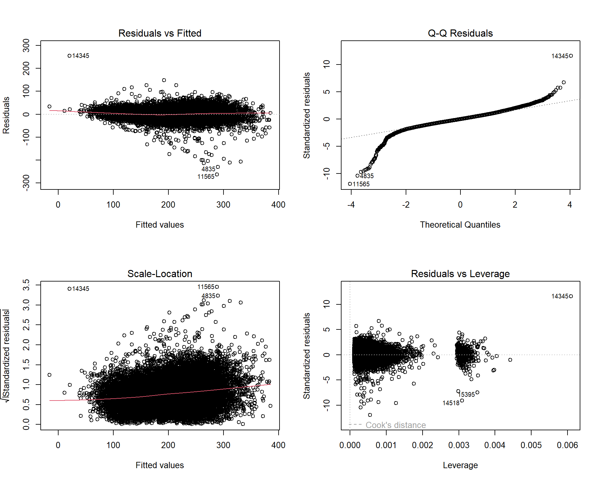

``` r
par(mfrow = c(1, 1))
```

### Normalidad de los residuos

Se plantean las hipotesis:

$$
H_0:\text{Los errores siguen una distribucion normal}
$$

$$
H_1:\text{Los errores no siguen una distribucion normal}
$$


``` r
qqnorm(
  residuals(modelo_optimo_rlm),
  main = "Grafico Q-Q de los residuos"
)

qqline(
  residuals(modelo_optimo_rlm),
  col = "red",
  lwd = 2
)
```

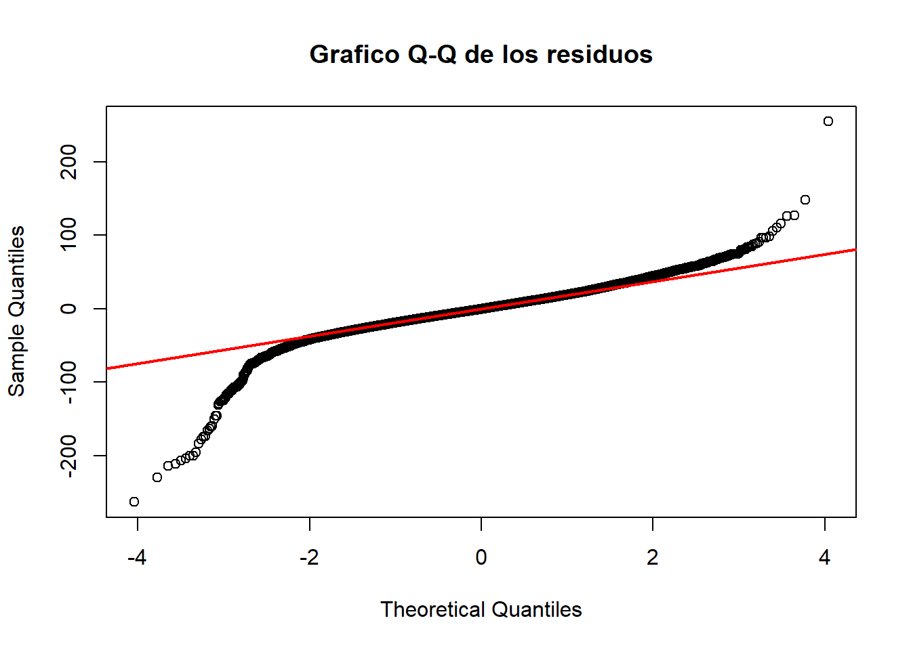

``` r
jb_rlm <- moments::jarque.test(
  residuals(modelo_optimo_rlm)
)

tabla_bonita(
  data.frame(
    Prueba = "Jarque-Bera",
    `Estadístico JB` = as.numeric(jb_rlm$statistic),
    `Grados de libertad` = 2,
    `Valor p` = fmt_p(jb_rlm$p.value),
    `Decisión` = ifelse(jb_rlm$p.value < 0.05,
                        "Se rechaza H0", "No se rechaza H0"),
    check.names = FALSE
  ),
  caption = "Prueba de normalidad de los residuos (Jarque-Bera)",
  digits = 2
)
```

<table class="table table-striped table-hover table-condensed" style="color: black; width: auto !important; margin-left: auto; margin-right: auto;">
<caption>(\#tab:rlm-normalidad)Prueba de normalidad de los residuos (Jarque-Bera)</caption>
 <thead>
  <tr>
   <th style="text-align:left;"> Prueba </th>
   <th style="text-align:right;"> Estadístico JB </th>
   <th style="text-align:right;"> Grados de libertad </th>
   <th style="text-align:left;"> Valor p </th>
   <th style="text-align:left;"> Decisión </th>
  </tr>
 </thead>
<tbody>
  <tr>
   <td style="text-align:left;"> Jarque-Bera </td>
   <td style="text-align:right;"> 60921.93 </td>
   <td style="text-align:right;"> 2 </td>
   <td style="text-align:left;"> &lt; 0.001 </td>
   <td style="text-align:left;"> Se rechaza H0 </td>
  </tr>
</tbody>
</table>


``` r
tabla_bonita(
  data.frame(
    Medida = c("Asimetría", "Curtosis"),
    Valor = c(moments::skewness(residuals(modelo_optimo_rlm)),
              moments::kurtosis(residuals(modelo_optimo_rlm)))
  ),
  caption = "Forma de la distribución de los residuos"
)
```

<table class="table table-striped table-hover table-condensed" style="color: black; width: auto !important; margin-left: auto; margin-right: auto;">
<caption>(\#tab:rlm-asimetria-curtosis)Forma de la distribución de los residuos</caption>
 <thead>
  <tr>
   <th style="text-align:left;"> Medida </th>
   <th style="text-align:right;"> Valor </th>
  </tr>
 </thead>
<tbody>
  <tr>
   <td style="text-align:left;"> Asimetría </td>
   <td style="text-align:right;"> -0.6589 </td>
  </tr>
  <tr>
   <td style="text-align:left;"> Curtosis </td>
   <td style="text-align:right;"> 11.6962 </td>
  </tr>
</tbody>
</table>

La prueba de Jarque-Bera presenta un estadistico aproximado de 60921.93 y un valor p inferior a 0.001.

Por tanto, se rechaza la hipotesis de normalidad.

Los residuos presentan una asimetria aproximada de -0.659 y una curtosis de 11.696, lo cual evidencia desviaciones respecto a una distribucion normal, particularmente por la presencia de colas pesadas.

Dado el elevado tamano de la muestra, la falta de normalidad no invalida automaticamente la estimacion por minimos cuadrados, pero exige precaucion al interpretar la inferencia clasica.

### Homocedasticidad

La homocedasticidad supone que la varianza de los errores permanece constante.

$$
H_0:Var(\varepsilon_i\mid X)=\sigma^2
$$

$$
H_1:\text{La varianza de los errores no es constante}
$$


``` r
bp_rlm <- lmtest::bptest(modelo_optimo_rlm)

tabla_bonita(
  data.frame(
    Prueba = "Breusch-Pagan",
    `Estadístico` = as.numeric(bp_rlm$statistic),
    `Grados de libertad` = as.numeric(bp_rlm$parameter),
    `Valor p` = format(bp_rlm$p.value, scientific = TRUE, digits = 3),
    `Decisión` = ifelse(bp_rlm$p.value < 0.05,
                        "Se rechaza H0 (heterocedasticidad)",
                        "No se rechaza H0"),
    check.names = FALSE
  ),
  caption = "Prueba de homocedasticidad (Breusch-Pagan)",
  digits = 2
)
```

<table class="table table-striped table-hover table-condensed" style="color: black; width: auto !important; margin-left: auto; margin-right: auto;">
<caption>(\#tab:rlm-breusch-pagan)Prueba de homocedasticidad (Breusch-Pagan)</caption>
 <thead>
  <tr>
   <th style="text-align:left;"> Prueba </th>
   <th style="text-align:right;"> Estadístico </th>
   <th style="text-align:right;"> Grados de libertad </th>
   <th style="text-align:left;"> Valor p </th>
   <th style="text-align:left;"> Decisión </th>
  </tr>
 </thead>
<tbody>
  <tr>
   <td style="text-align:left;"> Breusch-Pagan </td>
   <td style="text-align:right;"> 494.88 </td>
   <td style="text-align:right;"> 7 </td>
   <td style="text-align:left;"> 1.01e-102 </td>
   <td style="text-align:left;"> Se rechaza H0 (heterocedasticidad) </td>
  </tr>
</tbody>
</table>

La prueba de Breusch-Pagan presenta un estadistico aproximado de 494.88, con 7 grados de libertad y un valor p cercano a:

$$
p=1.01\times10^{-102}
$$

Como el valor p es considerablemente inferior a 0.05, se rechaza la hipotesis nula y se concluye que existe evidencia de heterocedasticidad.

En consecuencia, la varianza residual no permanece constante para todas las observaciones.

Este resultado es coherente con las dificultades identificadas durante el analisis de regresion lineal simple. La transformacion de los predictores mejora el ajuste, pero no elimina completamente los problemas asociados a la distribucion de los errores.

## Inferencia mediante errores estandar robustos

Debido a la evidencia de heterocedasticidad, se utiliza una matriz de varianzas y covarianzas robusta HC3 para complementar la inferencia estadistica.


``` r
V_robusta_rlm <- sandwich::vcovHC(
  modelo_optimo_rlm,
  type = "HC3"
)

tabla_coef(modelo_optimo_rlm, vcov. = V_robusta_rlm,
           caption = "Coeficientes con errores estándar robustos (HC3)")
```

<table class="table table-striped table-hover table-condensed" style="color: black; width: auto !important; margin-left: auto; margin-right: auto;">
<caption>(\#tab:rlm-hc3)Coeficientes con errores estándar robustos (HC3)</caption>
 <thead>
  <tr>
   <th style="text-align:left;"> Coeficiente </th>
   <th style="text-align:right;"> Estimación </th>
   <th style="text-align:right;"> Error estándar </th>
   <th style="text-align:right;"> Estadístico t </th>
   <th style="text-align:left;"> Valor p </th>
  </tr>
 </thead>
<tbody>
  <tr>
   <td style="text-align:left;"> (Intercept) </td>
   <td style="text-align:right;"> -111.2925 </td>
   <td style="text-align:right;"> 2.8049 </td>
   <td style="text-align:right;"> -39.6772 </td>
   <td style="text-align:left;"> &lt; 0.001 </td>
  </tr>
  <tr>
   <td style="text-align:left;"> sqrt(upper_lower_total) </td>
   <td style="text-align:right;"> 16.1093 </td>
   <td style="text-align:right;"> 0.1119 </td>
   <td style="text-align:right;"> 143.9845 </td>
   <td style="text-align:left;"> &lt; 0.001 </td>
  </tr>
  <tr>
   <td style="text-align:left;"> Age </td>
   <td style="text-align:right;"> -0.0450 </td>
   <td style="text-align:right;"> 0.0149 </td>
   <td style="text-align:right;"> -3.0249 </td>
   <td style="text-align:left;"> 0.0025 </td>
  </tr>
  <tr>
   <td style="text-align:left;"> BodyweightKg </td>
   <td style="text-align:right;"> 0.0284 </td>
   <td style="text-align:right;"> 0.0121 </td>
   <td style="text-align:right;"> 2.3425 </td>
   <td style="text-align:left;"> 0.0192 </td>
  </tr>
  <tr>
   <td style="text-align:left;"> SexM </td>
   <td style="text-align:right;"> 11.6003 </td>
   <td style="text-align:right;"> 0.5337 </td>
   <td style="text-align:right;"> 21.7362 </td>
   <td style="text-align:left;"> &lt; 0.001 </td>
  </tr>
  <tr>
   <td style="text-align:left;"> EquipmentRaw </td>
   <td style="text-align:right;"> 35.3711 </td>
   <td style="text-align:right;"> 2.1658 </td>
   <td style="text-align:right;"> 16.3317 </td>
   <td style="text-align:left;"> &lt; 0.001 </td>
  </tr>
  <tr>
   <td style="text-align:left;"> EquipmentSingle-ply </td>
   <td style="text-align:right;"> 18.0417 </td>
   <td style="text-align:right;"> 2.1395 </td>
   <td style="text-align:right;"> 8.4325 </td>
   <td style="text-align:left;"> &lt; 0.001 </td>
  </tr>
  <tr>
   <td style="text-align:left;"> EquipmentWraps </td>
   <td style="text-align:right;"> 31.6169 </td>
   <td style="text-align:right;"> 2.1597 </td>
   <td style="text-align:right;"> 14.6394 </td>
   <td style="text-align:left;"> &lt; 0.001 </td>
  </tr>
</tbody>
</table>

Al utilizar errores estandar robustos, se mantienen los coeficientes estimados por minimos cuadrados, pero se modifican sus errores estandar y valores p.

En particular, BodyweightKg pasa de presentar un valor p clasico aproximado de 0.003 a un valor p robusto de 0.019.

A pesar de este incremento, su asociacion continua siendo estadisticamente significativa al nivel del 5%.

Todos los coeficientes conservan su significancia individual bajo la inferencia robusta HC3, suponiendo independencia de las observaciones.

### Intervalos de confianza robustos


``` r
ee_robusto_rlm <- sqrt(diag(V_robusta_rlm))

tabla_ic_robusto_rlm <- data.frame(
  Coeficiente = names(coef(modelo_optimo_rlm)),
  `Límite inferior` = as.numeric(coef(modelo_optimo_rlm) -
    t_critico_rlm * ee_robusto_rlm),
  `Límite superior` = as.numeric(coef(modelo_optimo_rlm) +
    t_critico_rlm * ee_robusto_rlm),
  check.names = FALSE
)

tabla_bonita(tabla_ic_robusto_rlm,
             caption = "Intervalos de confianza robustos del 95% (HC3)")
```

<table class="table table-striped table-hover table-condensed" style="color: black; width: auto !important; margin-left: auto; margin-right: auto;">
<caption>(\#tab:rlm-ic-robustos)Intervalos de confianza robustos del 95% (HC3)</caption>
 <thead>
  <tr>
   <th style="text-align:left;"> Coeficiente </th>
   <th style="text-align:right;"> Límite inferior </th>
   <th style="text-align:right;"> Límite superior </th>
  </tr>
 </thead>
<tbody>
  <tr>
   <td style="text-align:left;"> (Intercept) </td>
   <td style="text-align:right;"> -116.7904 </td>
   <td style="text-align:right;"> -105.7945 </td>
  </tr>
  <tr>
   <td style="text-align:left;"> sqrt(upper_lower_total) </td>
   <td style="text-align:right;"> 15.8900 </td>
   <td style="text-align:right;"> 16.3286 </td>
  </tr>
  <tr>
   <td style="text-align:left;"> Age </td>
   <td style="text-align:right;"> -0.0741 </td>
   <td style="text-align:right;"> -0.0158 </td>
  </tr>
  <tr>
   <td style="text-align:left;"> BodyweightKg </td>
   <td style="text-align:right;"> 0.0046 </td>
   <td style="text-align:right;"> 0.0522 </td>
  </tr>
  <tr>
   <td style="text-align:left;"> SexM </td>
   <td style="text-align:right;"> 10.5543 </td>
   <td style="text-align:right;"> 12.6464 </td>
  </tr>
  <tr>
   <td style="text-align:left;"> EquipmentRaw </td>
   <td style="text-align:right;"> 31.1259 </td>
   <td style="text-align:right;"> 39.6162 </td>
  </tr>
  <tr>
   <td style="text-align:left;"> EquipmentSingle-ply </td>
   <td style="text-align:right;"> 13.8480 </td>
   <td style="text-align:right;"> 22.2354 </td>
  </tr>
  <tr>
   <td style="text-align:left;"> EquipmentWraps </td>
   <td style="text-align:right;"> 27.3837 </td>
   <td style="text-align:right;"> 35.8502 </td>
  </tr>
</tbody>
</table>


``` r
ci_rob_rlm <- lmtest::coefci(
  modelo_optimo_rlm,
  vcov. = V_robusta_rlm,
  level = 0.95
)

tabla_bonita(
  data.frame(
    Coeficiente = rownames(ci_rob_rlm),
    `Límite inferior` = as.numeric(ci_rob_rlm[, 1]),
    `Límite superior` = as.numeric(ci_rob_rlm[, 2]),
    check.names = FALSE
  ),
  caption = "Verificación con coefci(): intervalos robustos del 95%"
)
```

<table class="table table-striped table-hover table-condensed" style="color: black; width: auto !important; margin-left: auto; margin-right: auto;">
<caption>(\#tab:rlm-ic-robustos-verificacion)Verificación con coefci(): intervalos robustos del 95%</caption>
 <thead>
  <tr>
   <th style="text-align:left;"> Coeficiente </th>
   <th style="text-align:right;"> Límite inferior </th>
   <th style="text-align:right;"> Límite superior </th>
  </tr>
 </thead>
<tbody>
  <tr>
   <td style="text-align:left;"> (Intercept) </td>
   <td style="text-align:right;"> -116.7904 </td>
   <td style="text-align:right;"> -105.7945 </td>
  </tr>
  <tr>
   <td style="text-align:left;"> sqrt(upper_lower_total) </td>
   <td style="text-align:right;"> 15.8900 </td>
   <td style="text-align:right;"> 16.3286 </td>
  </tr>
  <tr>
   <td style="text-align:left;"> Age </td>
   <td style="text-align:right;"> -0.0741 </td>
   <td style="text-align:right;"> -0.0158 </td>
  </tr>
  <tr>
   <td style="text-align:left;"> BodyweightKg </td>
   <td style="text-align:right;"> 0.0046 </td>
   <td style="text-align:right;"> 0.0522 </td>
  </tr>
  <tr>
   <td style="text-align:left;"> SexM </td>
   <td style="text-align:right;"> 10.5543 </td>
   <td style="text-align:right;"> 12.6464 </td>
  </tr>
  <tr>
   <td style="text-align:left;"> EquipmentRaw </td>
   <td style="text-align:right;"> 31.1259 </td>
   <td style="text-align:right;"> 39.6162 </td>
  </tr>
  <tr>
   <td style="text-align:left;"> EquipmentSingle-ply </td>
   <td style="text-align:right;"> 13.8480 </td>
   <td style="text-align:right;"> 22.2354 </td>
  </tr>
  <tr>
   <td style="text-align:left;"> EquipmentWraps </td>
   <td style="text-align:right;"> 27.3837 </td>
   <td style="text-align:right;"> 35.8502 </td>
  </tr>
</tbody>
</table>

Todos los intervalos robustos excluyen el cero, manteniendo las conclusiones sobre la significancia individual de los coeficientes.

## Independencia de las observaciones y limitaciones

La independencia de los errores constituye un supuesto relevante para la inferencia estadistica.

El conjunto de datos presenta 3009 registros adicionales con nombres de deportistas repetidos, aunque los identificadores playerId son unicos.

La coincidencia de nombres no permite determinar por si sola que se trate del mismo deportista. Sin embargo, existe la posibilidad de que algunas observaciones correspondan a participaciones repetidas de una misma persona.

Por tanto, no puede garantizarse completamente la independencia de las observaciones utilizando unicamente la informacion disponible.

Asimismo, la imputacion mediante la media puede reducir artificialmente la variabilidad de los predictores afectados y los procedimientos de seleccion de modelos pueden introducir incertidumbre adicional en la inferencia.

Los resultados deben interpretarse principalmente como evidencia exploratoria de asociaciones estadisticas.

## Comparacion entre regresion simple y multiple


``` r
modelo_simple_original_rlm <- lm(
  BestDeadliftKg ~ upper_lower_total,
  data = df_nuevo
)

modelo_simple_transformado_rlm <- lm(
  BestDeadliftKg ~ sqrt(upper_lower_total),
  data = df_nuevo
)

tabla_comparacion_rlm <- data.frame(
  Modelo = c(
    "Regresion simple original",
    "Regresion simple transformada",
    "Regresion multiple original",
    "Regresion multiple transformada"
  ),
  R2 = c(
    summary(modelo_simple_original_rlm)$r.squared,
    summary(modelo_simple_transformado_rlm)$r.squared,
    summary(modelo_completo)$r.squared,
    summary(modelo_optimo_rlm)$r.squared
  ),
  R2_ajustado = c(
    summary(modelo_simple_original_rlm)$adj.r.squared,
    summary(modelo_simple_transformado_rlm)$adj.r.squared,
    summary(modelo_completo)$adj.r.squared,
    summary(modelo_optimo_rlm)$adj.r.squared
  ),
  Error_residual = c(
    summary(modelo_simple_original_rlm)$sigma,
    summary(modelo_simple_transformado_rlm)$sigma,
    summary(modelo_completo)$sigma,
    summary(modelo_optimo_rlm)$sigma
  ),
  AIC = c(
    AIC(modelo_simple_original_rlm),
    AIC(modelo_simple_transformado_rlm),
    AIC(modelo_completo),
    AIC(modelo_optimo_rlm)
  )
)

tabla_bonita(tabla_comparacion_rlm,
             caption = "Comparación de los modelos de regresión")
```

<table class="table table-striped table-hover table-condensed" style="color: black; width: auto !important; margin-left: auto; margin-right: auto;">
<caption>(\#tab:rlm-comparacion-r2)Comparación de los modelos de regresión</caption>
 <thead>
  <tr>
   <th style="text-align:left;"> Modelo </th>
   <th style="text-align:right;"> R2 </th>
   <th style="text-align:right;"> R2_ajustado </th>
   <th style="text-align:right;"> Error_residual </th>
   <th style="text-align:right;"> AIC </th>
  </tr>
 </thead>
<tbody>
  <tr>
   <td style="text-align:left;"> Regresion simple original </td>
   <td style="text-align:right;"> 0.8326 </td>
   <td style="text-align:right;"> 0.8326 </td>
   <td style="text-align:right;"> 25.4393 </td>
   <td style="text-align:right;"> 175971.9 </td>
  </tr>
  <tr>
   <td style="text-align:left;"> Regresion simple transformada </td>
   <td style="text-align:right;"> 0.8549 </td>
   <td style="text-align:right;"> 0.8549 </td>
   <td style="text-align:right;"> 23.6844 </td>
   <td style="text-align:right;"> 173269.9 </td>
  </tr>
  <tr>
   <td style="text-align:left;"> Regresion multiple original </td>
   <td style="text-align:right;"> 0.8712 </td>
   <td style="text-align:right;"> 0.8712 </td>
   <td style="text-align:right;"> 22.3157 </td>
   <td style="text-align:right;"> 171026.8 </td>
  </tr>
  <tr>
   <td style="text-align:left;"> Regresion multiple transformada </td>
   <td style="text-align:right;"> 0.8744 </td>
   <td style="text-align:right;"> 0.8744 </td>
   <td style="text-align:right;"> 22.0347 </td>
   <td style="text-align:right;"> 170546.9 </td>
  </tr>
</tbody>
</table>

La incorporacion de multiples predictores mejora la capacidad explicativa del modelo respecto a la regresion lineal simple original.

El coeficiente de determinacion aumenta desde 0.8326 hasta 0.8744, lo cual representa una mejora aproximada de 4.18 puntos porcentuales en la proporcion de variabilidad explicada.

Esta mejora combina dos efectos: la transformacion raiz cuadrada, que eleva el R2 de 0.8326 a 0.8549 (aproximadamente 2.23 puntos), y la inclusion de edad, peso corporal, sexo y equipamiento, que lo eleva de 0.8549 a 0.8744 (aproximadamente 1.95 puntos).

El R2 ajustado coincide con el R2 hasta el cuarto decimal en todos los modelos, debido al elevado tamano de la muestra, por lo que la penalizacion por numero de parametros es practicamente nula.

El error residual disminuye de 25.44 kg en la regresion simple original a 22.03 kg en la regresion multiple transformada, y el AIC desciende de 175971.9 a 170546.9, por lo que el modelo multiple transformado es el de mejor desempeño entre los cuatro comparados.


# Presentacion del Proyecto (Video)

<iframe width="560" height="315"
  src="https://www.youtube.com/embed/X5kHLOJBO6E"
  title="Presentacion del proyecto"
  frameborder="0" allowfullscreen></iframe>

<!--chapter:end:01-intro.Rmd-->

---
title: "Conclusion_Gen"
output: html_document
date: "2026-09-19"
---


# Conclusión general

Este estudio permitió analizar integralmente los factores asociados al rendimiento en peso muerto de los atletas de powerlifting mediante la aplicación de herramientas de estadística descriptiva, inferencial y modelos de regresión lineal simple y múltiple, utilizando una base de datos conformada por 18.900 registros.

Durante el análisis exploratorio se identificaron patrones relevantes en el comportamiento de las variables físicas y deportivas de los atletas. La preparación de los datos y la ingeniería de características permitieron construir una variable representativa de la fuerza combinada de sentadilla y press de banca, la cual desempeñó un papel fundamental en los análisis posteriores.

Los procedimientos de estadística no paramétrica permitieron identificar diferencias estadísticamente significativas en el rendimiento en peso muerto según el sexo y el tipo de equipamiento utilizado. Adicionalmente, mediante la prueba de independencia chi-cuadrado se evidenció una asociación estadísticamente significativa entre ambas variables categóricas.

El análisis de correlación mostró que tanto el peso corporal como la fuerza combinada de sentadilla y press de banca presentan asociaciones positivas con el rendimiento en peso muerto. Los coeficientes de correlación de Spearman obtenidos fueron de 0,6701 y 0,9321, respectivamente, siendo la fuerza combinada la variable que presentó la asociación de mayor intensidad entre las relaciones evaluadas en esta etapa.

A partir de estos hallazgos, se construyó un modelo de regresión lineal simple que permitió explicar aproximadamente el 83,26 % de la variabilidad observada en el rendimiento en peso muerto. La aplicación de una transformación de raíz cuadrada sobre la fuerza combinada incrementó esta proporción al 85,49 %, evidenciando una mejora en el ajuste del modelo.

Posteriormente, la incorporación simultánea de la edad, el peso corporal, el sexo, el equipamiento y la fuerza combinada transformada mediante un modelo de regresión lineal múltiple permitió aumentar el coeficiente de determinación hasta 0,8744. Este resultado indica que aproximadamente el 87,44 % de la variabilidad observada en el rendimiento en peso muerto es explicada por el modelo ajustado.

Asimismo, el error estándar residual disminuyó de aproximadamente 25,44 kg en el modelo de regresión lineal simple original a 22,03 kg en el modelo múltiple transformado. La comparación mediante el criterio de información de Akaike también favoreció esta última especificación.

En consecuencia, el modelo de regresión lineal múltiple transformado presentó las mejores características de ajuste entre los modelos considerados. La fuerza combinada constituye un predictor de especial relevancia, mientras que la incorporación de las demás características físicas y deportivas proporciona información adicional para explicar las diferencias observadas en el rendimiento.

No obstante, el análisis de los residuos evidenció que no se cumplen completamente los supuestos clásicos de regresión, particularmente los relacionados con la normalidad y la homocedasticidad de los errores. También se reconoce la posible dependencia entre algunas observaciones y las limitaciones derivadas del tratamiento de los valores faltantes.

Por lo anterior, la elevada capacidad explicativa del modelo no debe interpretarse como evidencia de causalidad ni como garantía de precisión predictiva fuera de la muestra analizada.

En respuesta a la pregunta problema, se concluye que el rendimiento en peso muerto se encuentra asociado con diferentes características físicas y deportivas de los atletas, y que los modelos de regresión permiten cuantificar dichas relaciones y explicar una proporción considerable de la variabilidad observada.

Finalmente, esta investigación evidencia la utilidad de integrar diferentes procedimientos estadísticos para comprender fenómenos deportivos, destacando la importancia de seleccionar modelos no únicamente por su capacidad explicativa, sino también por la interpretación de sus parámetros, la evaluación de sus supuestos y el reconocimiento de sus limitaciones.


<!--chapter:end:Conclusion_Gen.Rmd-->

---
title: "Bibliografia"
output: html_document
date: "2026-09-19"
---

# Bibliografía

Blatnik, J. A., Skinner, J. W., & McBride, J. M. (2012). Effect of supportive equipment on force, velocity, and power in the squat. *Journal of Strength and Conditioning Research, 26*(12), 3204–3208.

De Oro Aguado, C. (2026). *Notas de métodos estadísticos*. https://cdeoroaguado.github.io/rbook_met_estad/

Doncel, L. (2010). *Manual de powerlifting y otras modalidades de levantamiento de peso*. Visión Libros.

Guillén Vitaller, O. (2018). *Análisis de las variables en powerlifting* [Trabajo de fin de grado, Universitat de Lleida, INEFC].

León París, C. (2000). Influencia del sexo en la práctica deportiva. Biología de la mujer deportista. *Arbor, 165*(650), 249–263.

<!--chapter:end:Bibliografia.Rmd-->

